<div align="center">

  <p align="center">
    
  </p>

  <p align="center">
    <!-- Maintenance status -->
    &nbsp;&nbsp;
    <!-- License -->
    &nbsp;&nbsp;
    <!-- GitHub build workflow -->
    <a href="https://github.com/healkeiser/HdUnrealEngine/actions/workflows/ci.yml">
      </a>&nbsp;&nbsp;
    <!-- Release -->
    <a href="https://github.com/healkeiser/HdUnrealEngine/releases">
      </a>&nbsp;&nbsp;
    <!-- Last Commit -->
    &nbsp;&nbsp;
    <!-- Commit Activity -->
    <a href="https://github.com/healkeiser/HdUnrealEngine/pulse" alt="Activity">
      </a>&nbsp;&nbsp;
    <!-- GitHub stars -->
    
  </p>

</div>

<!-- TABLE OF CONTENTS -->
## Table of Contents

- [About](#about)
- [Gallery](#gallery)
- [Features](#features)
- [How It Works](#how-it-works)
- [What hdUE Changes](#what-hdue-changes)
- [Architecture](#architecture)
- [Installation](#installation)
- [Usage](#usage)
- [Environment Variables](#environment-variables)
- [Development](#development)
- [Credits](#credits)
- [Contact](#contact)
- [License](#license)

<!-- ABOUT -->
## About

**hdUE** is a Hydra render delegate that renders OpenUSD with [Unreal Engine 5.8](https://www.unrealengine.com/) inside the host process: the [SideFX Houdini](https://www.sidefx.com/) Solaris viewport, husk and the USD Render ROP, Live Render, usdview, or a standalone host. It renders with Lumen (realtime) or UE's Path Tracer, from the same USD and the same render settings as Karma.

Realtime mode is meant for final frames too: a simple 1080p frame takes about 0.25 s on an RTX 4090, after about 3 s of UE startup per husk process.

This is a fork of [K240/hdUE](https://github.com/K240/hdUE). See [Credits](#credits).

<!-- GALLERY -->
## Gallery

<picture>
  <source media="(prefers-color-scheme: dark)" srcset="docs/images/gallery/chart-times-dark.svg">
  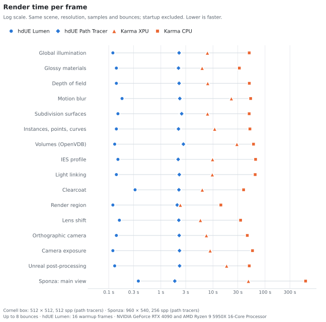
</picture>

<picture>
  <source media="(prefers-color-scheme: dark)" srcset="docs/images/gallery/chart-accuracy-dark.svg">
  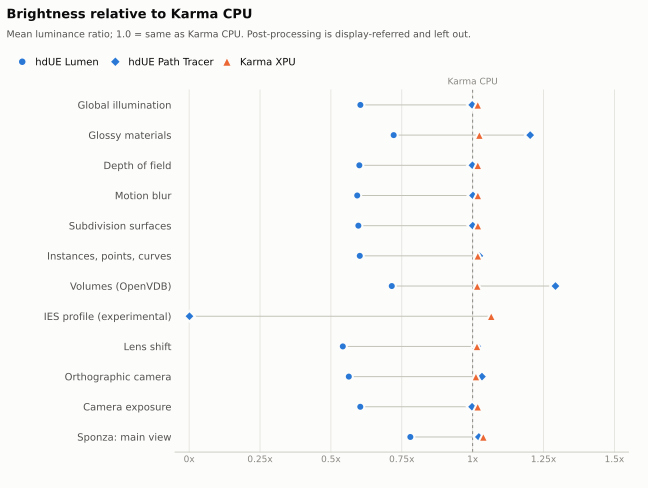
</picture>

The tables below give the numbers behind both charts; regenerate the charts with `uv run --with matplotlib python scripts/gallery_charts.py`.

<!-- gallery:start -->
Every scene is the [CC0 Cornell box](samples/cornell/) plus one small layer from [samples/cornell/variants](samples/cornell/variants), rendered with husk at 512 × 512:

- **hdUE Lumen**: realtime mode, 32 warmup frames on a sequence's first frame, then one draw per frame (as Movie Render Queue).
- **hdUE Path Tracer**: 512 samples per pixel, up to 32 bounces.
- **Karma XPU** (GPU and CPU) and **Karma CPU**: path traced, 512 samples per pixel, 8 diffuse bounces.
- Machine: NVIDIA GeForce RTX 4090 and AMD Ryzen 9 5950X 16-Core Processor.
- Times are per frame without process or UE startup: hdUE from the delegate's timing trace of a 16-frame (Lumen) or 4-frame (Path Tracer) husk run, after its first frame (a Lumen time is a sequence frame's, after the first frame's warm-up),Karma as husk's wall time minus its startup on an empty stage.
- Speed-ups compare with Karma XPU, the GPU renderer, when it was rendered; brightness is the mean luminance relative to Karma CPU, the reference (1.00 = same).

Regenerate with `hython scripts/render_gallery.py`.

| Scene | hdUE Lumen | hdUE Path Tracer | Karma XPU | Karma CPU | Faster than Karma XPU (Lumen / Path Tracer) | Brightness vs Karma CPU (Lumen / Path Tracer) |
| --- | ---: | ---: | ---: | ---: | ---: | ---: |
| Global illumination | 57 ms | 2.64 s | 7.83 s | 49.71 s | 138x / 3x | 0.93 / 1.01 |
| Glossy materials | 56 ms | 2.52 s | 6.20 s | 32.12 s | 112x / 2x | 1.03 / 1.22 |
| Depth of field | 58 ms | 2.39 s | 7.94 s | 49.91 s | 137x / 3x | 0.93 / 1.01 |
| Motion blur | 56 ms | 2.55 s | 22.57 s | 52.92 s | 402x / 9x | 0.97 / 1.01 |
| Subdivision surfaces | 59 ms | 2.37 s | 7.87 s | 49.61 s | 134x / 3x | 0.93 / 1.01 |
| Instances, points, curves | 56 ms | 2.53 s | 10.79 s | 51.23 s | 193x / 4x | 0.95 / 1.04 |
| Volumes (OpenVDB) | 57 ms | 4.13 s | 28.87 s | 60.04 s | 510x / 7x | 1.05 / 1.31 |
| IES profile | 55 ms | 2.39 s | 9.83 s | 65.81 s | 179x / 4x | 1.04 / 1.09 |
| Light linking | 55 ms | 2.38 s | 9.72 s | 64.61 s | 178x / 4x | 0.95 / 1.00 |
| Clearcoat | 60 ms | 2.40 s | 6.24 s | 38.75 s | 104x / 3x | 0.96 / 1.01 |
| Render region | 41 ms | 2.36 s | 2.37 s | 14.18 s | 58x / 1x | 0.95 / 1.04 |
| Lens shift | 54 ms | 2.38 s | 5.75 s | 33.92 s | 107x / 2x | 0.93 / 1.03 |
| Orthographic camera | 56 ms | 2.38 s | 7.49 s | 45.64 s | 134x / 3x | 0.83 / 1.04 |
| Camera exposure | 56 ms | 2.38 s | 8.84 s | 57.44 s | 159x / 4x | 0.93 / 1.01 |
| Unreal post-processing | 58 ms | 2.61 s | 18.29 s | 49.78 s | 315x / 7x | n/a |
| **All 15** | **832 ms** | **38.41 s** | **160.60 s** | **715.67 s** | **193x / 4x** | |

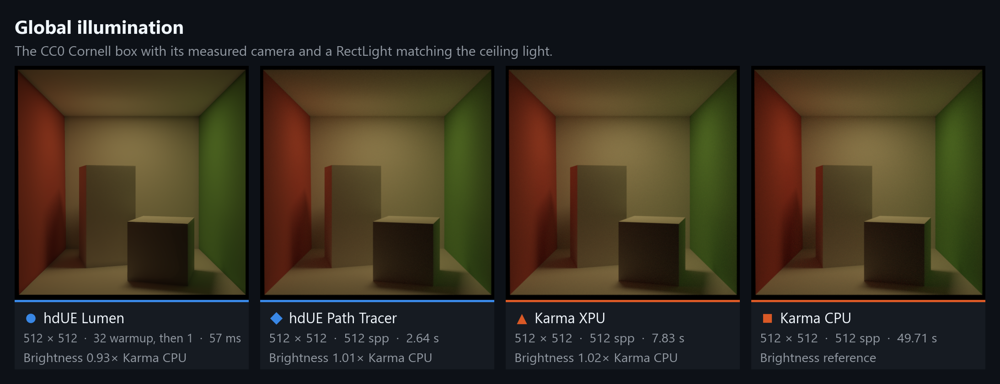

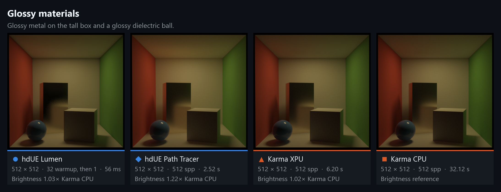

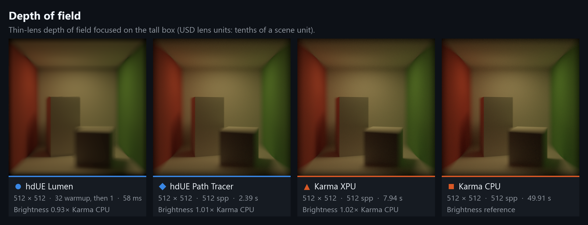

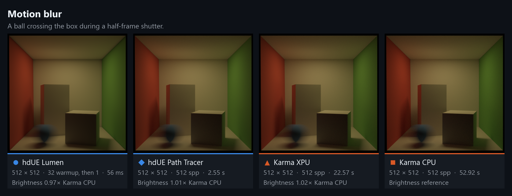

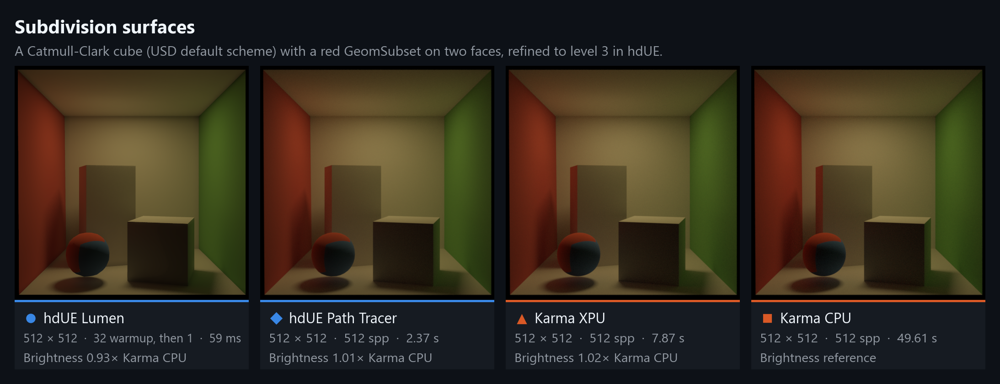

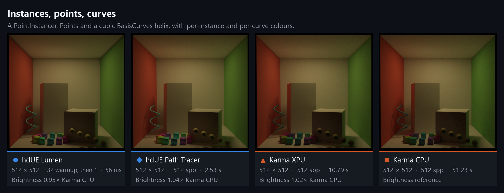

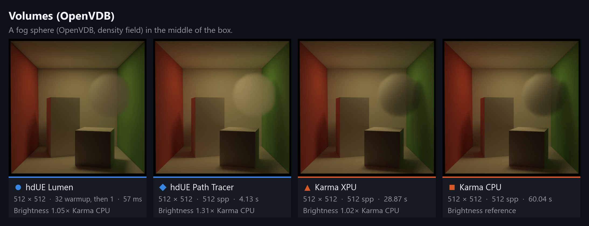

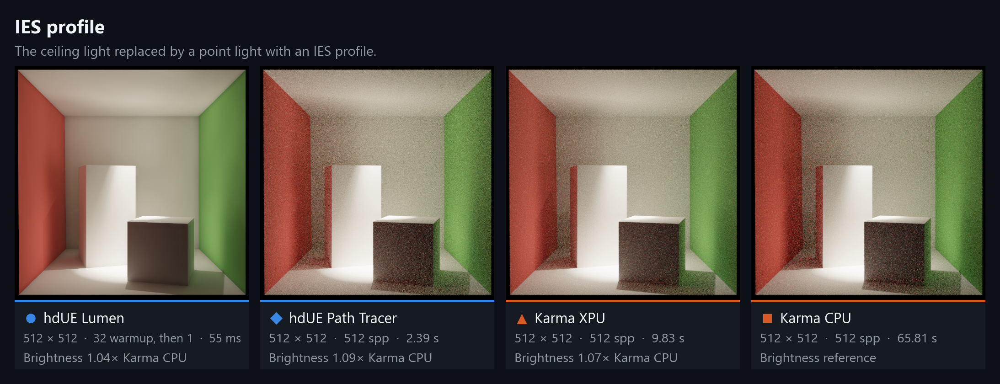

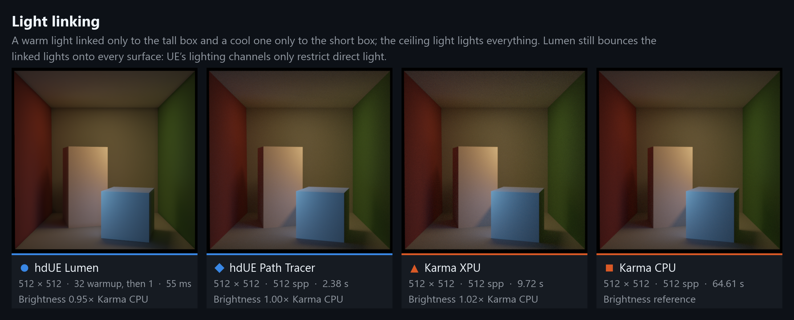

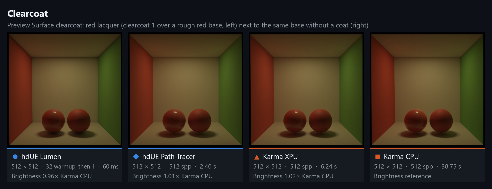

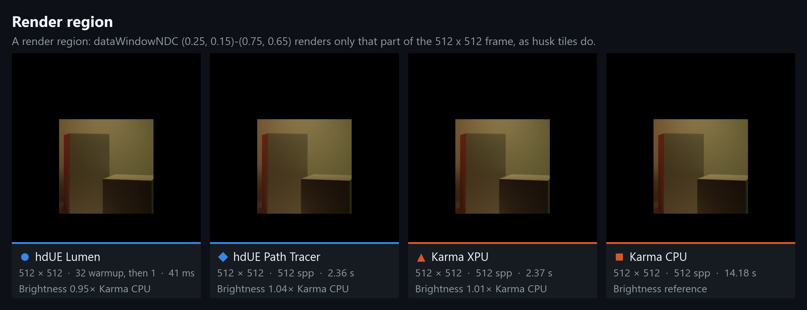

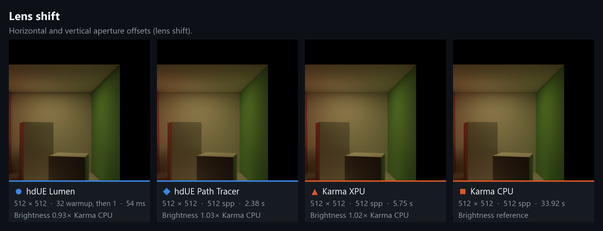

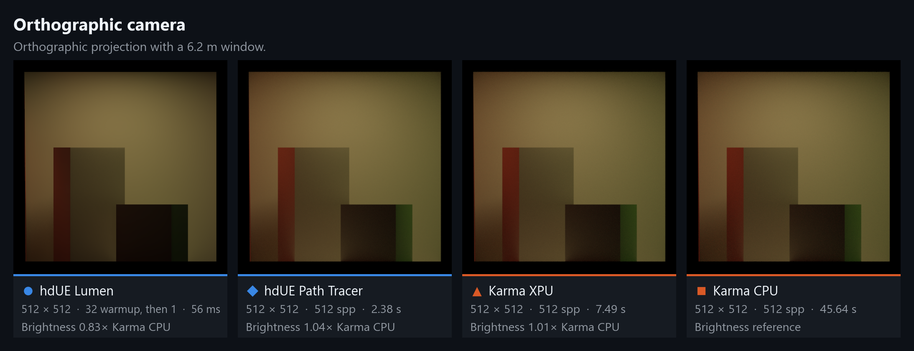

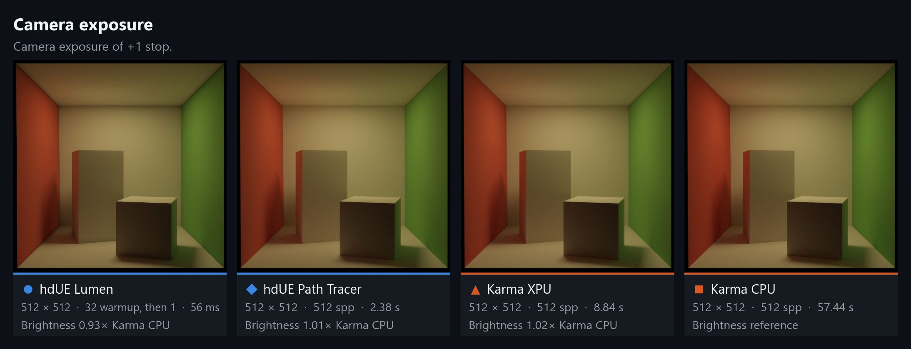


<!-- gallery:end -->

### Sponza

<!-- sponza:start -->
[Intel's Sponza 2022](https://www.intel.com/content/www/us/en/developer/topic-technology/graphics-processing-research/samples.html) (Frank Meinl and Anton Kaplanyan, CC BY 4.0; not included in this repository), from its main camera. Intel exports UsdPreviewSurface only; [samples/sponza/materials.usda](samples/sponza/materials.usda) gives every material a MaterialX standard_surface network on Intel's textures (stone, metal, wood, sheen and translucent curtains, translucent leaves cut out by their alpha, glass), which hdUE and Karma render. The gallery renders without hdUE’s optional Open Image Denoise (Houdini build), so its Path Tracer image shows more noise than Karma at the same sample count. The scene has no lights, so [samples/sponza/lighting.usda](samples/sponza/lighting.usda) adds a sun and a sky dome fitted to Intel's own renders of the scene, and levels the camera as Intel's render does; [samples/sponza/no_decals.usda](samples/sponza/no_decals.usda) deactivates the dirt decal meshes. Add-ons from the same package, sublayered unchanged: `NewSponza_Curtains_USD_YUp.usda`, `NewSponza_CypressTree_USDA_YUp.usda`. Rendered with husk at 960 × 540:

- **hdUE Lumen**: realtime mode, 32 warmup frames on a sequence's first frame, then one draw per frame (as Movie Render Queue).
- **hdUE Path Tracer**: 256 samples per pixel, up to 32 bounces.
- **Karma XPU** (GPU and CPU) and **Karma CPU**: path traced, 256 samples per pixel, 8 diffuse bounces.
- Machine: NVIDIA GeForce RTX 4090 and AMD Ryzen 9 5950X 16-Core Processor.
- Times are per frame without process or UE startup: hdUE from the delegate's timing trace of a 16-frame (Lumen) or 4-frame (Path Tracer) husk run, after its first frame (a Lumen time is a sequence frame's, after the first frame's warm-up),Karma as husk's wall time minus its startup on an empty stage.
- Speed-ups compare with Karma XPU, the GPU renderer, when it was rendered; brightness is the mean luminance relative to Karma CPU, the reference (1.00 = same).

Regenerate with `hython scripts/render_gallery.py --set sponza`.

| Scene | hdUE Lumen | hdUE Path Tracer | Karma XPU | Karma CPU | Faster than Karma XPU (Lumen / Path Tracer) | Brightness vs Karma CPU (Lumen / Path Tracer) |
| --- | ---: | ---: | ---: | ---: | ---: | ---: |
| Main view | 93 ms | 14.45 s | 42.19 s | 474.65 s | 453x / 3x | 0.88 / 0.94 |


<!-- sponza:end -->

<!-- FEATURES -->
## Features

| Area | What you get | Not yet |
|------|--------------|---------|
| **Houdini** | Solaris viewport renderer, husk, USD Render ROP, Render Gallery, Live Render LOP; hdUE Render Settings, Standard Render Vars and Render Products LOPs (`hdue::hduerendersettings::1.0`, ...) under TAB > Rendering > hdUE, with Output Picture on top as on Karma's; an **Unreal Engine** tab on Render Settings, Render Geometry Settings and Light LOPs; an hdUE Substrate Material Builder TAB tool; progress and stats in the viewport and in husk (`-V`); selection highlight; installable package | Houdini versions other than 22.0 |
| **Speed** | One UE per husk process for the whole frame range, only changed prims resent between frames (a moved mesh keeps its uploaded geometry), Nanite for meshes and instancer prototypes (millions of instances), a bundled PSO cache, about 0.25 s per simple 1080p Lumen frame | |
| **Geometry** | Meshes and GeomSubsets, implicit prims (Cube, Sphere, ...), Points, BasisCurves (widths per vertex, curve or segment; pinned; ribbons with normals), PointInstancers (nested, `protoIndices`, masks, half and float orientations, per-instance primvars on bound materials, instanced volumes) and native instancing, UsdSkel skinning, purposes, `displayColor` per face/vertex/point/curve/instance, Catmull-Clark and Loop subdivision (OpenSubdiv, uniform, with creases, corners and face-varying UVs), `doubleSided` honoured as in UE's USD importer (`unreal:cullBackface = 0` renders both sides, as Karma) | Adaptive subdivision and adaptive displacement, varying `displayOpacity`, shear in instances (warned) |
| **Volumes** | OpenVDB files, unsaved SOP volumes (`op:` paths, VDB and Houdini volumes), `.bgeo.sc` written by the USD Render ROP; `density` field | Temperature/emission, volume materials, frustum grids, volume shadows in realtime |
| **Materials** | UsdPreviewSurface with every texture input, cutouts, clearcoat, wrap modes and per-texture colour spaces (OCIO); several UV sets per mesh; primvar readers; true displacement (Preview Surface and MaterialX, diced on the CPU so the Path Tracer sees it); MaterialX Standard Surface and OpenPBR at runtime (images, subsurface, sheen, thin-walled, cutouts); prepared MaterialX and Substrate; COP textures | Arbitrary MaterialX node graphs at runtime (mix, procedurals), vector displacement |
| **Lights** | Distant, sphere, rect, disk, cylinder, dome (HDRI, `poleAxis`), UsdLux units, spot cones, IES profiles (`normalize`, `angleScale`), light and shadow linking (up to three linked collections, UE's lighting channels), Virtual Shadow Maps | Portals, volume lights, light filters, shadow colour, `shadow:distance`/`falloff` (warned) |
| **Camera** | Perspective, orthographic, lens shift, depth of field (`disableDepthOfField`), exposure, motion blur (transforms, camera, deforming meshes, point and instance `velocities`, `accelerations` and `angularVelocities`, `motion:blurScale`), render regions, husk tiles, overscan, pixel aspect ratio, `includedPurposes`, material binding purposes | Lens distortion, a finite far clip, instance motion from time-sampled positions |
| **Output** | Beauty (`C`, `Ci`, `C.*[LO]`, RGB or RGBA), depth, `cameraDepth`, every UE buffer visualization as an AOV (albedo, normal, roughness, metallic, specular, occlusion, AO, subsurface colour, ...), lighting components under Karma's names (diffuse, glossy reflection, emission, volume; direct, indirect, combined), Cryptomatte (object and material, with manifest), `primId`, `instanceId`, multi-frame EXR, Open Image Denoise for the Path Tracer with its albedo and normal guides | Deep output, motion vectors |
| **Post-processing** | UE tonemapper, bloom, grading, vignette, grain, any `FPostProcessSettings` property, post-process materials (beauty only, opt-in) | |

<!-- HOW IT WORKS -->
## How It Works

Houdini describes a scene in USD and hands it to a renderer through Hydra, the same plug-in slot Karma and Storm use. hdUE is such a renderer, except that it does not draw anything itself: it passes the scene to Unreal Engine, which renders it, and hands the picture back.

1. **Houdini sends the scene.** When you pick hdUE in the viewport, or render with husk, Houdini gives hdUE every mesh, light, material and camera, and later only what changed.
2. **hdUE translates it.** Meshes become Unreal meshes (Nanite for large and instanced ones), USD lights become Unreal lights in the same physical units, and UsdPreviewSurface and MaterialX materials become Unreal materials. Where Unreal already has a way to do something, such as importing MaterialX or USD lights, hdUE does it the same way.
3. **Unreal renders.** Unreal runs inside the Houdini (or husk) process, as a library, with no Unreal Editor and no window. It renders with Lumen for fast, real-time images or with its Path Tracer for reference quality.
4. **hdUE hands the image back.** Houdini's viewport shows each frame as Unreal renders it, then draws its grid, guides and selection highlight over it; husk receives the finished image, with any AOVs (depth, normals, Cryptomatte, ...), and writes it to disk.

Unreal starts once per Houdini or husk session, so a render does not pay that cost again for every frame, and editing the scene only resends what you changed.

Under the hood, for developers: [docs/architecture.md](docs/architecture.md) lists what to look for in Process Explorer or a debugger. That covers the two DLLs hdUE adds and the shared libraries they take from Houdini, the `GameThread` that hdUE starts, UE's named threads, the C ABI calls behind one frame, and how UE starts and stops.

<!-- WHAT HDUE CHANGES -->
## What hdUE Changes

hdUE runs a stock Unreal Engine 5.8.4 built from source, with these changes to the engine:

| Change | Why |
|---|---|
| `VirtualTextureSystem.h`: one `friend` declaration (`scripts/Apply-ResidencyPatch.ps1`) | The Path Tracer waits until every virtual-texture page it needs is loaded; UE's public API cannot report that. |
| `NaniteDisplace.cpp`: an editor-only guard around one displacement-texture read (same script) | So Nanite meshes can be built at runtime, outside the editor. |
| `MeshCards.cpp` compiles two of UE's private source files (`MeshRepresentationCommon.cpp`, `MeshCardRepresentationUtilities.cpp`) into the backend | To build Lumen cards for meshes created at runtime; the editor normally builds them on import. |
| Build settings: a monolithic UELibrary target with Developer modules, and `IS_RUNNING_GAMETHREAD_ON_EXTERNAL_THREAD` | UE runs as a DLL inside Houdini, on a thread hdUE starts; Nanite and Lumen cards need the Developer modules ([EULA note](docs/houdini.md)). |

The script checks the engine version and each insertion point before editing anything. UELibrary, Launch and the rest of the engine are unchanged.

Where Unreal already has a way to do something, hdUE does it the same way: MaterialX opacity as UE's Interchange imports it, `doubleSided` as UE's USD importer, Movie Render Queue's offline settings and warmup, UE's defaults for bounces and Lumen. It departs from Unreal only here:

| Where | Unreal | hdUE, and why |
|---|---|---|
| Light units | UE's USD importer passes UsdLux intensity as nits unchanged, so imported rect lights render 2x and sphere lights 4x brighter than UsdLux defines | Converts to UsdLux luminance, so lights match Karma and other renderers |
| Spot cones | Clamps spots to 89 degrees, where Lumen and the Path Tracer then light only a quarter of a downward cone | Caps cones at 88 degrees |
| Alpha-coverage mips for cutouts | UE's algorithm corrects each mip one level late and can make thin cutouts thinner | Same idea, with three fixes: thin leaves keep their coverage at a distance ([details](docs/rendering.md#materialx-surfaces)) |
| Displacement | UE's Path Tracer ignores displacement | The mesh is diced and displaced on the CPU, so both Lumen and the Path Tracer see it |
| New Nanite meshes | Their ray-tracing geometry is built on the next frame, so Lumen's first frame traced an empty scene | Builds it before the mesh is shown |
| Camera far clip | Views use an infinite far plane | Not applied either: a finite far plane changed Lumen's lighting with nothing clipped |

<!-- ARCHITECTURE -->
## Architecture

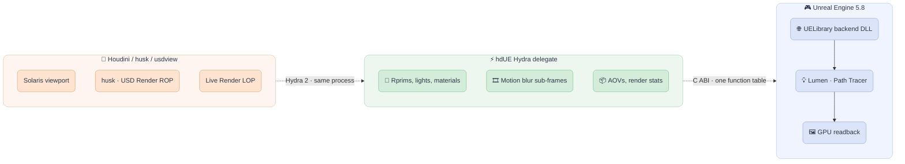

The delegate and UE share the host process. UE only accepts calls from the thread that started it, so hdUE starts UE on a thread of its own, in Houdini's UI as under husk. Delegates running on other threads (Live Render) queue their UE work for that thread. See [Architecture and ABI](docs/architecture.md).

<!-- INSTALLATION -->
## Installation

Requires Houdini 22.0 on Windows x64 and a DirectX 12 GPU with hardware ray tracing. Unreal Engine, Visual Studio and OpenUSD are not needed.

> [!NOTE]
> There is no public binary download. The backend links Unreal Engine Developer modules, which the [Unreal Engine EULA](https://www.unrealengine.com/eula/unreal) (section 6(d)) only lets us distribute through Fab or a fork of Epic's UnrealEngine GitHub network. [Build the package from source](docs/building.md) with your own Unreal Engine access.

1. Build `hdUE-<version>-houdini22.0.<build>-win64` with `Package-Houdini.ps1` (see [Installing on another machine](docs/houdini.md#installing-on-another-machine)).
2. Unzip it anywhere; the folder may be shared and read-only, since UE writes its shader cache and logs per user.
3. Run `Install.cmd`. It writes `Documents\houdini22.0\packages\hdUE.json`.
4. Restart Houdini.

For a studio-wide install, use `Install.ps1 -PackagesDirectory <shared HOUDINI_PACKAGE_DIR>`. `Uninstall.cmd` removes the package file. See [Installing on another machine](docs/houdini.md#installing-on-another-machine).

<!-- USAGE -->
## Usage

Pick **Unreal Engine** in the Solaris viewport's renderer menu, or render to disk:

```powershell
husk --renderer "Unreal Engine" -f 1 -n 24 -o render.$F4.exr scene.usd
```

Renderer settings live on any Render Settings LOP, on its **Unreal Engine** tab: render mode (Lumen or Path Tracer), samples, motion blur and motion samples, Lumen, environment resolution, and Unreal post-processing (tonemapper, bloom, grading, post-process materials). They are `unreal:*` attributes on the UsdRenderSettings prim, so files rendered on a farm carry them. Render one frame range per husk call, and give farm tasks chunks of frames: each process starts UE once.

| Topic | Page |
|-------|------|
| Solaris, husk, Live Render, AOVs | [docs/houdini.md](docs/houdini.md) |
| Render settings, geometry, cameras, motion blur, post-processing, lights, volumes | [docs/rendering.md](docs/rendering.md) |
| MaterialX, Substrate, COP textures, cooked native assets | [docs/materials.md](docs/materials.md) |
| Architecture and the C ABI | [docs/architecture.md](docs/architecture.md) |
| USD conformance: what each schema attribute does in hdUE | [docs/conformance.md](docs/conformance.md) |
| What was measured | [VERIFICATION.md](VERIFICATION.md) |

<!-- ENVIRONMENT VARIABLES -->
## Environment Variables

The package file sets the first two; the rest are for development and debugging.

| Variable | Description |
|----------|-------------|
| `HDUE_RUNTIME_CONFIG` | Runtime profile (`backend_dll`, `runtime_project`) the delegate starts UE from |
| `HDUE_HOUDINI_ENABLE` | `1` lets hdUE's Python host start in Houdini's UI when a viewer selects hdUE |
| `HDUE_BACKEND_DLL` | Backend DLL, overriding the runtime profile |
| `HDUE_HOUDINI_LOG_DIR` | Where the Houdini host writes its logs and state |
| `HDUE_NANITE` | `0` builds regular static meshes instead of Nanite |
| `HDUE_USER_DIR` | Where UE writes its logs and shader cache (set by the package) |
| `HDUE_GPU_FRAMES` | `0` reads Houdini viewport frames back to the CPU instead of sharing GPU textures |
| `HDUE_TRACE_PASS` | `1` prints one line per render pass to stderr |
| `HDUE_TRACE_SETTINGS` | `1` prints every render setting the delegate receives |
| `HDUE_TRACE_SCENE` | `1` prints scene submissions |

<!-- DEVELOPMENT -->
## Development

Building needs the Unreal Engine 5.8.4 source, Visual Studio 2022, OpenUSD 26.03 for the standalone delegate and Houdini 22.0 for Solaris; see [Building from source](docs/building.md).

```powershell
.\scripts\Build-Host.ps1               # standalone delegate and hosts (OpenUSD)
.\scripts\Prepare-Content.ps1          # UE content: parent materials, ID and volume materials
.\scripts\Build-Backend.ps1            # UE backend DLL
.\scripts\Stage-Runtime.ps1            # cooked runtime under out/runtime
.\scripts\Build-Houdini.ps1            # Houdini delegate and its unit tests
.\scripts\Update-HoudiniRuntime.ps1 -RuntimeConfig .local\runtime.json -OutputConfig .local\runtime-houdini.json
.\scripts\Test.ps1 -Suite all          # unit, Hydra/usdview and Houdini suites
hython scripts\run_conformance.py       # USD conformance set (docs/conformance.md)
.\scripts\Package-Houdini.ps1 -RuntimeConfig .local\runtime-houdini.json -Zip -UnrealLicenseesOnly
```

[CI](.github/workflows/ci.yml) builds the client library, runs the C ABI layout test, the unit suite (`Test.ps1 -Suite unit`: repository scope, Python tests, the gallery's brightness bands against Karma), the installer under Windows PowerShell 5.1, and the format and lint checks (Black, Ruff, clang-format, clang-tidy, PSScriptAnalyzer, actionlint). GitHub's runners have no UE, Houdini or ray-tracing GPU, so the rendering suites and the [conformance set](docs/conformance.md) run locally.

<!-- CREDITS -->
## Credits

hdUE was started by [K240](https://github.com/K240/hdUE): the Hydra delegate, the UE backend, the Solaris host, HDRI lighting and MegaLights, MaterialX and Substrate preparation with the Substrate Builder, and the native asset bridge. This fork adds the Houdini package, render settings on Render Settings LOPs, husk and Live Render support, AOVs, instancing, points, curves, volumes, motion blur, camera projection, post-processing and the comparisons against Karma.

<!-- CONTACT -->
## Contact

Project Link: [HdUnrealEngine](https://github.com/healkeiser/HdUnrealEngine)

<p align='center'>
  <!-- GitHub profile -->
  <a href="https://github.com/healkeiser">
    </a>&nbsp;&nbsp;
  <!-- LinkedIn -->
  <a href="https://www.linkedin.com/in/valentin-beaumont">
    </a>&nbsp;&nbsp;
  <!-- Behance -->
  <a href="https://www.behance.net/el1ven">
    </a>&nbsp;&nbsp;
  <!-- X -->
  <a href="https://twitter.com/valentinbeaumon">
    </a>&nbsp;&nbsp;
  <!-- Instagram -->
  <a href="https://www.instagram.com/val.beaumontart">
    </a>&nbsp;&nbsp;
  <!-- Gumroad -->
  <a href="https://healkeiser.gumroad.com/subscribe">
    </a>&nbsp;&nbsp;
  <!-- Gmail -->
  <a href="mailto:valentin.onze@gmail.com">
    </a>&nbsp;&nbsp;
  <!-- Buy me a coffee -->
  <a href="https://www.buymeacoffee.com/healkeiser">
    </a>&nbsp;&nbsp;
</p>

<!-- LICENSE -->
## License

Original hdUE code, documentation, and project-generated synthetic samples are available under the [MIT License](LICENSE).

Unreal Engine, Houdini, third-party libraries, and separately supplied content retain their respective licenses. A built package also carries `LICENSE-PACKAGE.txt` (the end-user terms the Unreal Engine EULA requires for its runtime) and the Unreal Engine third-party licenses under `licenses\`. The MIT license does not grant rights to vendor SDKs, engine code, binaries, or third-party assets. Building, using, or distributing those components requires compliance with their applicable terms. See [Third-party notices](THIRD_PARTY_NOTICES.md).
