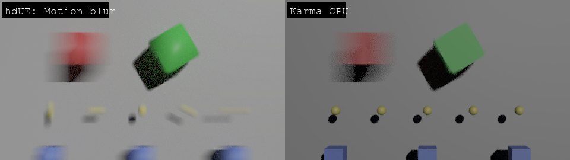
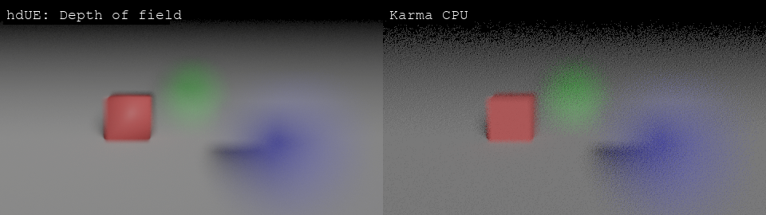
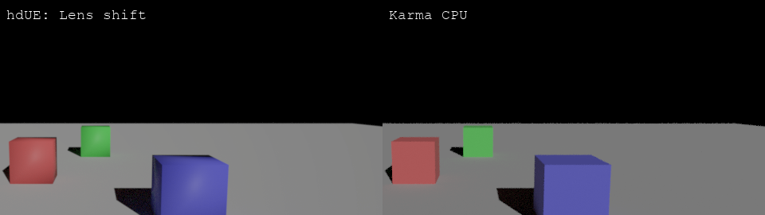
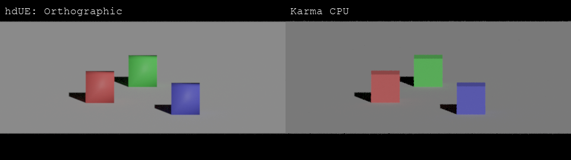
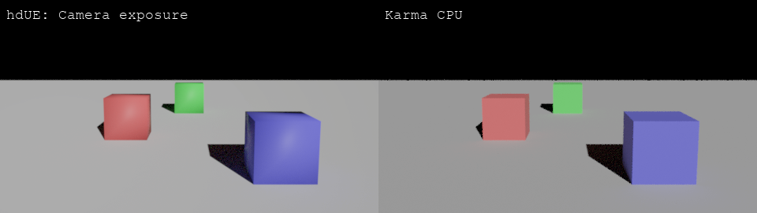
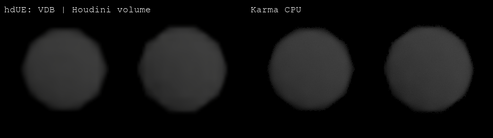
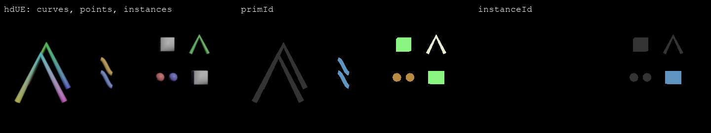
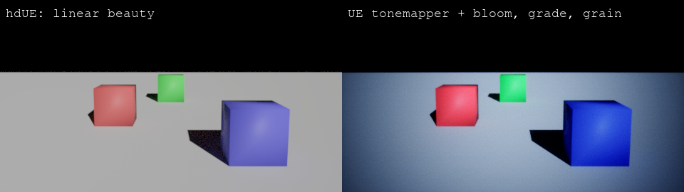
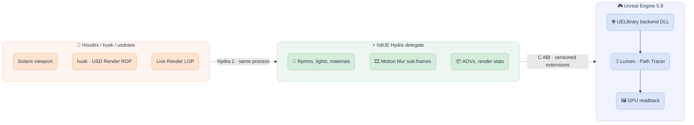

> [!IMPORTANT]
> This project is a Windows x64 proof of concept and subject to large changes.

<div align="center">

  <p align="center">
    
  </p>

  <p align="center">
    <!-- Maintenance status -->
    &nbsp;&nbsp;
    <!-- License -->
    &nbsp;&nbsp;
    <!-- GitHub build workflow -->
    <a href="https://github.com/healkeiser/hdUE/actions/workflows/ci.yml">
      </a>&nbsp;&nbsp;
    <!-- Release -->
    <a href="https://github.com/healkeiser/hdUE/releases">
      </a>&nbsp;&nbsp;
    <!-- Last Commit -->
    &nbsp;&nbsp;
    <!-- Commit Activity -->
    <a href="https://github.com/healkeiser/hdUE/pulse" alt="Activity">
      </a>&nbsp;&nbsp;
    <!-- GitHub stars -->
    
  </p>

</div>

<!-- TABLE OF CONTENTS -->
## Table of Contents

- [About](#about)
- [Gallery](#gallery)
- [Features](#features)
- [Architecture](#architecture)
- [Installation](#installation)
- [Usage](#usage)
- [Environment Variables](#environment-variables)
- [Development](#development)
- [Credits](#credits)
- [Contact](#contact)
- [License](#license)

<!-- ABOUT -->
## About

**hdUE** is a Hydra render delegate that renders OpenUSD with [Unreal Engine 5.8](https://www.unrealengine.com/) inside the host process: the [SideFX Houdini](https://www.sidefx.com/) Solaris viewport, husk and the USD Render ROP, Live Render, usdview, or a standalone host. It renders with Lumen (realtime) or UE's Path Tracer, from the same USD and the same render settings as Karma.

Realtime mode is meant for final frames too: a simple 1080p frame takes about 0.25 s on an RTX 4090, after about 3 s of UE startup per husk process.

This is a fork of [K240/hdUE](https://github.com/K240/hdUE). See [Credits](#credits).

<!-- GALLERY -->
## Gallery

Left: hdUE (UE Path Tracer). Right: Karma CPU. Same USD file, same husk command, only `--renderer` changes.

| | |
| --- | --- |
| **Motion blur** (transforms, camera, `velocities`) |  |
| **Depth of field** (`fStop`, `focusDistance`) |  |
| **Lens shift** (aperture offsets) |  |
| **Orthographic camera** |  |
| **Camera exposure** |  |
| **Volumes from SOPs** (VDB and native Houdini volumes) |  |
| **Curves, points, instances** with their `primId` / `instanceId` AOVs |  |
| **Unreal post-processing** (linear beauty, then UE's tonemapper, bloom, grading and grain) |  |

In the motion-blur image, hdUE blurs the points and instances from their `velocities`; Karma, with its default render settings, left them sharp. With glossy Preview Surfaces, hdUE comes out about 1.3x brighter than Karma; with fully rough ones they match to 0.1%. The difference is in the specular models, not light calibration. Without a bound material, each renderer shades `displayColor` with its own default, so compare with bound materials.

<!-- FEATURES -->
## Features

| Area | What you get | Not yet |
|------|--------------|---------|
| **Houdini** | Solaris viewport renderer, husk, USD Render ROP, Render Gallery, Live Render LOP, an **Unreal Engine** tab on Render Settings LOPs, selection highlight, installable package | Houdini versions other than 22.0 |
| **Speed** | One UE per husk process for the whole frame range, only changed prims resent between frames, about 0.25 s per simple 1080p Lumen frame | |
| **Geometry** | Meshes and GeomSubsets, implicit prims (Cube, Sphere, ...), Points, BasisCurves, PointInstancers (nested), `displayColor` per face/vertex/point/curve/instance | Subdivision, displacement, varying `displayOpacity` |
| **Volumes** | OpenVDB files, unsaved SOP volumes (`op:` paths, VDB and Houdini volumes), `.bgeo.sc` written by the USD Render ROP; `density` field | Temperature/emission, volume materials, frustum grids, volume shadows in realtime |
| **Materials** | UsdPreviewSurface with every texture input and cutouts, prepared MaterialX (Standard Surface, OpenPBR) and Substrate, COP textures | Arbitrary MaterialX at runtime |
| **Lights** | Distant, sphere, rect, disk, cylinder, dome (HDRI), UsdLux units, spot cones | Light linking, IES, portals |
| **Camera** | Perspective, orthographic, lens shift, depth of field, exposure, motion blur (transforms, camera, deforming meshes, point and instance `velocities`) | Lens distortion |
| **Output** | Beauty, depth, albedo, normal, roughness, metallic, specular, occlusion, `primId`, `instanceId`, multi-frame EXR | LPE AOVs, cryptomatte, deep output |
| **Post-processing** | UE tonemapper, bloom, grading, vignette, grain, any `FPostProcessSettings` property, post-process materials (beauty only, opt-in) | |

<!-- ARCHITECTURE -->
## Architecture



The delegate and UE share the host process. UE only accepts calls from the thread that started it: in Houdini that is the UI thread, which hdUE's Python host ticks; under husk, hdUE starts UE on a thread of its own. Delegates running on other threads (Live Render) queue their UE work for that thread. See [Architecture and ABI](docs/architecture.md).

<!-- INSTALLATION -->
## Installation

Requires Houdini 22.0 on Windows x64 and a DirectX 12 GPU with hardware ray tracing. Unreal Engine, Visual Studio and OpenUSD are not needed.

1. Download `hdUE-<version>-houdini22.0-win64.zip` from [Releases](https://github.com/healkeiser/hdUE/releases).
2. Unzip it somewhere writable: UE writes its shader cache and logs next to the runtime.
3. Run `Install.cmd`. It writes `Documents\houdini22.0\packages\hdUE.json`.
4. Restart Houdini.

For a studio-wide install, use `Install.ps1 -PackagesDirectory <shared HOUDINI_PACKAGE_DIR>`. `Uninstall.cmd` removes the package file. See [Installing on another machine](docs/houdini.md#installing-on-another-machine).

<!-- USAGE -->
## Usage

Pick **Unreal Engine (hdUE)** in the Solaris viewport's renderer menu, or render to disk:

```powershell
husk --renderer HdUEHoudiniRendererPlugin -f 1 -n 24 -o render.$F4.exr scene.usd
```

Renderer settings live on any Render Settings LOP, on its **Unreal Engine** tab: render mode (Lumen or Path Tracer), samples, motion blur and motion samples, Lumen, environment resolution, and Unreal post-processing (tonemapper, bloom, grading, post-process materials). They are `hdUE:*` attributes on the UsdRenderSettings prim, so files rendered on a farm carry them. Render one frame range per husk call, and give farm tasks chunks of frames: each process starts UE once.

| Topic | Page |
|-------|------|
| Solaris, husk, Live Render, AOVs | [docs/houdini.md](docs/houdini.md) |
| Render settings, geometry, cameras, motion blur, post-processing, lights, volumes | [docs/rendering.md](docs/rendering.md) |
| MaterialX, Substrate, COP textures, cooked native assets | [docs/materials.md](docs/materials.md) |
| Architecture and the C ABI | [docs/architecture.md](docs/architecture.md) |
| What was measured | [VERIFICATION.md](VERIFICATION.md) |

<!-- ENVIRONMENT VARIABLES -->
## Environment Variables

The package file sets the first three; the rest are for development and debugging.

| Variable | Description |
|----------|-------------|
| `HDUE_RUNTIME_CONFIG` | Runtime profile (`backend_dll`, `runtime_project`) the delegate starts UE from |
| `HDUE_HOUDINI_ENABLE` | `1` starts hdUE's UI-thread host in Houdini |
| `HDUE_HOUDINI_PLUGIN` | Delegate DLL the Houdini host loads |
| `HDUE_BACKEND_DLL` | Backend DLL, overriding the runtime profile |
| `HDUE_HOUDINI_LOG_DIR` | Where the Houdini host writes its logs and state |
| `HDUE_TRACE_PASS` | `1` prints one line per render pass to stderr |
| `HDUE_TRACE_SETTINGS` | `1` prints every render setting the delegate receives |
| `HDUE_TRACE_SCENE` | `1` prints scene submissions |

<!-- DEVELOPMENT -->
## Development

Building needs the Unreal Engine 5.8.4 source, Visual Studio 2022, OpenUSD 26.03 for the standalone delegate and Houdini 22.0 for Solaris; see [Building from source](docs/building.md).

```powershell
.\scripts\Build-Backend.ps1            # UE backend DLL
.\scripts\Stage-Runtime.ps1            # cooked runtime under out/runtime
.\scripts\Build-Houdini.ps1            # Houdini delegate and its unit tests
.\scripts\Update-HoudiniRuntime.ps1 -RuntimeConfig .local\runtime.json -OutputConfig .local\runtime-houdini.json
.\scripts\Verify.ps1 -WithUsdview      # native, Hydra and usdview regression
.\scripts\Test-Houdini.ps1             # Solaris regression in a GUI Houdini
.\scripts\Package-Houdini.ps1 -RuntimeConfig .local\runtime-houdini.json -Zip
```

[CI](.github/workflows/ci.yml) builds the client library, runs the C ABI layout test, the repository scope tests, Python byte-compilation and a PowerShell parse check. GitHub's runners have no UE, Houdini or ray-tracing GPU, so the rendering suites above run locally.

<!-- CREDITS -->
## Credits

hdUE was started by [K240](https://github.com/K240/hdUE): the Hydra delegate, the UE backend, the Solaris host, HDRI lighting and MegaLights, MaterialX and Substrate preparation with the Substrate Builder, and the native asset bridge. This fork adds the Houdini package, render settings on Render Settings LOPs, husk and Live Render support, AOVs, instancing, points, curves, volumes, motion blur, camera projection, post-processing and the comparisons against Karma.

<!-- CONTACT -->
## Contact

Project Link: [hdUE](https://github.com/healkeiser/hdUE)

<p align='center'>
  <!-- GitHub profile -->
  <a href="https://github.com/healkeiser">
    </a>&nbsp;&nbsp;
  <!-- LinkedIn -->
  <a href="https://www.linkedin.com/in/valentin-beaumont">
    </a>&nbsp;&nbsp;
  <!-- Behance -->
  <a href="https://www.behance.net/el1ven">
    </a>&nbsp;&nbsp;
  <!-- X -->
  <a href="https://twitter.com/valentinbeaumon">
    </a>&nbsp;&nbsp;
  <!-- Instagram -->
  <a href="https://www.instagram.com/val.beaumontart">
    </a>&nbsp;&nbsp;
  <!-- Gumroad -->
  <a href="https://healkeiser.gumroad.com/subscribe">
    </a>&nbsp;&nbsp;
  <!-- Gmail -->
  <a href="mailto:valentin.onze@gmail.com">
    </a>&nbsp;&nbsp;
  <!-- Buy me a coffee -->
  <a href="https://www.buymeacoffee.com/healkeiser">
    </a>&nbsp;&nbsp;
</p>

<!-- LICENSE -->
## License

Original hdUE code, documentation, and project-generated synthetic samples are available under the [MIT License](LICENSE).

Unreal Engine, Houdini, third-party libraries, and separately supplied content retain their respective licenses. The MIT license does not grant rights to vendor SDKs, engine code, binaries, or third-party assets. Building, using, or distributing those components requires compliance with their applicable terms. See [Third-party notices](THIRD_PARTY_NOTICES.md).
