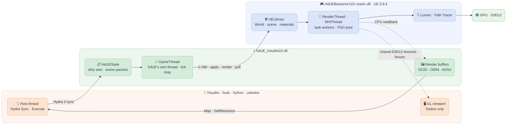

# Architecture and runtime anatomy

This page describes what hdUE adds to a process, on which threads it runs and how one frame travels from Hydra to UE and back, so that each part can be checked in Process Explorer or a debugger. Statements come from the code (file names are given) or from live observation of husk and Houdini 22.0.368 on Windows 11 with an RTX 4090 and a 16-core Ryzen 9 5950X (October 2026, Cornell box). Anything that was not observed or read in the code is marked *inferred*.



## Processes

hdUE runs entirely inside the host process. UE is linked into a DLL (UELibrary, `unreal/HdUEBackend/Source/HdUEBackend.Target.cs`: `LinkType = Monolithic`, `bShouldCompileAsDLL = true`, `UE_LIBRARY_ENABLED=1`), so there is no UE executable, editor or window.

| Host | Executable | Who starts UE |
| --- | --- | --- |
| Solaris viewport | `houdini.exe` (and the other GUI names in `houdiniUi()`, `src/hydra/delegate.cpp`: `houdinifx.exe`, `houdinicore.exe`, `hindie.exe`, ...) | The first hdUE delegate, once the Python host (`hdue_houdini.py`) has started because a Scene Viewer selected hdUE |
| husk, USD Render ROP | `husk.exe` (the ROP launches it as a child of Houdini) | The first hdUE delegate |
| hython | `hython.exe` | The first hdUE delegate (hython is not in the GUI list, so it gets the husk behaviour) |
| usdview | `python.exe` running `scripts/usdview_hdue.py` | The Python host itself (`scripts/hdue_runtime.py`, `Runtime(start=True)`) |

**Child processes.** During rendering hdUE starts none. A 10-frame Path Tracer and a 60-frame realtime husk render were polled every 500 ms for children: there were none. A Houdini session with hdUE in the viewport had one child, `conhost.exe` (Houdini's console). No `ShaderCompileWorker` runs: the runtime is a cooked game whose shaders come from `ShaderArchive-*.ushaderbytecode` in the staged `Content` folder, and the staged `Engine\Binaries` holds only `ThirdParty` (no `ShaderCompileWorker.exe`, `CrashReportClient.exe` or `UnrealTraceServer.exe`; UE logs "The Unreal Trace Server binary is not available").

The only child process hdUE can start is the background Substrate/MaterialX preparation in Houdini's UI (`docs/substrate-builder.md`): when a topology edit needs a new material, `scripts/substrate_live.py` starts `pwsh` (or `powershell`) with `scripts/Prepare-SubstrateLive.ps1` (`CREATE_NO_WINDOW`, environment stripped of `HOUDINI_*`, `PXR_*`, `QT_*`, `HDUE_RUNTIME_CONFIG`, ...). That script runs `Prepare-Substrate.ps1` (standalone USD Python through `Run-UsdPython.ps1`), `UnrealEditor-Cmd.exe` for the `HdUESubstrate` commandlet and the cook, and the publish step. Its PID is written to `runtime-state.json` (`substrate_preparation.worker_pid`). This path was not exercised for this page.

## Modules

Lists from `(Get-Process -Id <pid>).Modules` on a running husk render and on a Houdini session with hdUE in the viewport, filtered to what is not part of Houdini or Windows, plus the shared libraries whose origin matters.

| Module | Path in the observed process | Loaded by |
| --- | --- | --- |
| `hdUE_Houdini22.dll` | `<build>\Release\` (installed: the package's folder) | USD's `PlugRegistry`. The package appends the folder holding `plugInfo.json` to `PXR_PLUGINPATH_NAME`; its `LibraryPath` is the DLL, its types are `HdUnrealEngine` and two scene index plugins. Hydra loads it when hdUE is selected or named by `--renderer`. In Houdini's UI the Python host also opens it with `ctypes` from `Plug.Registry().GetPluginForType(...).path` (`hdue_houdini.py`, `hdue_viewport.py`) for its `hdue_*` exports: the same file, so the same module. |
| `HdUEBackend-h22-<hash>.dll` | `<runtime>\HdUEBackend\Binaries\Win64\` | `hdue::Backend` (`src/client/backend.cpp`): `LoadLibraryExW(absolute path, LOAD_LIBRARY_SEARCH_DLL_LOAD_DIR \| LOAD_LIBRARY_SEARCH_DEFAULT_DIRS)`, never `FreeLibrary`. The path is `backend_dll` from the JSON file named by `HDUE_RUNTIME_CONFIG` (relative paths resolve against that file), unless the `backendLibrary` render setting or `HDUE_BACKEND_DLL` names one. In Houdini's UI the Python host also loads it with `ctypes.CDLL(..., winmode=0x1100)` (the same flags) to read status. |
| `embree4.dll` | the backend's folder | Preloaded by the backend's `Initialize` (`Bridge.cpp`) before `UELibrary_InitW`, from the backend DLL's own folder: NaniteBuilder and the Lumen card builder delay-load it by name, and the executable's folder is the host's. |
| `tbb12.dll`, `tbbmalloc.dll` | Houdini's `bin` (the copies beside the backend are not loaded) | Windows loads a DLL name once per process. `tbbmalloc.dll` is a static import of the backend and `tbb12.dll` an import of `hdUE_Houdini22.dll`; Houdini has both loaded already. `Initialize` skips its `tbb12` preload when one is loaded and logs the one in use (observed: `hdUE: tbb12 interface version 12150 from <Houdini>\bin\tbb12.dll`, at Log verbosity, in the UE log file only). Embree therefore runs on Houdini's TBB; `scripts/check_shared_dlls.py` fails the package when a staged DLL imports a symbol Houdini's copy of the same name does not export. |
| `D3D12Core.dll` | `%SystemRoot%\System32` | The OS D3D12 runtime. The backend exports `D3D12SDKVersion` and `D3D12SDKPath` (UE's `UnrealAgilitySDKLink.inl`, compiled in by the engine's `AgilitySDK` module, with no target setting to turn it off), but neither `husk.exe` nor `houdini.exe`/`houdinifx.exe` exports them (checked with `dumpbin /exports`), and D3D12 reads them from the executable only (*inferred* from Microsoft's Agility SDK rules). UE's "DirectX Agility SDK runtime found." only checks that some `D3D12Core.dll` is loaded (`WindowsD3D12Device.cpp`). The Agility SDK copy UE stages (`Binaries\Win64\D3D12\x64`) is therefore dead weight: `Stage-Runtime.ps1` deletes it and `Package-Houdini.ps1` leaves it out. |
| `WinPixEventRuntime.dll`, `GFSDK_Aftermath_Lib.x64.dll`, `dbghelp.dll` | `<runtime>\Engine\Binaries\ThirdParty\...` | Delay-load imports of the backend, resolved by UE (the log names the PIX one: "Loading WinPixEventRuntime.dll for PIX profiling"). |
| `ispc_texcomp.dll` | `<runtime>\Engine\Binaries\ThirdParty\Intel\ISPCTexComp\Win64-Release\` | Delay-loaded by `Scene.cpp` the first time a runtime texture is block-compressed. Not loaded for the untextured Cornell box. |
| `OpenColorIO_sidefx.dll`, `OpenImageIO_sidefx.dll`, `OpenImageDenoise.dll` (+ `_core`), `openvdb_sesi.dll` | Houdini's `bin` | Imports of `hdUE_Houdini22.dll` (`dumpbin /dependents`): colour management, texture reads, the `unreal:denoiser = oidn` path (`delegate.cpp`) and VDB fields all use Houdini's libraries. |
| `d3d12.dll`, `dxgi.dll`, `nvwgf2umx.dll`, `nvapi64.dll`, ... | Windows and the NVIDIA driver | UE's D3D12 RHI. `nvoglv64.dll` (GL) is Houdini's viewport. |

**Why the hashed backend name.** `Update-HoudiniRuntime.ps1` copies the built `HdUEBackend.dll` to `HdUEBackend-h22-<first 16 hex digits of its SHA-256>.dll` beside it and writes that path into `runtime-houdini.json`. A running Houdini keeps its backend loaded until it exits (it is never freed), so a fixed name could not be replaced while Houdini runs, and a profile always names the exact binary it was made for (*inferred* from the script; the script itself states no reason). Several hashed copies accumulate in the folder; only the one in the profile is loaded.

**Paths UE sees.** `Initialize` starts UE with `"<runtime_project>" /Game/HdUETest -game -windowed -d3d12 -unattended -nosplash -nosound -NoLoadingScreen -NoSplash -ResX=640 -ResY=360` plus `Backend::boot`'s `-RenderOffscreen -stdout`, `HDUE_UE_ARGS` and `-userdir="<HDUE_USER_DIR>"` when set (`HDUE_SHOW_WINDOW=1` drops `-RenderOffscreen`). UE's base directory is the backend's folder (`LogInit: Base Directory: ...\HdUEBackend\Binaries\Win64/`), and UE changes the process's working directory to it; the delegate restores the host's working directory after every tick (`HdUESelfHost::tick`), which husk needs for relative output paths.

## Threads

Observed with a script that lists each thread's `GetThreadDescription` (UE names its threads with `SetThreadDescription`, `WindowsPlatformProcess.cpp`), its start address (`NtQueryInformationThread(ThreadQuerySetWin32StartAddress)`) mapped to a module, and its CPU time: the same columns as Process Explorer's Threads tab. hdUE itself names no thread.

### Who owns UE

The backend accepts calls only from the thread that called `initialize` (`Bridge.cpp`, `CheckOwner`: `HDUE_WRONG_THREAD` otherwise; `get_status`, `poll_frame`, `copy_frame`, `copy_depth`, `acquire_gpu_frame` and AOV copies are readable from any thread). That thread is UE's game thread. Because it is not the thread that ran the DLL's static initialization, the target defines `IS_RUNNING_GAMETHREAD_ON_EXTERNAL_THREAD=1`.

In husk, hython and Houdini's UI, the owner is an `std::thread` that the first delegate creates (`startSelfHost`, `HdUESelfHost::worker` in `delegate.cpp`). It creates a hidden `HdUESelfHost` window (passed to UE as its window), loads the backend, calls `Backend::boot` and then serves a queue:

- `run(f)` queues `f` and waits for its result; `post(f)` queues it without waiting. On the worker itself both run inline.
- When the queue is empty, it ticks (`PeekMessageW` dispatch, `api().tick()`, restore the working directory). In Houdini's UI it ticks continuously, waiting at most 2 ms for work while any viewport delegate is not paused, and after each tick runs the render passes' "pumps", which publish finished frames without waiting for Houdini to call `Execute`. Under husk it only runs queued work; ticks happen inside `Execute`.

In Process Explorer this thread is **`GameThread`** with a start address in `ucrtbase.dll` (the CRT thread entry of `std::thread`), not in the backend. In the Houdini session it was thread 7436 while Houdini's UI thread (start address `houdini.exe`, unnamed) was 48420, the `owner` the Python host recorded in `runtime-state.json`; `GameThread` CPU time grew while the viewport rendered. The Python host (`hdue_houdini.py`) never ticks UE: its 16 ms `QTimer` does housekeeping (materials, `op:` textures, status) and it attaches with `Runtime(start=False)`.

Work from other threads reaches the owner through `ueRun` (`delegate.cpp`): with the worker, `run(f)`; without one, inline. `hdue_run_on_ue_thread` runs a task through the same path and returns when it has run; the attached Python host sends every backend call it makes through it (`Runtime.on_ue_thread`, `scripts/hdue_runtime.py`). Live Render creates the delegate on one thread and executes it on others, which this indirection covers. In usdview, `hdue_runtime.Runtime(start=True)` initializes and ticks UE on usdview's Python thread; the delegate finds UE `READY` and starts no thread.

### Thread inventory

husk, realtime and Path Tracer (177-178 threads once UE is up; 60 two seconds after launch):

| Name in Process Explorer | Count | Start module | What it is |
| --- | ---: | --- | --- |
| `GameThread` | 1 | `ucrtbase.dll` | hdUE's worker thread, renamed by UE (above) |
| `RenderThread 0` | 1 | backend | UE's rendering thread: `ENQUEUE_RENDER_COMMAND` work, RDG, readback polling and the half-float to float conversion |
| `RHIThread`, `RHISubmissionThread`, `RHIInterruptThread` | 1 each | backend | D3D12 command translation, submission, GPU completion |
| `Foreground Worker #0-1`, `Background Worker #0-27` | 2 + 28 | backend | UE's task scheduler (`ParallelFor`, `UE::Tasks`) |
| `Foreground Worker (Standby #0-1)`, `Background Worker (Standby #0-15)` | 2 + 16 | backend | its standby workers |
| `PSOPrecompilePool #0-23` | 24 | backend | PSO compilation (bundled PSO cache and precache requests); 12-15 s of CPU during startup in each run |
| `IOThreadPool #0-3`, `BackgroundThreadPool #0-1`, `IoDispatcher`, `FAsyncLoadingThread` | 4 + 2 + 1 + 1 | backend | UE's I/O and package loading |
| `OutputDeviceRedirector`, `FAsyncWriter_HdUEBackend` | 1 each | backend | log fan-out and the log file writer |
| `CrashReportingThread`, `FHeartBeatThread`, `RTHeartBeat 0`, `FMediaTicker`, `FMessageBus.DefaultBus.Router`, `ScreenSaverInhibitor` | 1 each | backend | UE's crash handler, hang detectors and engine services |
| `D3D Background Thread 0-3` | 4 | `ucrtbase.dll` | the D3D12 runtime (*inferred* from the name) |
| unnamed | 64 | `ucrtbase.dll` | host thread pools; *inferred*: TBB workers (Hydra's `WorkParallelForN`, used by hdUE's mesh conversion, OCIO and render buffer copies) and Houdini's own pools; the start address alone cannot tell them apart |
| unnamed | 7-8 | `nvwgf2umx.dll` | NVIDIA's D3D12 driver |
| unnamed | 1 | `husk.exe` | husk's main thread: Hydra sync and `Execute` |

Houdini's UI adds the same UE set (615 threads in all) next to Houdini's own: its UI thread, Qt's `QQmlThread`, `QSGRenderThread` and `Thread (pooled)`, 82 unnamed `ucrtbase.dll` threads, 11 in `nvoglv64.dll` (GL), and 394 unnamed threads starting in `nvwgf2umx.dll`, against 7-8 under husk (*inferred*: driver threads of the D3D12 devices in the process).

### hdUE's parallel work

- **Delegate (host side).** Hydra syncs prims on its own TBB workers (`HdRenderIndex::SyncAll`); prims write into `HdUEState` under its mutex. `prepareMeshes` converts points, normals and UV sets with `WorkParallelForN`; `HdUEToSceneLinear` (OCIO) and the render buffers' copies (`render_buffer.cpp`) use it too. Colour textures in another colour space are converted once through OCIO into EXRs under `%TEMP%\hdue_ocio`.
- **Backend (UE side).** `ApplyScene` builds static meshes with `ParallelFor` over the batch (`Scene.cpp`); texture block compression and readback conversion use `ParallelFor`. Interactive hosts launch Lumen card and Nanite builds as `UE::Tasks` at `BackgroundLow` priority (`HdueConversion`), which `TickConversions` swaps in on the game thread; offline hosts build them inline before the frame.

## One frame

1. **Sync (host thread, Hydra workers).** Rprims (`Mesh`, `Points`, `Curves`, `Volume` in `prims.cpp`), sprims (materials, lights, cameras) and bprims (render buffers, fields) copy what UE needs into `HdUEState`: geometry, transforms, materials, and dirty sets (`dirtyMeshes`, `movedMeshes`, ...). Each change bumps `revision`. No UE call happens during Sync.
2. **Execute (`Pass::_Execute`, host thread).** Copies the pass state (AOV bindings, buffers, view, projection, camera values) into a `PassSnapshot`, since Houdini reuses those objects once `Execute` returns. Then:
   - **husk / hython:** `host.run(...)` blocks the host thread while the UE thread calls `executeOnce` repeatedly for up to 250 ms or until converged, so a realtime frame costs GPU time rather than husk's polling interval.
   - **Houdini's UI:** `host.post(...)` and return at once; calls arriving while one is queued are coalesced to the newest camera, and the pump keeps publishing until `IsConverged`.
3. **`executeOnce` (UE thread).** Ticks UE (unless the loop just did), creates or resizes the session (`create_session`, `resize_session`), and when `revision` changed: `prepareScene` takes the dirty sets under the state lock into a `ScenePacket` of ABI descriptors, then `sendScene` calls `apply_scene` (meshes, materials, removals; `reset_scene` on the first batch), then the lighting, volume, asset, surface and motion functions (`set_transforms` for moved meshes, keeping their geometry). Then it builds an `HdueRenderRequest` (UE centimetres, +X forward, +Z up; generation, mode, samples, warmup, projection, depth of field) and calls `request_render` when the request changed, then `poll_frame` / `copy_frame` (and `copy_depth`, `poll_aov`, `copy_aov_buffer` for AOVs).
4. **UE tick (`Tick`, `Bridge.cpp`).** `UELibrary_Tick`, native assets, lighting and `TickConversions`; retire finished readbacks and poll the pending ones; when residency for the Path Tracer becomes ready, reset the view state; unless the current request's frame is converged, `Draw`.
5. **Render.** `Draw` builds a scene view family for the session's render target (`SCS_FinalToneCurveHDR`, so the float target gets UE's tone curve as linear Rec.709) and `RenderAndReadBack` calls `BeginRenderingViewFamily`. A frame converges after `samples_per_pixel` Path Tracer draws, or after `warmup_frames` full-resolution realtime draws; offline, the next frame of a sequence keeps the history and converges after one.
6. **Readback (CPU path).** A `FRHIGPUTextureReadback` copies the colour (and depth, Path Tracer albedo/normal guides) in one of three slots. On a later tick the render thread locks it, converts half floats to float RGBA with straight alpha (and device depth to linear centimetres), and publishes `Pixels` and `Frame` under `FrameMutex`, with `frame_id`, `generation`, `converged`, `completed_samples`. `poll_frame` returns the newest frame; the delegate compares its generation with the request's so a stale frame is not shown as current.
7. **Shared GPU frames (Solaris viewport).** With `configure_gpu_frames` enabled, each beauty draw is also written into a ring of three shared D3D12 textures (RGBA16F colour, R32F depth, bottom row first) and UE's queue signals a shared ready fence (`SharedFrames.cpp`). On the GL thread, `HdUERenderBuffer::GetResource` → `HdUEGpuFrames::color` calls `acquire_gpu_frame`, imports the NT handles once per ring (`GL_EXT_memory_object_win32`, `GL_EXT_semaphore_win32`), waits for the ready fence on the GPU (`glWaitSemaphoreEXT`), copies into HgiGL textures (`glCopyImageSubData`) and signals the release fence. The CPU readback then runs only for converged frames, and Houdini composites the CPU buffers once they hold the converged frame, since its selection highlight lines the CPU `primId` buffer up with a CPU colour buffer. Motion blur, the denoiser, a non-Rec.709 OCIO `scene_linear`, husk, usdview, Live Render and `HDUE_GPU_FRAMES=0` keep the CPU path (`docs/houdini.md`).
8. **Publish (delegate).** Pixels are converted to the OCIO `scene_linear` space when needed, written into the bound `HdUERenderBuffer`s (colour, depth, AOVs, Cryptomatte), optionally denoised by OIDN, and the host maps them: husk writes the image, Houdini draws it.

### Interactive and offline profiles

`Backend::boot` passes `HDUE_INIT_INTERACTIVE` exactly in Houdini's UI (`houdiniUi()`); every other host gets the offline profile.

| | Offline (husk, hython) | Interactive (Houdini's UI) |
| --- | --- | --- |
| Scalability | Cinematic, keeping the resolution quality; `r.Streaming.FullyLoadUsedTextures=1`, `r.D3D12.GPUTimeout=0`, faster Lumen surface cache updates (`Initialize`) | project defaults |
| PSOs | a draw does not count towards convergence while PSOs compile (observed: "hdUE request 1 waits for 2996 PSO compilations") | not waited for; `r.PSOPrecache.ProxyCreationStrategy=2` draws the default material meanwhile |
| Texture streaming | `BlockTillAllRequestsFinished` and pending virtual texture tiles before the frame | not waited for |
| Lumen cards and Nanite | built inline in `ApplyScene` | the mesh shows first, `UE::Tasks` build cards and Nanite, `TickConversions` swaps them in |
| Resolution while moving | full | `r.HdUE.InteractiveScreenPercentage` (50) until requests stop for 250 ms |
| Readbacks | one in flight: the first draw, the converging one, and one per 250 ms for progress | up to three in flight, every draw (or only converged ones with shared GPU frames) |
| UE ticks | inside `Execute` | continuously on the UE thread |

## Startup and shutdown

**Startup.** `HdUnrealEngine::CreateRenderDelegate` → `HdUERenderDelegate` constructor → `hdue::Backend` loads the backend and fills its one table from `hdue_get_api` (checked for version and size) → if no worker exists, `get_status`; when `COLD`, `startSelfHost`:

- husk and hython wait for the boot; Houdini's UI returns at once (work posted meanwhile runs once UE is ready, and a boot failure is kept in `bootError` and reported by every later delegate).
- On the new thread: hidden window, `Backend::boot(instance, window, runtime_project, interactive)` → `Initialize`: owner thread, embree/tbb preload, `UELibrary_InitW`, checks for `GEngine`, a non-null RHI and a game world with a scene, offline cvars, `READY`. Then `std::atexit(shutdownSelfHost)`.

UE starts once per process. Later delegates (the next viewport, husk `--restart-delegate`) increment `host.delegates` and reuse it; deleting a delegate destroys its session (`destroy_session` releases the scene, readbacks and view states) but not UE. The backend has one session at a time ("The initial backend supports one active session."). Under husk, UE starts before husk prints `>>> Render ... frame 1` (observed); about 3 s elapse between husk loading the stage and "Engine is initialized".

**Shutdown in Houdini's UI.** `Host.close` (Qt `aboutToQuit`, or `atexit`) calls `hdue_shutdown_ue` → `shutdownSelfHost`: on the UE thread, one tick, `Backend::shutdown` → `Shutdown` (`DestroySession`, `UELibrary_Shutdown`), destroy the window; then join the thread. `Shutdown` also constructs a function-local static whose destructor, which runs before UE's own static destructors at process exit, hands the game thread to the exiting thread (`FTaskTagScope::SwapTag(ETaskTag::EGameThread)`, `GGameThreadId = current thread`), since `~FScheduler` checks it runs on the game thread. Viewports that still draw afterwards report converged without rendering.

**Shutdown elsewhere (husk).** Nobody calls `hdue_shutdown_ue`. `ExitProcess` ends every other thread, including UE's, and then runs the DLL's `atexit` handlers at detach: `shutdownSelfHost` finds the worker thread already signalled and calls `TerminateProcess` with the exit code already set, because UE can no longer shut down from there and waiting for it hung the exit (`delegate.cpp`). So a husk process ends without `UELibrary_Shutdown`; observed exit code 0 for both renders. `hdue_backend_smoke` covers the clean path with UE on a worker thread through process exit.

**Restart.** Not possible: UELibrary cannot initialize again after `Shutdown` (`Initialize` returns `HDUE_INVALID_STATE` unless `COLD`), so a stopped UE stays stopped until the process exits.

**Failures and where to look.**

- UE's log: `<runtime project>\Saved\Logs\HdUEBackend.log`, previous runs as `HdUEBackend-backup-<time>.log`, or under `HDUE_USER_DIR` (`-userdir`) when the package sets it. With `-stdout`, UE also writes its log lines to the host's stdout as UTF-8 (husk's console shows `LogD3D12RHI: ...`).
- husk shows no Tf warnings of a delegate, so hdUE prints its own to stderr as `hdUE warning: ...` (once per message) and frame failures as `hdUE error: ...`, and sets `huskErrorStatus` so husk exits non-zero.
- Houdini's host: `HDUE_HOUDINI_LOG_DIR`, else `$HOUDINI_TEMP_DIR/hdUE/<pid>/` (`integration.log`, `runtime-state.json` with the UI thread id, UE state, errors and the Substrate worker; `ue.log` is the name passed to the attached `Runtime`).
- `HDUE_TRACE_TIMING=1` (to `HDUE_TRACE_FILE` when set) prints slow ticks, slow tasks and where each `Execute` spent its time.
- A UE crash is handled in process by UE's handler (`CrashReportingThread`); no crash reporter is staged, so none starts (*inferred* from the staged files). A hang in Houdini's UI shows the UI thread waiting in `HdUESelfHost::run` (a `std::future::get`: render stats, delegate and render pass destruction still use `run`) while `GameThread` is busy or blocked; `Execute` itself only posts.

## Memory, GPU and disk

- **Scene data** exists twice. The delegate keeps its own copy in `HdUEState` (points, normals, UVs, indices, transforms, materials) so that later edits resend only what changed; the `ScenePacket` holds the converted descriptors for the duration of `apply_scene`, which copies everything it needs (strings included) before returning. UE then owns its meshes (`UStaticMesh` render data, Nanite data, Lumen cards, dynamic meshes), materials, lights and textures in its world. Observed working sets: 2.7-2.9 GB for husk on the Cornell box, 5.1 GB for the Houdini session.
- **GPU.** One render target per session, three readback slots (colour, depth, Path Tracer guides), the AOV view state when AOVs are requested, and, in the Solaris viewport, the three-slot shared ring (colour and depth textures, a ready and a release fence) that GL imports. `acquire_gpu_frame` returns new NT handles when the ring changes (first call, resize, depth toggled), and the caller closes them.
- **CPU frame buffers.** The backend keeps the newest beauty frame, depth, guides and AOV pixels as float arrays under `FrameMutex`, recycled through spare buffers; `copy_frame` copies into the caller's buffer. The delegate's render buffers hold their own copy for `Map()`.
- **On disk.**
  - Shaders: the cooked shader archives in `<runtime>\HdUEBackend\Content` and `GlobalShaderCache-PCD3D_SM6.bin`; nothing is compiled at run time.
  - PSOs: the bundled PSO cache in `Content\PipelineCaches` (`docs/building.md`, observed: "enqueued 150 tasks for precompile"). UE's own PSO disk cache is off (`r.D3D12.PSO.DiskCache=0` in the log); the NVIDIA driver keeps its own shader cache (*inferred*).
  - Converted OCIO textures: `%TEMP%\hdue_ocio`, entries unused for a week removed (`color_management.h`).
  - Nanite builds: `Saved\NaniteCache` (`BuildNanite`, `Scene.cpp`), keyed by the builder's version and the mesh's content, entries unused for a week removed.
  - UE's `Saved` (`Logs`, `Config`): under the runtime project, or under `HDUE_USER_DIR` when set.
  - Houdini's host: its log directory (above) and exported `op:` texture images, removed on shutdown (`docs/houdini.md`).

## ABI

`include/hdue/bridge.h` is the whole backend ABI: `HDUE_ABI_VERSION` 12, engine 5.8.4. The backend exports one function, `hdue_get_api(version, capacity, &api)`, which fills `HdueApi` (320 bytes: `struct_size`, `abi_version` and 39 function pointers) for exactly `HDUE_ABI_VERSION`, or returns `HDUE_ABI_MISMATCH` (another version) or `HDUE_BUFFER_TOO_SMALL` (capacity under `sizeof(HdueApi)`) without touching the table. `src/client/backend.cpp` and `scripts/hdue_runtime.py` load it once and check its version and size. It does not start UE, and the DLL must stay loaded until process exit. Fixed-width POD fields, UTF-8 strings copied during the call, opaque handles and caller-owned buffers cross it; UE, USD and STL types, exceptions and memory ownership do not. The delegate and backend come from the same build, so there are no optional parts: a change to any function or descriptor bumps the one version.

| Functions | Purpose |
| --- | --- |
| `initialize`, `get_status`, `tick`, `shutdown`, `window_message` | UE's lifetime |
| `create_session`, `destroy_session`, `resize_session` | render targets; resizing keeps the scene |
| `apply_scene`, `set_transforms` | meshes, materials, removals; transforms without resending geometry |
| `request_render`, `poll_frame`, `copy_frame` | the beauty |
| `set_depth_enabled`, `copy_depth` | linear depth readback |
| `poll_aov`, `set_aov_buffers`, `copy_aov_buffer` | AOV frames; buffer visualizations from one render |
| `upsert_lights`, `get_lighting_status` | UsdLux lights, HDRI, IES, light linking channels |
| `upsert_volume`, `remove_volume` | OpenVDB / field volumes |
| `upsert_asset`, `remove_asset`, `get_asset_status`, `get_asset_scene_status` | native UE assets in the scene |
| `get_renderer_info`, `set_material_parameters`, `get_material_stats` | renderer info, native material parameters, stats |
| `apply_surfaces`, `get_surface_status` | wet surface layer |
| `set_post_process` | post-process settings and cvars |
| `configure_residency`, `get_residency_status` | virtual texture residency before Path Tracer samples |
| `configure_gpu_frames`, `poll_gpu_frame`, `acquire_gpu_frame` | shared D3D12 frames for the host's graphics API |
| `pick_native`, `get_pick_material_info` | ray picks against UE meshes, material info |

Recent versions: 12 folded the twelve separately versioned extension tables and `hdue_resize_session` into `HdueApi`; 11 added the `HDUE_AOV_BUFFERS` and `HDUE_AOV_LIGHTING` requests and the Path Tracer's own albedo and normal; 10 added UV sets (`uv_set_count`, `HdueTextureDesc.uv_set`); 9 texture wrap modes and per-texture sRGB decoding; 8 indexed meshes and runtime MaterialX; 7 the camera projection and depth of field; 6 per-vertex and per-instance colours.

The delegate DLL exports a host-side API of its own (`include/hdue/viewport_api.h`, for the Python host): `hdue_get_viewport_status`, `hdue_set_viewport_up_axis`, `hdue_run_on_ue_thread`, `hdue_set_viewport_materials`, `hdue_set_viewport_surfaces`, `hdue_set_viewport_textures` (each descriptor version 1) and `hdue_shutdown_ue`. Calls validate versions, sizes, capacities, generations and the owning thread. These stay plain exports: the Python host binds each by name with ctypes, and a table would add a getter and a mirror struct for no loader to remove.

## Motion blur

UE's Path Tracer has no motion blur of its own (Movie Render Queue averages sub-frames). hdUE does the same inside the delegate: rprims record their transform samples one frame either side (`SampleTransform`, `SampleInstancerTransform`) and their `velocities`; the camera sprim records its own. When the render camera has an open shutter and something moves, the render pass renders `unreal:motionSamples` sub-frames at times spread over `[shutter:open, shutter:close]`, moving meshes through `set_transforms` (which leaves geometry untouched), and publishes the running average. Path Tracer samples are divided between sub-frames. AOVs render the unblurred pose at the current time.

## Inspecting a process

The thread table above came from this PowerShell, run against a husk or Houdini PID while it renders (`THREAD_QUERY_INFORMATION` is needed: `GetThreadDescription` returns access denied with the limited right):

```powershell
Add-Type @"
using System; using System.Runtime.InteropServices;
public static class Th {
  [DllImport("kernel32")] static extern IntPtr OpenThread(uint a, bool i, uint id);
  [DllImport("kernel32")] static extern bool CloseHandle(IntPtr h);
  [DllImport("kernel32")] static extern int GetThreadDescription(IntPtr h, out IntPtr d);
  [DllImport("ntdll")] static extern int NtQueryInformationThread(IntPtr h, int c, out IntPtr v, int l, IntPtr r);
  public static string Name(uint id, out long start) {
    IntPtr h = OpenThread(0x40, false, id), p, v; start = 0; string s = "";
    if (h == IntPtr.Zero) return "?";
    if (GetThreadDescription(h, out p) >= 0 && p != IntPtr.Zero) s = Marshal.PtrToStringUni(p);
    if (NtQueryInformationThread(h, 9, out v, IntPtr.Size, IntPtr.Zero) == 0) start = v.ToInt64();
    CloseHandle(h); return s;
  }
}
"@
$p = Get-Process -Id <pid>
$p.Modules | Select ModuleName, FileName
$p.Threads | % { $s = 0L; $n = [Th]::Name([uint32]$_.Id, [ref]$s)
  $m = $p.Modules | ? { $s -ge $_.BaseAddress.ToInt64() -and $s -lt $_.BaseAddress.ToInt64() + $_.ModuleMemorySize }
  "{0}`t{1}`t{2}`t{3}" -f $_.Id, $n, $m.ModuleName, $_.TotalProcessorTime }
```
