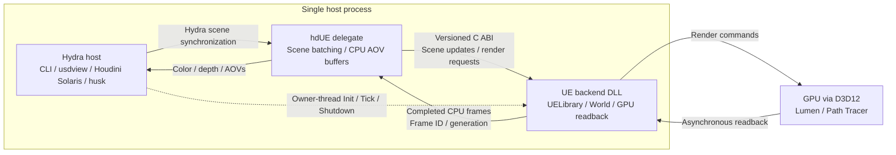

# Architecture and ABI

The host, delegate, and UE runtime share one process. The C ABI passes fixed-width data, handles, and caller-owned buffers. The host owns UE's lifetime; destroying a delegate releases its scene resources without restarting UE. Under husk, the first delegate starts UE itself (see [husk](houdini.md#rendering-to-disk-with-husk)).

Hydra changes are batched and applied on the UE owner thread. Rendering and readback run asynchronously, and the delegate publishes completed frames without waiting for another Tick. Frame IDs and generation numbers prevent stale results from being presented as current. Solaris consumes both color and linear depth; the standalone path uses color by default.

## ABI

`include/hdue/bridge.h` is the base ABI (`HDUE_ABI_VERSION` 7; its function table stays 96 bytes). It uses fixed-width POD fields, UTF-8 strings, opaque handles, and caller-owned buffers. UE, USD, STL objects, exceptions, and memory ownership do not cross the DLL boundary. The delegate and backend must come from the same build: version 7 added the camera projection, depth of field and focal length to `HdueRenderRequest`, and version 6 added per-vertex and per-instance colors to `HdueMeshDesc`.

Optional versioned extensions provide native assets, picking, material parameters, lighting/HDRI diagnostics, virtual-texture residency, depth, AOVs (`aov_api.h`), volumes (`volume_api.h`), motion-blur transforms (`motion_api.h`), post-processing (`postprocess_api.h`), lighting (`lighting_api.h`, version 2 adds IES profiles), shared GPU frames (`gpu_api.h`), and viewport diagnostics. Calls validate versions, sizes, capacities, generations, and the owning thread.

UE initializes once per process. Delegate destruction releases scene resources; process shutdown stops UE. GPU readbacks use fences. Completed images are returned without waiting synchronously for another Tick; stale generations are discarded. AOV maps pin immutable snapshots until Unmap. Color uses RGBA float and HDR output uses PFM. Shared GPU images remain a future optimization.

## Motion blur

UE's Path Tracer has no motion blur of its own (Movie Render Queue averages sub-frames). hdUE does the same inside the delegate: rprims record their transform samples one frame either side (`SampleTransform`, `SampleInstancerTransform`) and their `velocities`; the camera sprim records its own. When the render camera has an open shutter and something moves, the render pass renders `hdUE:motionSamples` sub-frames at times spread over `[shutter:open, shutter:close]`, moving meshes through `motion_api.h` (`set_transforms`, which leaves geometry untouched), and publishes the running average. Path Tracer samples are divided between sub-frames. AOVs render the unblurred pose at the current time.
