# Gallery

Point at a bar or a mark for its value; click a renderer in the legend to hide or show it.

## Cornell box: one feature per scene

Every scene is the [CC0 Cornell box](https://github.com/healkeiser/HdUnrealEngine/blob/main/samples/cornell) plus one small layer from [samples/cornell/variants](https://github.com/healkeiser/HdUnrealEngine/blob/main/samples/cornell/variants), rendered with husk at 512 × 512:

- **hdUE Lumen**: realtime mode, 64 warmup frames on a sequence's first frame, then one draw per frame (as Movie Render Queue).
- **hdUE Path Tracer**: 512 samples per pixel, up to 32 bounces.
- **Karma XPU** (GPU and CPU) and **Karma CPU**: path traced, 512 samples per pixel, 8 diffuse bounces.
- Machine: NVIDIA GeForce RTX 4090 and AMD Ryzen 9 5950X 16-Core Processor.
- Times are per frame without process or UE startup: hdUE from the delegate's timing trace of a 16-frame (Lumen) or 4-frame (Path Tracer) husk run, after its first frame (a Lumen time is a sequence frame's, after the first frame's warm-up),Karma as husk's wall time minus its startup on an empty stage.
- Speed-ups compare with Karma XPU, the GPU renderer, when it was rendered; brightness is the mean luminance relative to Karma CPU, the reference (1.00 = same).

Regenerate with `hython scripts/render_gallery.py`.

| Scene | hdUE Lumen | hdUE Path Tracer | Karma XPU | Karma CPU | Faster than Karma XPU (Lumen / Path Tracer) | Brightness vs Karma CPU (Lumen / Path Tracer) |
| --- | ---: | ---: | ---: | ---: | ---: | ---: |
| Global illumination | 48 ms | 2.34 s | 8.08 s | 49.70 s | 168x / 3x | 0.98 / 1.01 |
| Glossy materials | 49 ms | 2.29 s | 5.88 s | 30.30 s | 121x / 3x | 1.06 / 1.22 |
| Depth of field | 48 ms | 2.36 s | 8.40 s | 51.03 s | 173x / 4x | 0.98 / 1.01 |
| Motion blur | 49 ms | 2.53 s | 7.92 s | 50.24 s | 162x / 3x | 0.98 / 1.01 |
| Subdivision surfaces | 46 ms | 2.37 s | 7.60 s | 48.27 s | 163x / 3x | 0.98 / 1.01 |
| Instances, points, curves | 49 ms | 2.40 s | 7.63 s | 50.05 s | 155x / 3x | 0.98 / 1.03 |
| Volumes (OpenVDB) | 49 ms | 4.04 s | 8.21 s | 58.66 s | 167x / 2x | 1.10 / 1.31 |
| IES profile | 48 ms | 1.99 s | 9.81 s | 68.45 s | 205x / 5x | 1.02 / 1.09 |
| Light linking | 48 ms | 2.37 s | 9.74 s | 64.69 s | 203x / 4x | 0.99 / 1.00 |
| Clearcoat | 49 ms | 1.97 s | 6.34 s | 37.10 s | 129x / 3x | 0.99 / 1.00 |
| Render region | 34 ms | 2.25 s | 2.33 s | 13.71 s | 70x / 1x | 0.98 / 1.04 |
| Lens shift | 45 ms | 2.25 s | 5.63 s | 34.78 s | 125x / 3x | 0.97 / 1.03 |
| Orthographic camera | 49 ms | 2.29 s | 7.23 s | 44.68 s | 149x / 3x | 0.85 / 1.04 |
| Camera exposure | 49 ms | 2.34 s | 8.98 s | 57.14 s | 182x / 4x | 0.97 / 1.01 |
| Unreal post-processing | 50 ms | 2.40 s | 7.77 s | 47.66 s | 154x / 3x | n/a |
| **All 15** | **711 ms** | **36.19 s** | **111.57 s** | **706.49 s** | **157x / 3x** | |

### Global illumination

The CC0 Cornell box with its measured camera and a RectLight matching the ceiling light.

<figure class="hdue-shot">
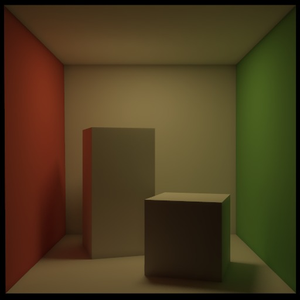
<figcaption>hdUE Lumen48 ms64 warmup, then 1 · 0.98× brightness</figcaption>
</figure>
<figure class="hdue-shot">
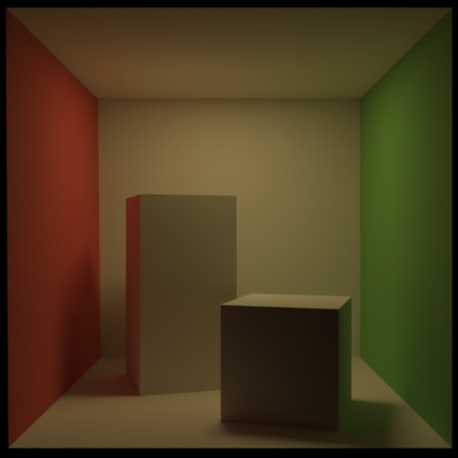
<figcaption>hdUE Path Tracer2.34 s512 spp · 1.01× brightness</figcaption>
</figure>
<figure class="hdue-shot">

<figcaption>Karma XPU8.08 s512 spp · 1.02× brightness</figcaption>
</figure>
<figure class="hdue-shot">
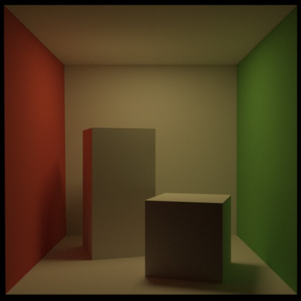
<figcaption>Karma CPU49.70 s512 spp · brightness reference</figcaption>
</figure>

### Glossy materials

Glossy metal on the tall box and a glossy dielectric ball.

<figure class="hdue-shot">
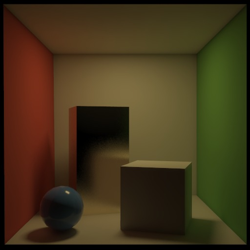
<figcaption>hdUE Lumen49 ms64 warmup, then 1 · 1.06× brightness</figcaption>
</figure>
<figure class="hdue-shot">
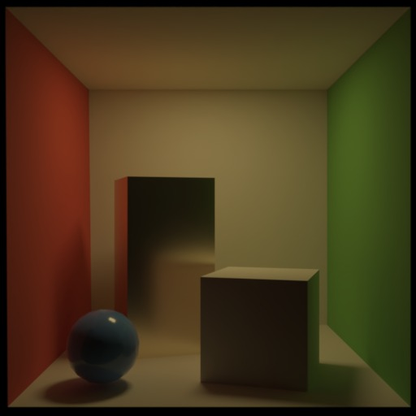
<figcaption>hdUE Path Tracer2.29 s512 spp · 1.22× brightness</figcaption>
</figure>
<figure class="hdue-shot">
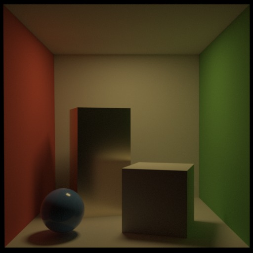
<figcaption>Karma XPU5.88 s512 spp · 1.02× brightness</figcaption>
</figure>
<figure class="hdue-shot">
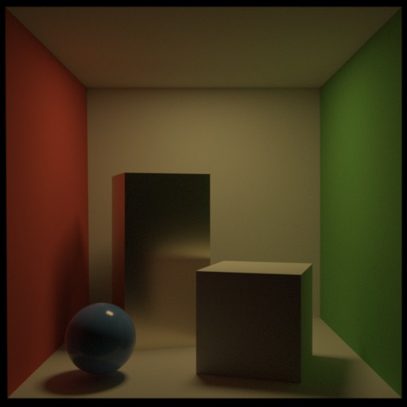
<figcaption>Karma CPU30.30 s512 spp · brightness reference</figcaption>
</figure>

### Depth of field

Thin-lens depth of field focused on the tall box (USD lens units: tenths of a scene unit).

<figure class="hdue-shot">
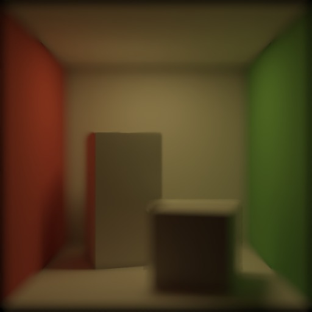
<figcaption>hdUE Lumen48 ms64 warmup, then 1 · 0.98× brightness</figcaption>
</figure>
<figure class="hdue-shot">

<figcaption>hdUE Path Tracer2.36 s512 spp · 1.01× brightness</figcaption>
</figure>
<figure class="hdue-shot">

<figcaption>Karma XPU8.40 s512 spp · 1.02× brightness</figcaption>
</figure>
<figure class="hdue-shot">
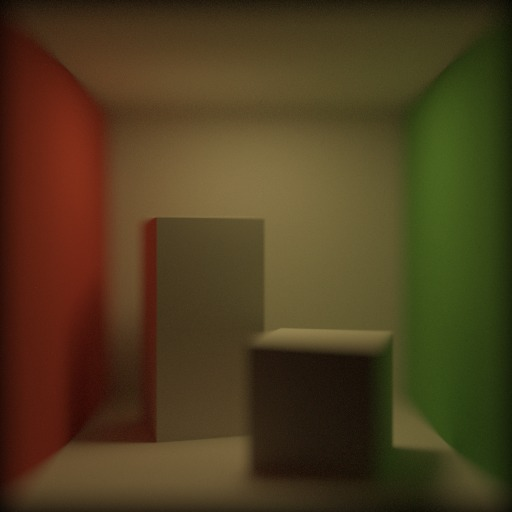
<figcaption>Karma CPU51.03 s512 spp · brightness reference</figcaption>
</figure>

### Motion blur

A ball crossing the box during a half-frame shutter.

<figure class="hdue-shot">
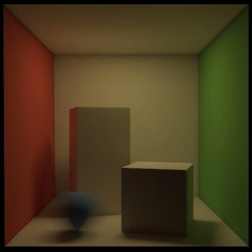
<figcaption>hdUE Lumen49 ms64 warmup, then 1 · 0.98× brightness</figcaption>
</figure>
<figure class="hdue-shot">

<figcaption>hdUE Path Tracer2.53 s512 spp · 1.01× brightness</figcaption>
</figure>
<figure class="hdue-shot">
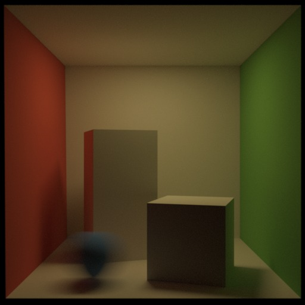
<figcaption>Karma XPU7.92 s512 spp · 1.02× brightness</figcaption>
</figure>
<figure class="hdue-shot">

<figcaption>Karma CPU50.24 s512 spp · brightness reference</figcaption>
</figure>

### Subdivision surfaces

A Catmull-Clark cube (USD default scheme) with a red GeomSubset on two faces, refined to level 3 in hdUE.

<figure class="hdue-shot">
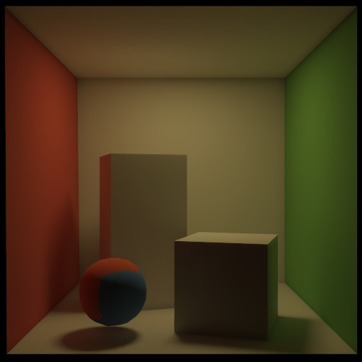
<figcaption>hdUE Lumen46 ms64 warmup, then 1 · 0.98× brightness</figcaption>
</figure>
<figure class="hdue-shot">
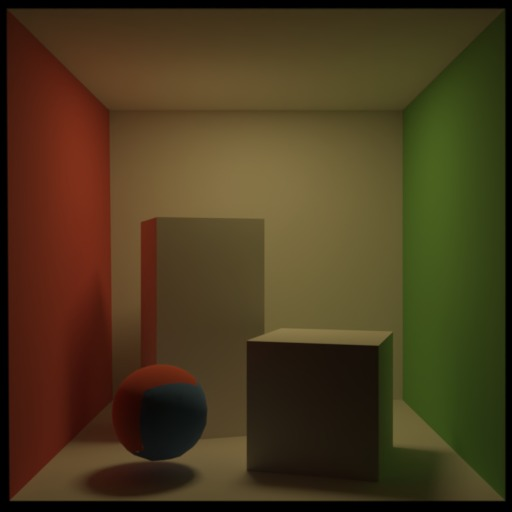
<figcaption>hdUE Path Tracer2.37 s512 spp · 1.01× brightness</figcaption>
</figure>
<figure class="hdue-shot">
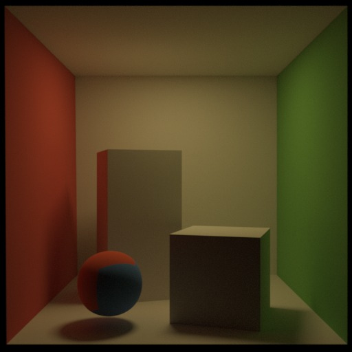
<figcaption>Karma XPU7.60 s512 spp · 1.02× brightness</figcaption>
</figure>
<figure class="hdue-shot">
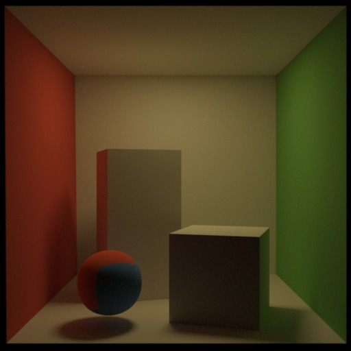
<figcaption>Karma CPU48.27 s512 spp · brightness reference</figcaption>
</figure>

### Instances, points, curves

A PointInstancer, Points and a cubic BasisCurves helix, with per-instance and per-curve colours.

<figure class="hdue-shot">
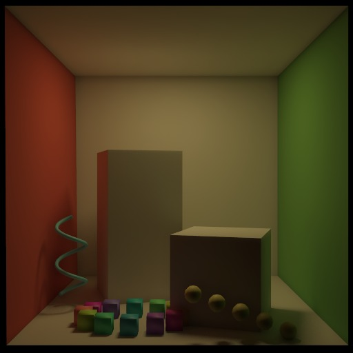
<figcaption>hdUE Lumen49 ms64 warmup, then 1 · 0.98× brightness</figcaption>
</figure>
<figure class="hdue-shot">
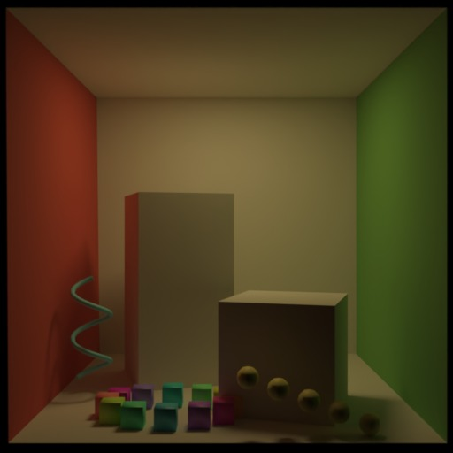
<figcaption>hdUE Path Tracer2.40 s512 spp · 1.03× brightness</figcaption>
</figure>
<figure class="hdue-shot">
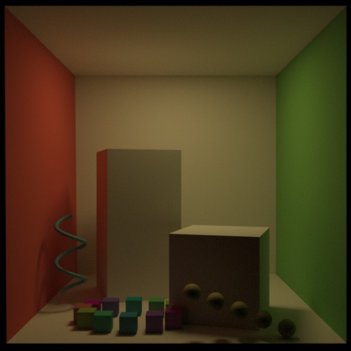
<figcaption>Karma XPU7.63 s512 spp · 1.02× brightness</figcaption>
</figure>
<figure class="hdue-shot">

<figcaption>Karma CPU50.05 s512 spp · brightness reference</figcaption>
</figure>

### Volumes (OpenVDB)

A fog sphere (OpenVDB, density field) in the middle of the box.

<figure class="hdue-shot">
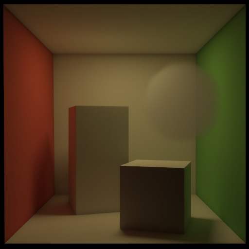
<figcaption>hdUE Lumen49 ms64 warmup, then 1 · 1.10× brightness</figcaption>
</figure>
<figure class="hdue-shot">
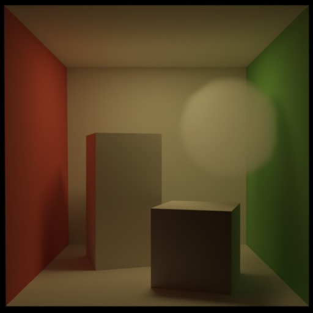
<figcaption>hdUE Path Tracer4.04 s512 spp · 1.31× brightness</figcaption>
</figure>
<figure class="hdue-shot">
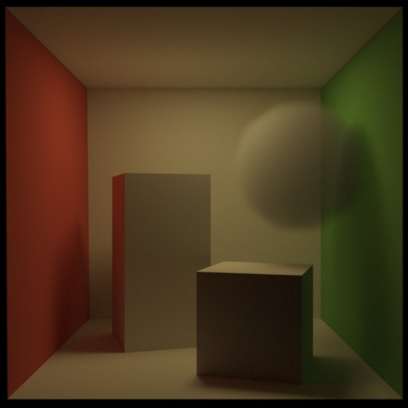
<figcaption>Karma XPU8.21 s512 spp · 1.02× brightness</figcaption>
</figure>
<figure class="hdue-shot">

<figcaption>Karma CPU58.66 s512 spp · brightness reference</figcaption>
</figure>

### IES profile

The ceiling light replaced by a point light with an IES profile.

<figure class="hdue-shot">
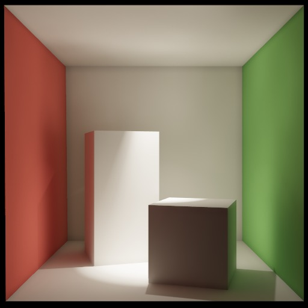
<figcaption>hdUE Lumen48 ms64 warmup, then 1 · 1.02× brightness</figcaption>
</figure>
<figure class="hdue-shot">
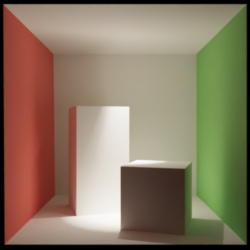
<figcaption>hdUE Path Tracer1.99 s512 spp · 1.09× brightness</figcaption>
</figure>
<figure class="hdue-shot">
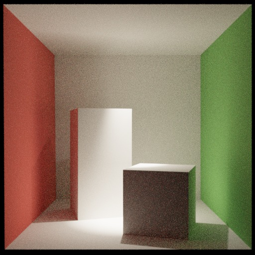
<figcaption>Karma XPU9.81 s512 spp · 1.07× brightness</figcaption>
</figure>
<figure class="hdue-shot">
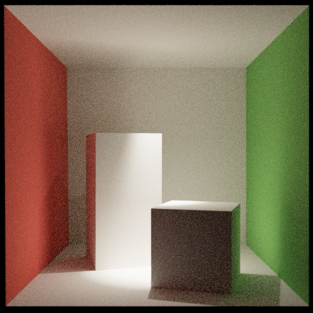
<figcaption>Karma CPU68.45 s512 spp · brightness reference</figcaption>
</figure>

### Light linking

A warm light linked only to the tall box and a cool one only to the short box; the ceiling light lights everything. Lumen still bounces the linked lights onto every surface: UE’s lighting channels only restrict direct light.

<figure class="hdue-shot">

<figcaption>hdUE Lumen48 ms64 warmup, then 1 · 0.99× brightness</figcaption>
</figure>
<figure class="hdue-shot">
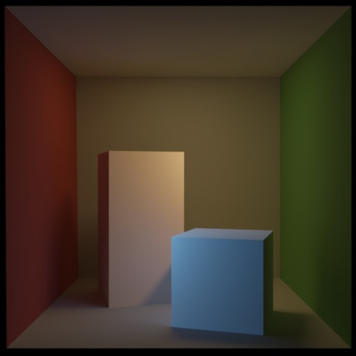
<figcaption>hdUE Path Tracer2.37 s512 spp · 1.00× brightness</figcaption>
</figure>
<figure class="hdue-shot">
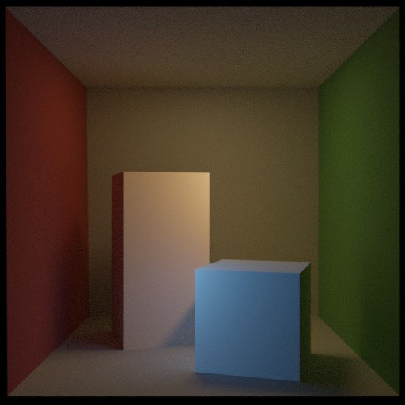
<figcaption>Karma XPU9.74 s512 spp · 1.02× brightness</figcaption>
</figure>
<figure class="hdue-shot">
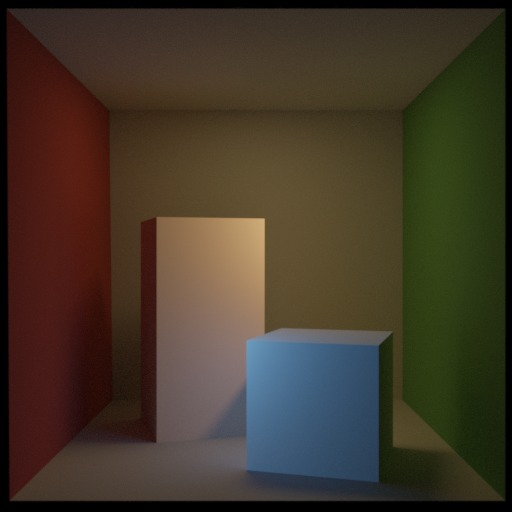
<figcaption>Karma CPU64.69 s512 spp · brightness reference</figcaption>
</figure>

### Clearcoat

Preview Surface clearcoat: red lacquer (clearcoat 1 over a rough red base, left) next to the same base without a coat (right).

<figure class="hdue-shot">
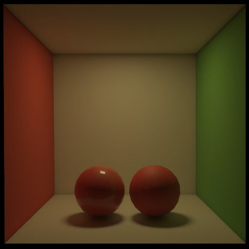
<figcaption>hdUE Lumen49 ms64 warmup, then 1 · 0.99× brightness</figcaption>
</figure>
<figure class="hdue-shot">
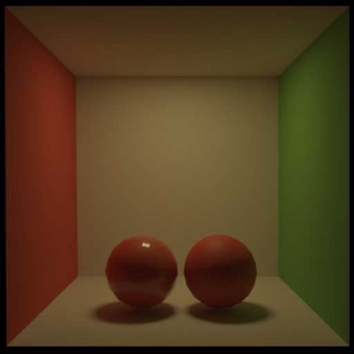
<figcaption>hdUE Path Tracer1.97 s512 spp · 1.00× brightness</figcaption>
</figure>
<figure class="hdue-shot">
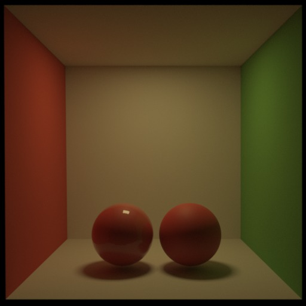
<figcaption>Karma XPU6.34 s512 spp · 1.02× brightness</figcaption>
</figure>
<figure class="hdue-shot">

<figcaption>Karma CPU37.10 s512 spp · brightness reference</figcaption>
</figure>

### Render region

A render region: dataWindowNDC (0.25, 0.15)-(0.75, 0.65) renders only that part of the 512 x 512 frame, as husk tiles do.

<figure class="hdue-shot">
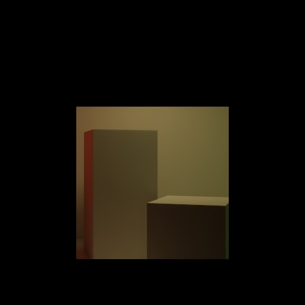
<figcaption>hdUE Lumen34 ms64 warmup, then 1 · 0.98× brightness</figcaption>
</figure>
<figure class="hdue-shot">
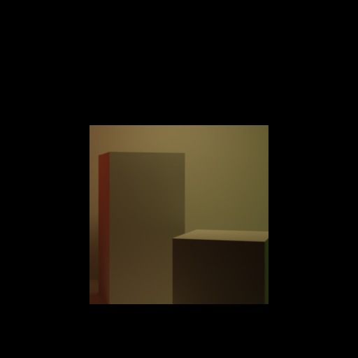
<figcaption>hdUE Path Tracer2.25 s512 spp · 1.04× brightness</figcaption>
</figure>
<figure class="hdue-shot">
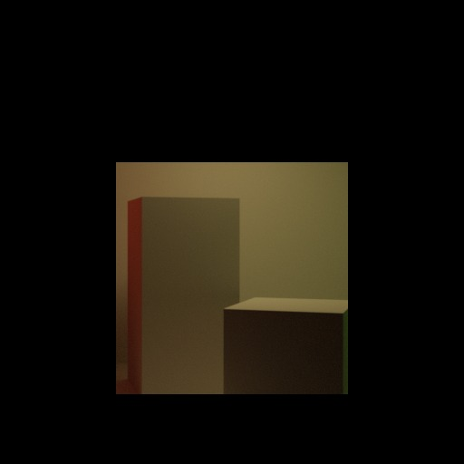
<figcaption>Karma XPU2.33 s512 spp · 1.01× brightness</figcaption>
</figure>
<figure class="hdue-shot">

<figcaption>Karma CPU13.71 s512 spp · brightness reference</figcaption>
</figure>

### Lens shift

Horizontal and vertical aperture offsets (lens shift).

<figure class="hdue-shot">
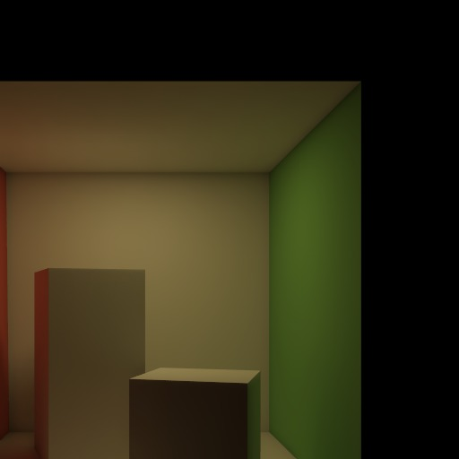
<figcaption>hdUE Lumen45 ms64 warmup, then 1 · 0.97× brightness</figcaption>
</figure>
<figure class="hdue-shot">
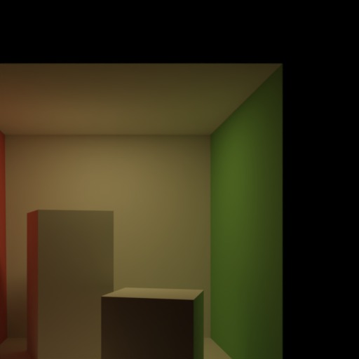
<figcaption>hdUE Path Tracer2.25 s512 spp · 1.03× brightness</figcaption>
</figure>
<figure class="hdue-shot">
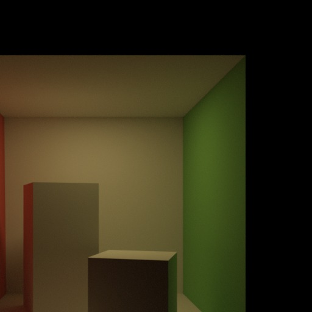
<figcaption>Karma XPU5.63 s512 spp · 1.02× brightness</figcaption>
</figure>
<figure class="hdue-shot">

<figcaption>Karma CPU34.78 s512 spp · brightness reference</figcaption>
</figure>

### Orthographic camera

Orthographic projection with a 6.2 m window.

<figure class="hdue-shot">
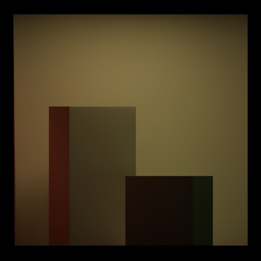
<figcaption>hdUE Lumen49 ms64 warmup, then 1 · 0.85× brightness</figcaption>
</figure>
<figure class="hdue-shot">

<figcaption>hdUE Path Tracer2.29 s512 spp · 1.04× brightness</figcaption>
</figure>
<figure class="hdue-shot">
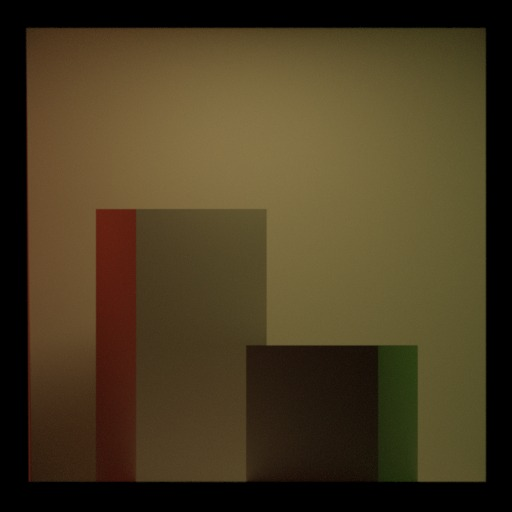
<figcaption>Karma XPU7.23 s512 spp · 1.01× brightness</figcaption>
</figure>
<figure class="hdue-shot">
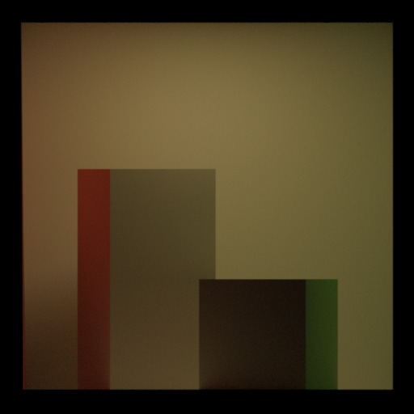
<figcaption>Karma CPU44.68 s512 spp · brightness reference</figcaption>
</figure>

### Camera exposure

Camera exposure of +1 stop.

<figure class="hdue-shot">
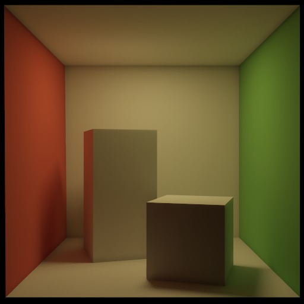
<figcaption>hdUE Lumen49 ms64 warmup, then 1 · 0.97× brightness</figcaption>
</figure>
<figure class="hdue-shot">
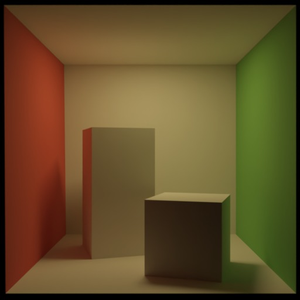
<figcaption>hdUE Path Tracer2.34 s512 spp · 1.01× brightness</figcaption>
</figure>
<figure class="hdue-shot">

<figcaption>Karma XPU8.98 s512 spp · 1.02× brightness</figcaption>
</figure>
<figure class="hdue-shot">
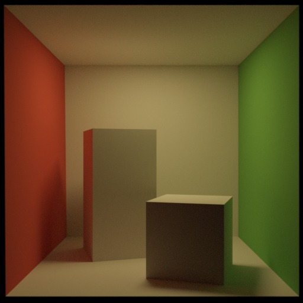
<figcaption>Karma CPU57.14 s512 spp · brightness reference</figcaption>
</figure>

### Unreal post-processing

UE's tonemapper (+2.5 stops), bloom, vignette, chromatic aberration, lens flares, film grain and a warm grade on the hdUE beauty; Karma renders the linear image.

<figure class="hdue-shot">
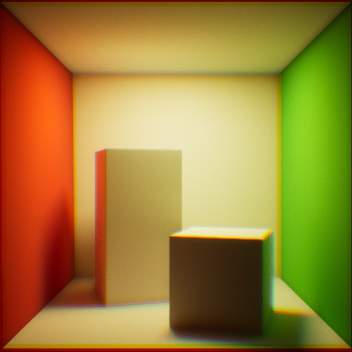
<figcaption>hdUE Lumen50 ms64 warmup, then 1</figcaption>
</figure>
<figure class="hdue-shot">
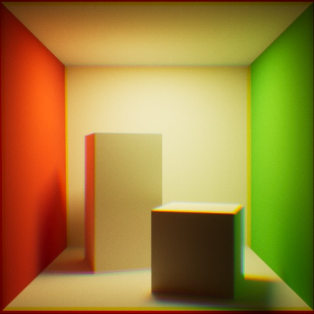
<figcaption>hdUE Path Tracer2.40 s512 spp</figcaption>
</figure>
<figure class="hdue-shot">

<figcaption>Karma XPU7.77 s512 spp</figcaption>
</figure>
<figure class="hdue-shot">

<figcaption>Karma CPU47.66 s512 spp · brightness reference</figcaption>
</figure>

## Sponza: a production-style scene

[Intel's Sponza 2022](https://www.intel.com/content/www/us/en/developer/topic-technology/graphics-processing-research/samples.html) (Frank Meinl and Anton Kaplanyan, CC BY 4.0; not included in this repository), from its main camera. Intel exports UsdPreviewSurface only; [samples/sponza/materials.usda](https://github.com/healkeiser/HdUnrealEngine/blob/main/samples/sponza/materials.usda) gives every material a MaterialX standard_surface network on Intel's textures (stone, metal, wood, sheen and translucent curtains, translucent leaves cut out by their alpha, glass), which hdUE and Karma render. hdUE's Path Tracer image is denoised by UE's default denoiser (NNEDenoiser, PathTracingEnableDenoiser on); Karma's is not. Ray tracing uses Nanite's fallback meshes, as in UE (r.RayTracing.Nanite.Mode 0): the tree and the curtains are simplified in the Path Tracer, and Nanite Ray Tracing (Streamed Out Mesh) traces them in full. The scene has no lights, so [samples/sponza/lighting.usda](https://github.com/healkeiser/HdUnrealEngine/blob/main/samples/sponza/lighting.usda) adds a sun and a sky dome fitted to Intel's own renders of the scene, and levels the camera as Intel's render does; [samples/sponza/no_decals.usda](https://github.com/healkeiser/HdUnrealEngine/blob/main/samples/sponza/no_decals.usda) deactivates the dirt decal meshes. Add-ons from the same package, sublayered unchanged: `NewSponza_Curtains_USD_YUp.usda`, `NewSponza_CypressTree_USDA_YUp.usda`. Rendered with husk at 960 × 540:

- **hdUE Lumen**: realtime mode, 64 warmup frames on a sequence's first frame, then one draw per frame (as Movie Render Queue).
- **hdUE Path Tracer**: 256 samples per pixel, up to 32 bounces.
- **Karma XPU** (GPU and CPU) and **Karma CPU**: path traced, 256 samples per pixel, 8 diffuse bounces.
- Machine: NVIDIA GeForce RTX 4090 and AMD Ryzen 9 5950X 16-Core Processor.
- Times are per frame without process or UE startup: hdUE from the delegate's timing trace of a 16-frame (Lumen) or 4-frame (Path Tracer) husk run, after its first frame (a Lumen time is a sequence frame's, after the first frame's warm-up),Karma as husk's wall time minus its startup on an empty stage.
- Speed-ups compare with Karma XPU, the GPU renderer, when it was rendered; brightness is the mean luminance relative to Karma CPU, the reference (1.00 = same).

Regenerate with `hython scripts/render_gallery.py --set sponza`.

| Scene | hdUE Lumen | hdUE Path Tracer | Karma XPU | Karma CPU | Faster than Karma XPU (Lumen / Path Tracer) | Brightness vs Karma CPU (Lumen / Path Tracer) |
| --- | ---: | ---: | ---: | ---: | ---: | ---: |
| Main view | 84 ms | 6.64 s | 42.19 s | 474.65 s | 504x / 6x | 0.91 / 1.06 |

### Main view

`/root/PhysCamera001`, levelled as in Intel's Render_Main_A, exposure +4.5 stops as authored; sun and sky fitted to Intel's renders.

<figure class="hdue-shot">
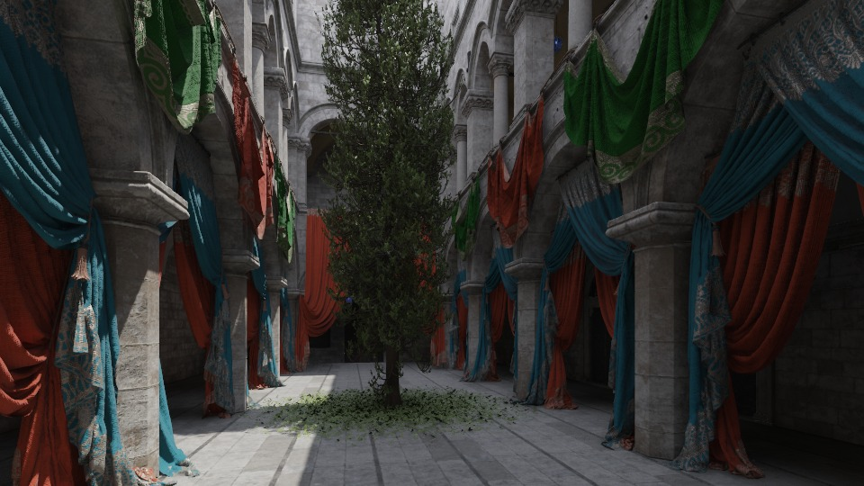
<figcaption>hdUE Lumen84 ms64 warmup, then 1 · 0.91× brightness</figcaption>
</figure>
<figure class="hdue-shot">
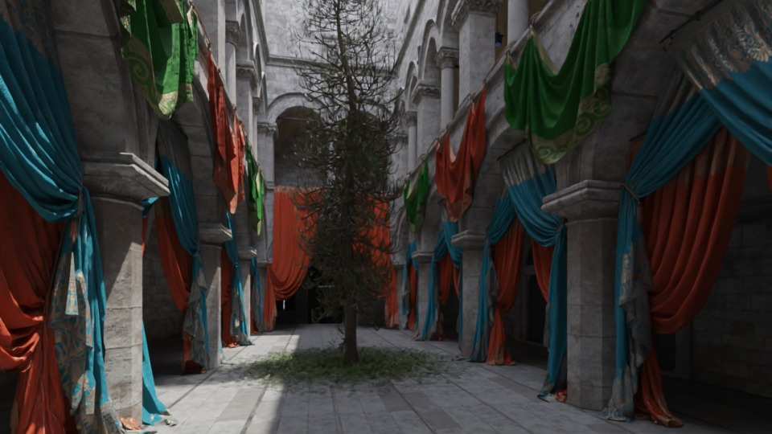
<figcaption>hdUE Path Tracer6.64 s256 spp · 1.06× brightness</figcaption>
</figure>
<figure class="hdue-shot">
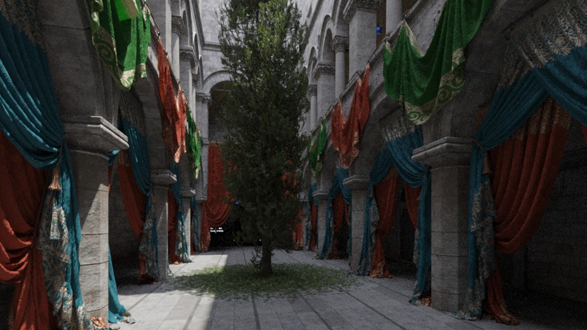
<figcaption>Karma XPU42.19 s256 spp · 0.98× brightness</figcaption>
</figure>
<figure class="hdue-shot">
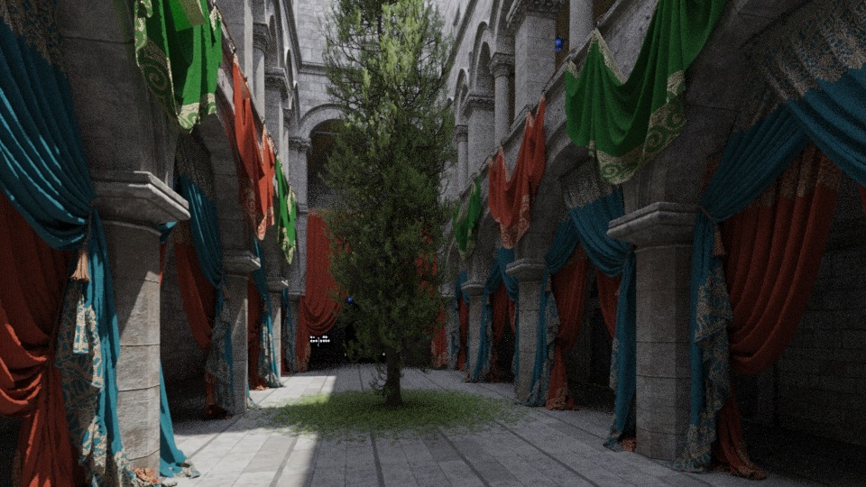
<figcaption>Karma CPU474.65 s256 spp · brightness reference</figcaption>
</figure>

