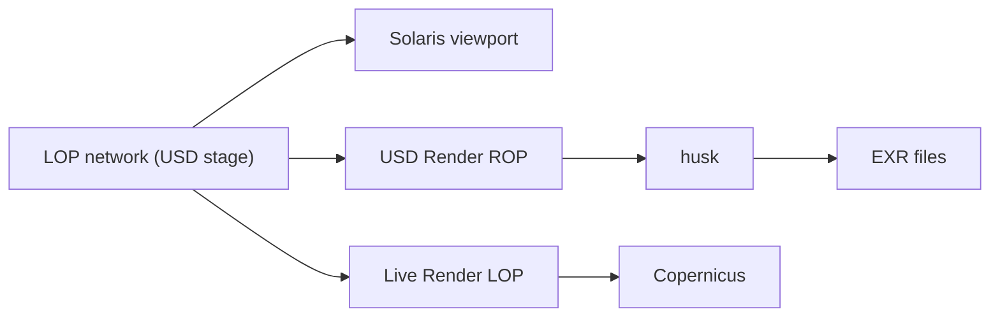

# Houdini

hdUE adds **Unreal Engine** as a renderer to Houdini 22.0 Solaris. The viewport, husk, the USD Render ROP and Live Render all load the same renderer and read the same `unreal:*` render settings, so a farm renders what your viewport shows.

## Where to start

| Page | What you learn |
| --- | --- |
| [Solaris viewport](viewport.md) | Picking Unreal Engine, the Unreal Engine tab, the Unreal menu, keeping the viewport fast |
| [Rendering with husk](husk.md) | Command lines, frame ranges, farms, render products, failures |
| [Live Render and Copernicus](live-render.md) | Rendering into a Live Render LOP for compositing |
| [Substrate materials](substrate-materials.md) | Building UE Substrate materials in a VOP network |
| [AOVs in Houdini](../output/aovs.md#aovs-in-houdini) | Render vars, hdUE Standard Render Vars, Cryptomatte |
| [COP and embedded textures](../materials/cop-textures.md) | `op:` images and textures embedded in assets |

## The hdUE LOPs

The package adds these LOPs to the TAB menu under **hdUE**:

| LOP | TAB menu | Karma counterpart |
| --- | --- | --- |
| **hdUE Render Settings** | hdUE > Rendering | Karma Render Settings |
| **hdUE Standard Render Vars** | hdUE > Rendering | Karma Standard Render Vars |
| **hdUE Render Products** | hdUE > Rendering | Karma Render Products |
| **hdUE Height Fog**, **hdUE Sky Atmosphere**, **hdUE Volumetric Cloud**, **hdUE Local Fog Volume** | hdUE > Visual Effects | |
| **hdUE Post Process Volume**, **hdUE Decal** | hdUE > Visual Effects | |
| **hdUE Substrate Material Builder** | hdUE (in `/mat` and Material Library LOPs) | Karma Material Builder |

The Visual Effects LOPs place Unreal Engine's scene components as USD prims, filed as UE's Place Actors panel files them. See [Fog](../environment/fog.md), [Sky and clouds](../environment/sky.md) and [Post-processing](../rendering/post-processing.md).
