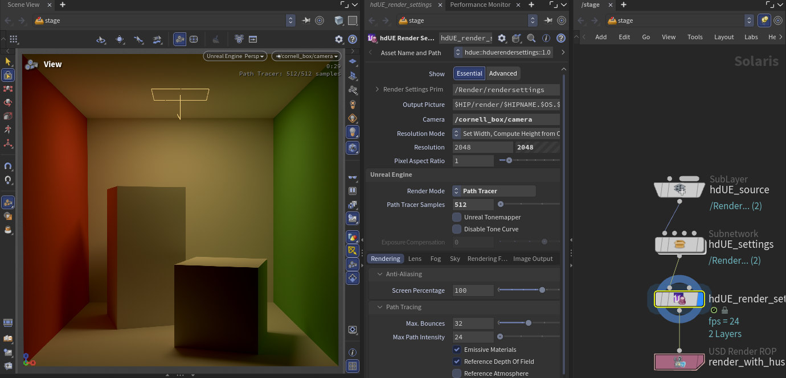

# Solaris viewport

The Solaris Scene Viewer renders with Unreal Engine once you pick **Unreal Engine** in its renderer menu. Unreal Engine runs inside Houdini on its own thread, so a slow frame never blocks Houdini's UI.

/// caption
The Scene Viewer rendering with **Unreal Engine** (Path Tracer, 512 samples), the hdUE Render Settings LOP's parameters, and the network: a Sublayer, hdUE's settings, the render settings and a USD Render ROP.
///

## Picking Unreal Engine

1. Display a LOP network in a Scene Viewer.
2. In the viewer's renderer menu, pick **Unreal Engine**, or choose **Unreal > Use Unreal Engine in the Viewport**.

The first time in a session, Unreal Engine starts inside Houdini; the image appears a few seconds later. It then stays loaded until Houdini exits, so switching back to Unreal Engine is immediate.

One Houdini session renders one hdUE image at a time: one viewport, or one [Live Render](live-render.md).

Selection works as with Karma: click a prim in the viewport to select it, and Solaris outlines it. The outline appears once the view is still.

## Render settings

hdUE reads its settings from `unreal:*` attributes on the stage's render settings prim. You set them in three places.

### hdUE Render Settings LOP

**hdUE Render Settings** (TAB menu > hdUE > Rendering) is the counterpart of Karma Render Settings: one LOP with the camera, resolution, **Output Picture** and every hdUE setting. **Unreal > Create hdUE Render Settings** adds one after the displayed LOP.

From top to bottom it shows:

1. **Show: Essential | Advanced**. Essential shows what Unreal's editor shows by default; Advanced adds the settings UE keeps behind its Advanced expanders. Settings hidden by Essential still render. When a hidden setting differs from its default, a notice names it, with a **Show in Advanced** button.
2. The camera and output: **Output Picture** (`$HIP/render/$HIPNAME.$OS.$F4.exr` by default), camera, resolution (up to 16384 pixels a side; render larger images in husk tiles) and pixel aspect ratio.
3. The main settings: **Render Mode**, **Path Tracer Samples** or **Warmup Frames**, **Unreal Tonemapper** and **Exposure Compensation**. See [Above the tabs](../reference/render-settings/index.md#above-the-tabs).
4. One tab per Unreal Engine category, in the order of UE's Details panel:

| Tab | Holds |
| --- | --- |
| [Rendering](../reference/render-settings/rendering.md) | Anti-aliasing and screen percentage, Path Tracing, View Mode, Geometry, Materials |
| [Lens](../reference/render-settings/lens.md) | Bloom, Exposure, Chromatic Aberration, Dirt Mask, Camera, Local Exposure, Lens Flares, Image Effects, Depth of Field |
| [Color Grading](../reference/render-settings/color-grading.md) | Temperature, Global, Shadows, Midtones, Highlights, Misc, Film, Film Grain |
| [Lighting](../reference/render-settings/lighting.md) | Global Illumination (Lumen), Reflections, Shadows, Dome and Viewer Lights |
| [Fog](../reference/render-settings/fog.md) | Exponential Height Fog and Volumetric Fog |
| [Sky](../reference/render-settings/sky.md) | Sky Atmosphere and Volumetric Cloud |
| [Rendering Features](../reference/render-settings/rendering-features.md) | Post-process materials, MegaLights, Ambient Occlusion, Motion Blur, Translucency |
| Image Output | Render products and one toggle per [AOV](../output/aovs.md#aovs-in-houdini) |
| [Engine Quality](../reference/render-settings/engine-quality.md) | Scalability, Nanite, Ray Tracing |

Settings that one render mode ignores are hidden in that mode. For example, Lumen and Shadows are hidden with the Path Tracer, and **Path Tracer Samples** is hidden in Realtime. A hidden setting keeps its value.

### Render Settings LOP

Houdini's own **Render Settings** LOP gets the same settings on an **Unreal Engine** tab. As with Karma's properties, each setting starts unauthored: set its control menu to author it.

### Viewport Display Options

The viewport's Display Options get an **Unreal Engine** tab with the settings you change while working: Render Mode, Warmup Frames, Path Tracer Samples, Debug View, Motion Blur, Lumen, Light Unlit Scenes, Viewer Light Intensity, Subdivision Level, Unreal Tonemapper and the Engine Quality group (scalability, anti-aliasing, DLSS, screen percentage, hardware ray tracing, Virtual Shadow Maps).

!!! note "Console variables apply to the whole session"
    Settings named `unreal:cvar:*` are Unreal Engine console variables. They apply to the whole Houdini process, so they change every hdUE render in the session until you change them back.

### Light and geometry settings

Light LOPs get an **Unreal Engine** tab for the per-light `unreal:*` properties ([Light properties](../reference/light-properties.md)). Render Geometry Settings LOPs get one for per-prim settings: a cooked native UE asset, hair, and wet surfaces.

## The Unreal menu

The package adds an **Unreal** menu to Houdini's main menu bar, before **Windows**.

| Entry | What it does |
| --- | --- |
| **Use Unreal Engine in the Viewport** | Picks Unreal Engine in the Scene Viewer, as the renderer menu does. |
| **Render Mode > Realtime** / **Path Traced** | Sets **Render Mode** on the first Render Settings or hdUE Render Settings LOP above the displayed LOP. If there is none, adds an hdUE Render Settings LOP after the displayed LOP. |
| **Create hdUE Render Settings** | Adds an hdUE Render Settings LOP after the displayed LOP and displays it. It takes the camera, render mode and samples from the stage's existing render settings, if any. |
| **Caches > Show Cache Sizes** | Lists each hdUE disk cache with its size, file count and folder. |
| **Caches > *cache* > Open Folder** | Opens that cache's folder. |
| **Caches > *cache* > Clear...** | Asks, then deletes the cache's contents. |
| **Caches > Clear All hdUE Caches...** | Asks, then deletes the contents of every cache. |
| **Open Unreal Engine Logs** | Opens the folder of Unreal Engine's logs. |
| **Documentation** | Opens this guide's Houdini pages in your browser. |

### Caches

hdUE keeps four disk caches so a scene's second load is faster. Each process removes entries unused for a week. Clear a cache to reclaim its space at once, or after a problem you suspect comes from stale cache data.

| Cache | Folder | Holds |
| --- | --- | --- |
| Texture | `%LOCALAPPDATA%\hdUE\TextureCache` | Block-compressed textures |
| Virtual texture | `HDUE_VIRTUAL_TEXTURE_CACHE`, else `%LOCALAPPDATA%\hdUE\VirtualTextureCache` | UDIM virtual textures |
| Nanite | `Saved\NaniteCache` under `HDUE_USER_DIR` | [Nanite](../geometry/nanite.md) mesh builds |
| OCIO texture | `%TEMP%\hdue_ocio` | Textures converted to the OCIO working space |

Clearing is refused once Unreal Engine has started in the session, because it reads the cache files while it runs. Restart Houdini and clear before you pick Unreal Engine. Files another process holds open (husk, another Houdini) are kept and listed.

## Viewport speed

While you tumble, scrub or play, the viewport renders a cheaper image, then refines it once the view is still. In the Path Tracer, it renders 8 samples per pixel while you move:

| Symptom | Cause | Fix |
| --- | --- | --- |
| The Realtime image is soft while you move, then sharpens. | **Lower Resolution While Moving** renders at **Moving Screen Percentage** (50%) until 250 ms after the last change. | Raise [Moving Screen Percentage](../reference/render-settings/rendering.md#unreal-cvar-r-hdue-interactivescreenpercentage), or turn off [Lower Resolution While Moving](../reference/render-settings/rendering.md#unreal-cvar-r-hdue-interactiveresolution). |
| The Path Tracer is noisy while you move. | It renders 8 samples per pixel until the view is still. | None needed: it refines to **Path Tracer Samples** once you stop. |
| The selection outline appears late or flickers. | The outline needs two extra ID renders per view, which run only once the view is still. | Set `int unreal:viewportIdAovs = 0` on the render settings to skip them. Selection then works from the Scene Graph Tree only, without an outline. |
| Realtime is slow at every frame. | Lumen, shadows and reflections run at Epic quality. | Lower the [Engine Quality](../reference/render-settings/engine-quality.md#unreal-cvar-sg-globalilluminationquality) groups (Shadows, Global Illumination, Reflections) from Epic (3) to High (2), or lower **Screen Percentage**. |
| The viewport renders far more pixels than it shows. | Display Options > Render > Image Resolution is set to the render settings' resolution. | Use the viewport's size while you work. |
| Materials first show flat colours, then their textures. | Textures decode and compress in the background. The progress line under the viewport counts the files done and the time left. | Wait; the second load of a scene reads them from the texture cache. |
| Meshes appear a moment after the scene loads. | Meshes upload as standard meshes first, then are swapped for [Nanite](../geometry/nanite.md) meshes in the background. | Wait; Nanite builds are cached on disk, so the next session skips most of them. |
| The viewport shows a black or stale image while husk renders fine. | Frames pass from Unreal Engine to Houdini's OpenGL viewport on the GPU, which needs the GPU driver's shared-memory extensions. | Set `HDUE_GPU_FRAMES=0` before starting Houdini to copy frames through the CPU instead. |

To measure where a frame's time goes, set `HDUE_TRACE_TIMING=1` and `HDUE_TRACE_FILE=<path>` before starting Houdini ([Environment variables](../getting-started/environment-variables.md)).

## Unreal Engine and Karma

- The renderer settings live on the same render settings prim as Karma's, so a scene can carry both.
- hdUE's LOPs mirror Karma's: hdUE Render Settings, hdUE Standard Render Vars and hdUE Render Products work like their Karma counterparts.
