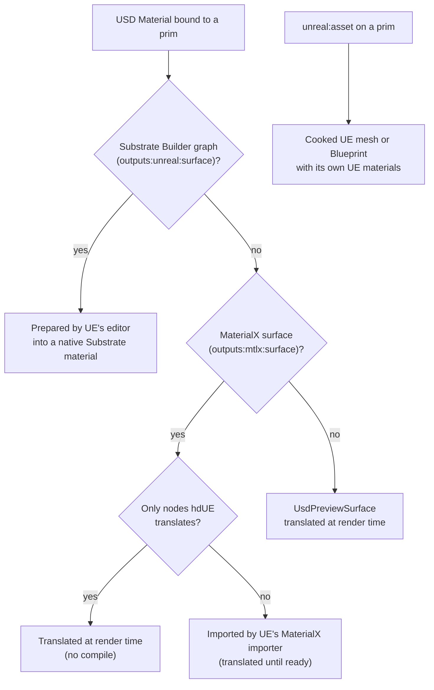

# Materials

hdUE renders USD materials with Unreal Engine's material system, Substrate. A material reaches UE by one of four routes: a UsdPreviewSurface, a MaterialX Standard Surface or OpenPBR graph, an hdUE Substrate Builder graph, or a cooked UE asset with its own materials.

The shader ball with four material models: UsdPreviewSurface, then MaterialX Standard Surface with transmission, subsurface and sheen (Realtime).

<div class="hdue-figure" data-figure="materials-models"></div>

## Which route a material takes



| Route | You author | Edits | Page |
| --- | --- | --- | --- |
| UsdPreviewSurface | A USD Preview Surface VOP, or any `UsdPreviewSurface` shader | Live: every input and texture | [Preview Surface](materials/preview-surface.md) |
| MaterialX | A Material Builder (Karma or MaterialX) with Standard Surface or OpenPBR | Live for the nodes hdUE translates; other graphs are imported by UE in the background | [MaterialX surfaces](materials/materialx-surfaces.md) |
| Substrate Builder | An **hdUE Substrate Material Builder** with Slabs, layers and mixes | Values live; wiring changes compile in the background (seconds) | [Substrate Builder](substrate-builder.md) |
| Cooked UE asset | `unreal:asset` on a prim, pointing at a mesh or Blueprint in the runtime project | The asset's own materials, edited in UE's editor | [below](#cooked-native-assets) |

A prim without a bound material renders its `displayColor` and `displayOpacity`, as UE's USD importer draws an unbound prim.

## Which material model to choose

- **UsdPreviewSurface** for plastics, metals, painted surfaces, cutout foliage and emissive surfaces. It costs one Substrate slab per pixel, the cheapest UE material.
- **MaterialX Standard Surface or OpenPBR** for glass that refracts, skin and wax (subsurface), cloth (sheen), and thin leaves or fabric (thin-walled). A material with subsurface, sheen or coat costs several Substrate closures per pixel.
- **Substrate Builder** for layered UE materials no USD model expresses: a water film over a surface, hair, eyes, Single Layer Water, thin film, decals and volume materials.
- **Cooked UE assets** to reuse content that already lives in a UE project, with its UE materials unchanged.

## Using it in Solaris

1. Create the material in a **Material Library** LOP: a USD Preview Surface, a Karma Material Builder or MaterialX Standard Surface, or an **hdUE Substrate Material Builder** (TAB menu > hdUE).
2. Assign it with **Assign Material**, or in the Material Library's **Geometry Path**.
3. Edit any value. The viewport updates without a restart; a Substrate Builder rewire or an imported MaterialX graph takes a few seconds to compile first.

The three material settings are on hdUE Render Settings > Rendering > Materials:

| Setting | Default | What it does |
| --- | --- | --- |
| [Cooked MaterialX Library](reference/render-settings/rendering.md#unreal-materialxlibrary) (`unreal:materialxLibrary`) | empty | A `library.json` of MaterialX materials cooked ahead of time; they replace the render-time translation |
| [Prepared Substrate Library](reference/render-settings/rendering.md#unreal-substratelibrary) (`unreal:substrateLibrary`) | empty | A `library.json` of Substrate Builder materials prepared ahead of time |
| [Prepare Edited Materials](reference/render-settings/rendering.md#unreal-substrateautoprepare) (`unreal:substrateAutoPrepare`) | On | Compiles Substrate Builder graphs and imports untranslatable MaterialX graphs in the background, in the viewport and in husk |

## MaterialX and Substrate

UE renders every material with Substrate. hdUE's runtime holds up to four closures and 128 bytes per pixel (Substrate's Adaptive GBuffer). A Preview Surface uses one slab; a Standard Surface with coat, sheen or subsurface uses UE's layered `Substrate-StandardSurface` function, which uses several.

### Automatic import of untranslatable graphs

A MaterialX graph with a node hdUE does not translate ([the list](materials/materialx-surfaces.md#nodes-hdue-translates); for example a `mix` of two textures, a `multiply` of two textures, noises, ramps, Houdini's own nodes) is imported by UE's own MaterialX importer, as UE's USD importer does for `.mtlx` files. With **Prepare Edited Materials** on:

- the viewport keeps rendering the translation, with the untranslated inputs at their constants, and switches to the imported material when UE has compiled it (a few seconds);
- husk imports the graphs a frame needs before rendering it.

Each graph is imported once per runtime: later renders, viewport or husk, reuse it. Numeric and colour inputs of the graph's nodes stay live after the import. Changing a filename, an integer or boolean input, or a value inside a Houdini node imports the graph again.

Importing needs UE's editor and the hdUE backend project on the machine. Without them, for example on a render node with a package install, the graph renders translated and hdUE prints why once.

### Cooked MaterialX libraries

For a farm without UE's editor, cook the MaterialX materials once and point **Cooked MaterialX Library** at the result:

```powershell
.\scripts\Import-MaterialX.ps1 `
  -Source @('samples/materialx/standard_surface.mtlx') `
  -OutputDirectory out/materialx-import/review
.\scripts\Stage-Runtime.ps1
```

A cooked material replaces the translation for the materials it maps. A material whose graph changed since it was cooked fails a husk frame with the library's message. Published scalar and colour inputs stay live; structural changes need another import, cook and staging, and a restart.

## Normal maps and UDIMs

- **Normal maps**: connect a raw texture to UsdPreviewSurface `normal` through `scale` (2, 2, 2, 1) and `bias` (-1, -1, -1, 0), or to MaterialX `normal` through a `normalmap` node. Both expect OpenGL maps (+Y up), as USD and MaterialX do.
- **UDIMs**: write `<UDIM>` in a texture's file name (`wall.<UDIM>.exr`). hdUE builds a UE streaming virtual texture of the tiles it finds, with no preparation.

Streamed texture data is cached on disk in `%LOCALAPPDATA%\hdUE\VirtualTextureCache` (or the folder in `HDUE_VIRTUAL_TEXTURE_CACHE`). The cache is never trimmed: delete the folder to reclaim space. A first load of a large scene writes tens of gigabytes there (41 GB for NVIDIA's Da Vinci Workshop).

In the Path Tracer, the first frames of a scene with UDIMs are a warm-up while UE streams the texture pages the camera sees. Accumulation starts once the pages stop changing.

## Cooked native assets

A Mesh, Xform or Scope prim with `unreal:asset` renders a cooked UE asset from the runtime project in its place: a Static Mesh, Skeletal Mesh, Actor Blueprint, Level or Sparse Volume Texture.

=== "Houdini"

    1. Add a **Render Geometry Settings** LOP and select the prims.
    2. On its **Unreal Engine** tab, set **Native Asset** to Set or Create and pick the asset from the menu.

=== "USD"

    ```usda
    def Xform "NativeMesh"
    {
        custom string unreal:asset = "/Game/HdUE/SM_Nanite.SM_Nanite" # (1)!
    }
    ```

    1. The asset's UE object path in the runtime project.

The asset keeps its UE materials, material slots, pivot and centimetre dimensions; the prim's transform places it. Without an asset catalog the menu lists the staged runtime's levels and the assets named with UE's prefixes (`SM_`, `SK_`, `BP_`, `SVT_`).

A Sparse Volume Texture (a VDB imported in UE's editor) renders as UE's Heterogeneous Volume, in both render modes. UE reads its VDB in centimetres, so a VDB written in metres needs a scale of 100 on the prim. For a VDB sequence, `primvars:unreal:volume:frame` picks the frame (0 is the first file); set it on the Render Geometry Settings LOP as **Volume Frame**, for example `$F - 1`.

Skeletal meshes render in their reference pose. Blueprint gameplay, time synchronisation and World Partition are limited.

## Troubleshooting

| Symptom | Cause | Fix |
| --- | --- | --- |
| A MaterialX material renders with flat values where a texture or noise should be | The graph uses a node hdUE does not translate, and the import has not finished or cannot run | Wait for the import (status bar), turn on **Prepare Edited Materials**, or check the warning naming the node |
| husk fails a frame with a library message | A material in the Cooked MaterialX or Prepared Substrate Library changed since it was prepared | Prepare it again, or leave **Prepare Edited Materials** on |
| Disk fills under `%LOCALAPPDATA%\hdUE` | The virtual texture cache of UDIM scenes | Delete `VirtualTextureCache` |
| GPU memory runs out on a scene with many large textures | Non-UDIM textures are held whole on the GPU | Start with `HDUE_UE_ARGS=-DPCVars=r.GlobalTextureLODBias=1` (halves every texture's width and height, a quarter of the memory), or `-DPCVars=r.VT.EnableAutoImport=1` to stream textures of 4096 x 4096 and above as virtual textures, as UE's texture import does |
| A native asset renders in the wrong place or size | Its VDB or mesh is in centimetres, the stage in metres | Scale the prim; the asset keeps UE's centimetre dimensions |

## Unreal Engine and Karma

hdUE translates materials as UE's USD importer and Interchange do: UsdPreviewSurface to UE's Preview Surface reference materials, MaterialX through UE's `Substrate-StandardSurface` functions and its MaterialX importer. Where UE and Karma differ (cutout opacity, glass reflections, `transmission_depth`), hdUE follows UE; each page lists the differences.
