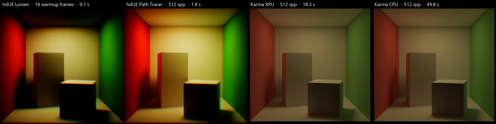

# Rendering reference

## Render settings

Renderer settings are `hdUE:*` attributes on the UsdRenderSettings prim (the **Unreal Engine** tab of Render Settings LOPs, or the hdUE Render Settings LOP, in Houdini; see [Houdini](houdini.md#solaris-viewport)). `hdue:*`, the spelling of hdUE's light and prim attributes, is accepted too. String settings accept `string` or `token` (Houdini's menus author tokens), numbers accept any numeric type. Houdini's viewport and husk read the same prim, so they render the same settings.

| Setting | Default | Meaning |
| --- | --- | --- |
| `hdUE:renderMode` | `realtime` | `realtime` (Lumen) or `pathtraced` |
| `hdUE:samplesPerPixel` | 64 | Path Tracer samples |
| `hdUE:lumenEnabled` | 1 | Lumen GI and reflections in realtime mode |
| `hdUE:warmupFrames` | 32 | Realtime frames before a frame counts as converged (Movie Render Queue's default render warm-up count) |
| `hdUE:motionBlur` | 1 | Motion blur when the camera shutter is open and something moves |
| `hdUE:motionSamples` | 16 | Motion-blur sub-frames; Path Tracer samples are divided between them |
| `hdUE:denoiser` | `off` | `oidn` denoises the converged Path Tracer image with Open Image Denoise (Houdini build) |
| `hdUE:debugView` | `off` | One of UE's viewport view modes instead of the realtime beauty; see [debug views](#debug-views) |
| `hdUE:subdivisionLevel` | 2 | Uniform refinement of catmullClark and loop meshes; see [subdivision](#subdivision-surfaces) |
| `hdUE:cullBackface` | 1 | Meshes whose `doubleSided` is off render their front faces only, as UE's USD importer does; 0 renders both sides, as Karma; see [geometry](#geometry) |
| `hdUE:tonemapper` | 0 | Run UE's tonemapper and the effects inside it; see [post-processing](#unreal-post-processing) |
| `hdUE:postProcess:<Property>` | | Any `FPostProcessSettings` property, for the beauty; see [post-processing](#unreal-post-processing) |
| `hdUE:cvar:<console variable>` | | A UE console variable, with `:` for `.` (`int hdUE:cvar:r:Shadow:Virtual:Enable = 0`); see [engine quality](#engine-quality) |
| `hdUE:postProcessMaterials` | | Cooked post-process materials added to the beauty |
| `hdUE:domeResolution` | 512 | Environment cubemap face size |
| `hdUE:autoViewerLight`, `hdUE:viewerLightIntensity` | | Review light for scenes without lights |
| `hdUE:upAxis` | stage | Up axis override |
| `hdUE:materialxLibrary`, `hdUE:substrateLibrary` | runtime profile | Cooked MaterialX and prepared Substrate libraries (`library.json`). Applied in Houdini's viewport; husk keeps the Preview Surface fallback and warns |
| `hdUE:viewportIdAovs` | 1 | Houdini's viewport renders the `primId`/`instanceId` AOVs for its selection highlight once the view settles (skipped while tumbling, scrubbing or playing); 0 never renders them (no highlight) |

In Houdini's viewport, `houdini:interactive` (tumbling, scrubbing, playing) caps Path Tracer samples at 8 and skips the AOV passes; the full image renders once the viewport is still. Flipbooks render in full.

## AOVs

A render var selects an AOV by its `sourceName` (`raw`), or by its light path expression (`lpe`): Karma's names and expressions for the same output select the same AOV. The table is data in the delegate (`src/hydra/aov_table.h`), which the hdUE Standard Render Vars and hdUE Render Settings assets read. Every output comes from something UE 5.8 already provides:

- **Buffer visualizations** (`[Engine.BufferVisualizationMaterials]`, UE's Buffer Visualization view mode): all the frame's buffer AOVs render in **one** raster pass after the beauty converges, read back through Movie Render Queue's buffer visualization pipes (`FinalPostProcessSettings.BufferVisualizationPipes`, as `MoviePipelineDeferredPasses` does), from the beauty's camera without Lumen, anti-aliasing or post effects.
- **The Path Tracer's own albedo and normal**, which it accumulates for denoisers and hands post-process materials (`PathTracingBufferTexture`): read back from the converged beauty, at no extra cost.
- **Lighting components**: the Path Tracer's Lighting Components post-process settings (`PathTracingIncludeDiffuse`, `IndirectDiffuse`, `Specular`, `IndirectSpecular`, `Emissive`, `Volume`, `IndirectVolume`), which MRQ's render layers use; in realtime, the Diffuse, Specular, Direct Lighting and Global Illumination show flags of UE's Lighting Components menu. Each is a full render of the beauty (its mode, samples, warmup, Lumen and exposure): UE has no light path expressions, so components do not come out of one render.
- **Cryptomatte**: MRQ's Object ID pass recipe (MurmurHash3 ids, sub-pixel spatial samples, `cryptomatte/<key>/*` metadata); see [Houdini, Cryptomatte](houdini.md#cryptomatte).

| Render var (`sourceName`) | Karma name / LPE | Data type | UE source | Realtime | Path traced |
| --- | --- | --- | --- | --- | --- |
| `albedo` (`baseColor`) | `CDA` | color3f | `BaseColor` buffer; path traced, the Path Tracer's albedo (diffuse and specular reflectance, followed through mirrors and glass) | yes | yes |
| `normal` | `N` (`ray:hitN`) | normal3f | `WorldNormal` buffer; path traced, the Path Tracer's normal | yes | yes |
| `roughness`, `metallic`, `specular`, `occlusion` | | float | `Roughness`, `Metallic`, `Specular`, `MaterialAO` buffers | yes | yes |
| `ambientOcclusion` | `AO` | float | `AmbientOcclusion` buffer (screen-space AO of the raster pass) | yes | yes |
| `opacity` | | float | `Opacity` buffer (UE's GBuffer custom data: subsurface and foliage opacity, 0 for other surfaces) | yes | yes |
| `subsurfaceColor` | | color3f | `SubsurfaceColor` buffer | yes | yes |
| `anisotropy` | | float | `Anisotropy` buffer | yes | yes |
| `tangent` | | normal3f | `WorldTangent` buffer, USD axes | yes | yes |
| `shadingModel` | | color3f | `ShadingModel` buffer (the colour code of UE's Shading Model view) | yes | yes |
| `customDepth`, `customStencil` | | float | `CustomDepthWorldUnits`, `CustomStencil` buffers; hdUE meshes do not render custom depth, so far and 0 | yes | yes |
| `velocity` | | color3f | `Velocity` buffer (encoded, 0.5 still); the raster pass renders one time, so 0.5 | yes | yes |
| `combineddiffuse` (`diffuse`) | `C<RD>.*L` | color3f | Diffuse + Indirect Diffuse components | yes | yes |
| `directdiffuse` | `C<RD>L` | color3f | Diffuse component | yes | yes |
| `indirectdiffuse` | `C<RD>.+L` | color3f | Indirect Diffuse component (realtime: Lumen GI) | yes | yes |
| `combinedglossyreflection` (`glossy`) | `C<RG>.*L` | color3f | Specular + Indirect Specular components (UE's specular includes transmission) | yes | yes |
| `directglossyreflection` | `C<RG>L` | color3f | Specular component | yes | yes |
| `indirectglossyreflection` | `C<RG>.+L` | color3f | Indirect Specular component (realtime: Lumen reflections) | yes | yes |
| `directemission` (`emission`) | `CO` | color3f | Emissive component | yes | yes |
| `combinedvolume`, `directvolume`, `indirectvolume` (`volume`) | `CV.*L`, `CVL`, `CV.+L` | color3f | Volume and Indirect Volume components | warned, cleared | yes |
| `primId`, `instanceId` | | int | hdUE's unlit ID passes | yes | yes |
| `CryptoObject<NN>`, `CryptoMaterial<NN>` | | float4 | 16 sub-pixel ID passes (Cryptomatte) | yes | yes |
| `depth`, `cameraDepth` | | float | the beauty's scene depth | yes | yes |

Costs per frame: the buffer AOVs together, one short raster render; each lighting component, one more full render of the beauty; each ID AOV one short raster render, Cryptomatte 16; path-traced albedo and normal nothing. Realtime components are approximations: emission stays in every component (alone it is the image with diffuse and specular off) and volumes are not split. A motion-blurred Path Tracer beauty gives raster albedo and normal (its sub-frames each show another pose); lighting components render without motion blur. Other render vars (other light path expressions, primvars, unknown names) and AOVs a mode cannot produce receive their clear value, with one warning each.

UE buffer visualizations hdUE does not offer: `SceneColor`, `PreTonemapHDRColor`, `PostTonemapHDRColor`, `FinalImage`, `SeparateTranslucencyRGB`/`A` (states of the beauty, which is `C`; in the raster pass they would show its unlit image) and `SceneDepth`/`SceneDepthWorldUnits` (`depth` is the beauty's, in scene units).

## Geometry

Generic Hydra translation supports meshes, cameras, materials, and distant, sphere, rect, disk, cylinder, and dome lights.

Meshes reach UE indexed: the triangle corners of a point share one vertex unless a face-varying normal, UV, color or wet mask differs between them, so UE holds about as many vertices as the USD mesh has points. A mesh UE cannot take (more than about 715 million vertices, or broken indices) is skipped with a warning naming it in the UE log; the rest of the scene still loads.

Material-binding GeomSubsets partition triangles by their original USD face while preserving UVs, normals, transforms, visibility, and picking paths. Unassigned faces retain the mesh material; overlapping or invalid material subsets are rejected. Subset edits and removals update the generated meshes.

Meshes follow USD's `doubleSided`, as UE's USD importer does: single-sided meshes draw a one-sided twin of their material and cull their back faces. `hdUE:cullBackface = 0` renders every mesh on both sides, as Karma does (its `karma:object:cull_backface` defaults to off). Karma's per-object `karma:object:cull_backface` primvar is not read; `doubleSided` is the per-mesh switch.

Missing or zero normals are generated from area-weighted vertex adjacency before subset partitioning, so material boundaries share the same shading normals. Authored normals are retained. Author explicit face-varying normals or split vertices where hard edges are required; normal generation does not apply subdivision creases.

Hydra instancers (USD PointInstancers, including nested ones) are translated: each prototype mesh is built once as a runtime static mesh, or uses its native cooked asset, and drawn through one instanced static mesh component with per-instance transforms composed as in hdEmbree. Preview Surface and ID materials are cooked with instanced-static-mesh usage; prepared MaterialX or Substrate materials need that usage too before they render on instances. Instanceable references (USD native instancing) reach the delegate as Hydra instancers too, in Solaris as elsewhere. Instances hidden by `invisibleIds` or deactivated by `inactiveIds` are not drawn (Hydra leaves them out of the instance indices), `orientations` (half) and `orientationsf` (float) are normalized as `UsdGeomPointInstancer` does, an instance-rate primvar that a bound Preview Surface's base colour reads through a primvar reader colours each instance (as an unbound prototype's `displayColor` does), and volumes under an instancer are drawn once per instance (sharing one density grid on the Hydra side). UE instances are `FTransform`s, which hold no shear: a rotated prototype under a non-uniform instance scale renders without its shear, with a warning.

Implicit Cube, Sphere, Cone, Cylinder, Capsule and Plane prims are converted to meshes by Hydra's implicit-surface scene index (`HdUE_ImplicitSurfaceSceneIndexPlugin`), as for hdEmbree.

Points render as one shared sphere instanced per point, sized by `widths` (0.1 when unauthored). BasisCurves render as six-sided tubes with flat end caps on open curves: linear curves follow their vertices, cubic Bezier, B-spline and Catmull-Rom curves are evaluated in their basis, and `widths` set the diameter (0.01 when unauthored). Points and curves under a PointInstancer are drawn once per instance.

Mesh UVs come from the primvar that the bound material's `UsdPrimvarReader_float2` reads (`varname`, such as `st`, or `map1` from 3ds Max exports), or from `st` when the material names none. Each texture reads the UV set its own `st` input names (also through a `UsdTransform2d`): the mesh carries every UV primvar its material reads, up to four, chosen through its own binding (else its first bound GeomSubset's). The UV transform is still one per material, from the first textured input.

Unbound geometry uses `displayColor`/`displayOpacity`. A `displayColor` that varies (uniform, vertex or face-varying on meshes, per point on Points, per vertex or per curve on BasisCurves, per instance on a PointInstancer, from the nearest of nested instancers that authors it) is multiplied into `M_PreviewSurface` as vertex colors or per-instance custom data. Dynamic mesh vertex colors are stored in 8 bits, so very dark colors band slightly. Varying `displayOpacity`, and colors on meshes that also carry a wet-surface mask (the mask reuses the vertex colors), are not translated. The unbound default is a Preview Surface (roughness 0.5) whose base colour is `displayColor`, as UE's USD importer draws unbound prims (its `DisplayColor` reference material feeds the vertex colour straight into Base Color).

## Preview Surface inputs

Every `UsdPreviewSurface` input is translated, as a constant or a `UsdUVTexture` (with `scale`, `bias`, a single-channel output and the first `UsdTransform2d`):

| Input | In UE |
| --- | --- |
| `diffuseColor`, `emissiveColor` | Base colour and emission |
| `metallic`, `roughness` | Metalness workflow |
| `ior` | Dielectric reflectance, F0 = ((ior - 1) / (ior + 1))² |
| `useSpecularWorkflow`, `specularColor` | Specular workflow: diffuse and F0 straight from `diffuseColor` and `specularColor` |
| `clearcoat`, `clearcoatRoughness` | A white coat layered over the base (the layered Standard Surface parent, coat IOR 1.5), only on materials with `clearcoat` above 0. With `useSpecularWorkflow` or partial opacity it stays a second specular lobe on the base (Substrate haziness) |
| `opacity`, `opacityThreshold` | See-through (translucent) or cutout (masked). `opacityMode` is not read: partial opacity is presence (it scales specular and emission too), so thin glass loses part of its Fresnel reflections (rims at 0.8 × Karma, which keeps them in both modes) |
| `normal` | Tangent-space normal map (USD's +Y up) |
| `occlusion` | Ambient occlusion |
| `displacement` | Moves the mesh's vertices along the normal (see [Displacement](#displacement)) |

`UsdUVTexture` `wrapS`/`wrapT` (MaterialX `uaddressmode`/`vaddressmode`) are honoured: `repeat`, `clamp`, `mirror`, and `black`, which clamps and reads the input's `bias` outside [0, 1]. `useMetadata`, the default, does not read the file's wrap metadata and falls back to `black`, as the spec says for files without it (Karma does the same). `sourceColorSpace` (or the file's `colorSpace` metadata) decides whether 8-bit texels are sRGB-decoded: `raw` and linear spaces read linear, `sRGB` decodes, `auto` decodes colour inputs only.

## MaterialX surfaces

hdUE asks Hydra for the `mtlx` render context before the universal one, so a material with a MaterialX surface output renders from its MaterialX graph, and one with only `outputs:surface` from its UsdPreviewSurface. MaterialX graphs are read directly at render time, with no preparation, cook or shader compile; the [prepared MaterialX library](materials.md#materialx-and-substrate) still takes precedence for materials it maps, and stays the route for graphs this mapping cannot express.

Surfaces: `ND_standard_surface_surfaceshader`, `ND_open_pbr_surface_surfaceshader` and `ND_UsdPreviewSurface_surfaceshader` (read like `UsdPreviewSurface`). Each input is a constant, or an image reached through these nodes:

| Node | Translation |
| --- | --- |
| `ND_image_*`, `ND_tiledimage_*` (`uvtiling`, `uvoffset`), `UsdUVTexture` | The texture, with its `colorspace` / `sourceColorSpace` and address modes, as for Preview Surface |
| `ND_geompropvalue_vector2`, `UsdPrimvarReader_float2` | Selects the texture's UV set (`geomprop` / `varname`, such as `map1`) |
| `ND_extract_*` | Selects a channel (alpha cutouts: `ND_image_color4` → `ND_extract_color4` index 3) |
| `ND_convert_*`, `ND_dot_*` | Passed through |
| `ND_normalmap*` | Tangent-space decode, with its `scale` on XY |
| `ND_multiply_*` by a constant | Scales the texture or constant |
| `ND_constant_*` | Its value |

Any other node (`ND_mix_*`, `ND_place2d_*`, procedurals, ...) leaves the input at its constant and is reported once as a warning; the material still renders. Textured weights (`base`, `sheen`, `subsurface`, ...) also use their constant.

| standard_surface (OpenPBR) | In UE |
| --- | --- |
| `base` × `base_color` (`base_weight` × `base_color`) | Base colour |
| `metalness` (`base_metalness`), `specular_roughness`, `specular_IOR` (`specular_ior`) | As Preview Surface `metallic`, `roughness`, `ior` |
| `specular` × `specular_color` | Specular tint (layered parents) |
| `coat` (`coat_weight`), `coat_roughness`, `coat_color` | Clear coat; `coat_color` tints it on the layered parents only |
| `sheen`, `sheen_color`, `sheen_roughness` (`fuzz_*`) | Substrate fuzz |
| `subsurface`, `subsurface_color`, `subsurface_radius` × `subsurface_scale` (`subsurface_weight`, `subsurface_color`, `subsurface_radius_scale` × `subsurface_radius`) | Substrate subsurface scattering, mean free path in scene units |
| `thin_walled` (`geometry_thin_walled`) | Thin two-sided shell that transmits its subsurface colour (cloth, leaves) |
| `emission` × `emission_color` (`emission_luminance` × `emission_color`) | Emission (OpenPBR's luminance is used as a plain weight) |
| `opacity` (`geometry_opacity`) | As UE's Interchange imports MaterialX: an image, or a constant below 1, is a cutout (masked) at UMaterial's default clip value 0.3333; a standard_surface with `transmission` is see-through instead (OpenPBR's `geometry_opacity` stays the cutout). The MaterialX spec, and Karma, render opacity as fractional coverage with no threshold, so moving a scene between them calls for material adjustments: Lumen reads the cutout from mipmaps, where thin foliage averages below the clip and would thin with distance. hdUE therefore scales the mips of every texture that drives a cutout (MaterialX opacity, UsdPreviewSurface with `opacityThreshold`) to keep its alpha coverage at the clip value, as UE's "scale mips for alpha coverage" texture setting does, with three fixes to UE's algorithm (`ComputeAlphaScale` in `TextureCompressorModule.cpp`): each level's scale is measured on that level rather than the previous one, the closest tested scale is kept rather than an untested midpoint, and a level is only ever scaled up. A 9x-distant thin-branch card keeps 0.42 of its near coverage (plain mips 0.05, UE's version less than plain); the Path Tracer reads the top mip and is unaffected |
| `transmission` (`transmission_weight`) | Approximated as see-through coverage, opacity × (1 − transmission); no refraction. Ignored with an OpenPBR `geometry_opacity` cutout |
| `normal` (`geometry_normal`) | Tangent-space normal map |

Materials with `subsurface`, `sheen` or a clear coat above 0 render with the layered Standard Surface parents: UE's own `Substrate-StandardSurface-Opaque` material function (the one UE's Interchange uses for MaterialX), fed the same texture slots, in four cooked variants (opaque or masked, solid or thin-walled; `thin_walled` is a static input of the function). Everything else, including standard_surface materials without subsurface, sheen or coat, uses the single-slab Preview Surface parents. The layered function mixes metal and dielectric slabs and layers coat and sheen vertically, so it costs several Substrate closures per pixel where Preview Surface costs one; keeping it to the materials that need it bounds that cost. In the Sponza gallery shot (960 x 540, Lumen, curtains covering about half the frame), the layered curtains cost about 1 to 2 ms per frame over the same curtains on Preview Surface (husk, 1500 realtime frames, measured twice).

Limits: `subsurface_color` and `sheen_color` follow an image only when it is `base_color`'s (the usual authoring; their tint is kept), else they use their constant. Subsurface uses Substrate's per-material mean free path; UE subsurface profiles are not created at runtime. One UV transform per material, from the first textured input. `diffuse_roughness`, anisotropy, thin film, `coat_IOR`, `coat_normal`, `transmission_*` colours and dispersion are not translated. Transmissive materials, see-through materials and translucent sorting follow the Preview Surface translucent parent, which has no subsurface or sheen.

## Colour management (OCIO, ACES)

UE renders in linear Rec.709. In the Houdini build, hdUE converts at its boundaries with the OpenColorIO configuration Houdini uses (`$OCIO`):

- The beauty is published in the config's `scene_linear` role. With an ACES pipeline whose `scene_linear` is ACEScg, renders come out in ACEScg, as Karma's do. Houdini 22's default config uses linear Rec.709 for `scene_linear`, so nothing is converted there.
- Authored colours (Preview Surface diffuse and emissive colours, `displayColor`, light colours) are read as `scene_linear` values and converted to linear Rec.709 for UE.
- With UE's tonemapper on, the beauty is display-linear Rec.709 (see [post-processing](#unreal-post-processing)). It is still converted to `scene_linear`'s primaries, a matrix with no tone curve, so an un-tone-mapped view shows UE's image in any config; skipping the conversion would shift hues under an ACEScg `scene_linear`. ACES or AgX views tone-map it a second time, and hdUE warns once. It stays in the `color` AOV: a separate tone-mapped AOV would need a second, untone-mapped render of every frame.
- `HDUE_COLOR_MANAGEMENT=0` turns the conversion off.

- Colour textures (base colour, emissive, specular colour) are converted from their authored colour space: MaterialX `colorspace` (`acescg`, `lin_rec709`, `srgb_texture`, ...) or the file's `colorSpace` metadata, resolved by name through the OCIO config. Float images (EXR, HDR) with none, or `auto`, are read as `scene_linear`. Conversions run once through OCIO, into a cache under the temp folder (`hdue_ocio`), keyed by path, file time and colour space, whose entries unused for a week are removed; a name the config does not know is warned about once and used as is.

`raw` and sRGB-encoded spaces (`sRGB`, `srgb_texture`) are not converted: UE decodes sRGB 8-bit texels to linear Rec.709 itself. An 8-bit image in a linear space other than Rec.709 (`acescg`) is converted to a half-float copy. Measured: an ACEScg EXR on a MaterialX image renders at 1.03 × Karma. Karma ignores `colorSpace` metadata on a `UsdUVTexture` file; hdUE converts it.

## Alpha

The beauty carries straight alpha: 1 where geometry covers the pixel, 0 where the camera sees no geometry, fractional on anti-aliased edges and see-through surfaces. hdUE turns on UE's `r.PostProcessing.PropagateAlpha` at startup and converts UE's inverted coverage to straight alpha. A dome light hidden from camera rays (`hdue:visibleBackground = 0`) leaves alpha 0 behind it.

## Displacement

The Preview Surface `displacement` input and MaterialX `ND_displacement_float` (`displacement` × `scale`) move the mesh's points along their normals by that distance, in the mesh's object space and units, before the mesh is uploaded, so Lumen, the Path Tracer and Nanite see the same surface. A textured displacement first dices the mesh uniformly: each triangle splits into four per level, up to about one triangle per two texels and at most about a million triangles per mesh. Normals are then recomputed from the displaced surface; a UV seam splits the surface only where the texture differs across it, and hard edges open. A constant displacement moves the points without dicing. Meshes with wet-surface effects are not displaced. Displacement is not adaptive (Karma dices by screen size). UE's Nanite tessellation and World Position Offset are not used: UE 5.8's ray-traced geometry, which the Path Tracer renders, ignores both. MaterialX vector displacement is not translated.

## Nanite

Meshes from the native asset catalog render with Nanite when their cooked asset has Nanite data (`hdUE:requireNanite` enforces it). Static meshes hdUE builds from Hydra, and instancer prototypes, become Nanite meshes too. Batch renders (husk) build Nanite data and Lumen cards before the first frame; interactive hosts (Houdini's viewport, which start UE with `HDUE_INIT_INTERACTIVE`) first draw regular static meshes, build both on worker threads, then swap each mesh, one per frame. Every Nanite page stays resident in memory, since UE streams the other pages only from cooked files. Animated or edited meshes stay dynamic. `HDUE_NANITE=0` turns Nanite off.

## Debug views

`hdUE:debugView` (**Debug View** under Rendering, in the viewport's display options and on Render Settings LOPs) replaces the realtime beauty with one of the view modes of UE's viewport **View Mode** menu, set the way UE's game viewport sets them (view mode show flags, the view's visualization name and material overrides). Values are `<mode>` or `<mode>:<visualization>`, with the names UE's `r.*.Visualize` console variables take:

| Value | Shows |
| --- | --- |
| `off` | the lit image (default) |
| `unlit`, `lightingOnly`, `detailLighting`, `reflections` | UE's Unlit, Lighting Only, Detail Lighting and Reflections modes |
| `lightComplexity` | lights affecting each pixel |
| `buffer:BaseColor`, `Metallic`, `Roughness`, `Specular`, `WorldNormal`, `SceneDepth`, `ShadingModel` (any `[Engine.BufferVisualizationMaterials]` entry) | a GBuffer channel |
| `nanite:Mask`, `Triangles`, `Clusters`, `Primitives`, `Instances`, `Overdraw` (any Nanite visualization) | Nanite data; only Nanite meshes show (the viewport's converted meshes and native Nanite assets, not husk's) |
| `lumen:Overview`, `LumenScene`, `SurfaceCache`, `GeometryNormals`, `ReflectionView` | Lumen's scene and surface cache |
| `vsm:mip`, `vpage`, `cache` (any Virtual Shadow Map visualization) | Virtual Shadow Map pages |

Buffer views are linear data, like AOVs. The other views are drawn for display through UE's tonemapper, as with `hdUE:tonemapper` (set the viewport colour correction to raw to see them as UE does); lighting views take the camera exposure before it. Debug views apply to the realtime beauty only: AOVs and Path Tracer renders are unchanged.

Not offered, because this runtime is a cooked non-editor build: Wireframe (UE composites it in the editor-primitives pass, compiled into editor builds only), Shader Complexity, Quad Overdraw, LOD coloration and the other material debug modes (their shaders are cooked only with `r.ForceDebugViewModes=1`, for every material), and the Lightmap modes (no static lighting). Cooked runtimes also leave UE's buffer visualization data uninitialized, so hdUE blends the buffer materials (`/Engine/BufferVisualization`, cooked through `DirectoriesToAlwaysCook`) as post-process materials itself.

## Denoising

With `hdUE:denoiser = "oidn"` (the **Denoiser** menu on Render Settings LOPs), the Houdini build denoises the converged Path Tracer beauty with the Open Image Denoise 2.3 library Houdini ships for Karma, on the GPU through CUDA when available, else on the CPU. Its guides are the Path Tracer's own albedo and normal buffers (the `albedo` and `normal` AOVs, read internally when they are not bound; see [AOVs](#aovs)), so edges and textures stay sharp; the frame counts as converged only once the denoised image is published, so husk writes the denoised beauty. Other AOVs are not denoised, Lumen is unaffected, and progressive viewport updates stay noisy until the image converges. The standalone OpenUSD build has no denoiser. On the Cornell box at 32 samples, denoising cut the noise on a flat wall from 0.0071 to 0.0031 (standard deviation) with the mean brightness unchanged.

UE's own path-tracer denoiser plugins were not usable here: in UE 5.8.4 the OptiX plugin only writes a 384 x 384 tile of larger frames, and its Open Image Denoise plugin left the image unchanged.

## Subdivision surfaces

Meshes whose `subdivisionScheme` is `catmullClark` (USD's default) or `loop` are refined uniformly with OpenSubdiv to `hdUE:subdivisionLevel` levels, with their creases, corners and holes. Vertex, varying, face-varying and uniform primvars (`st`, `displayColor`, `velocities`, time-sampled `points`) follow the refined surface, and GeomSubsets keep their faces. Authored normals are ignored, as USD specifies for subdivision surfaces; normals come from the refined surface. `bilinear` and `none` render the mesh as authored.

Each level multiplies the face count by four. Level 3 matches Karma's surfaces closely on a cube; the default 2 still shows facets on close silhouettes. There is no adaptive or screen-space refinement; a displaced subdivision mesh is diced further (see [Displacement](#displacement)). Wet-surface masks are not translated on subdivided meshes.

## Cameras

Cameras use Hydra's projection as is, so the conformed window, aperture offsets (lens shift) and orthographic projection match Karma; orthographic depth spans the camera's clipping range.

Framing is honoured: UE renders exactly the data window into the render buffer, with the projection remapped to it (Hydra's `CameraUtilFraming`, or under husk the render settings' `resolution`, `dataWindowNDC`, `pixelAspectRatio` and `aspectRatioConformPolicy`). Crops, husk tiles, overscan and non-square pixels therefore match Karma, and depth, AOVs and IDs follow the same window. Render buffers are limited to 8192 pixels per axis; render larger images in husk tiles (`--tile-count`), each within the limit. Realtime effects that work in screen space (Lumen screen traces, bloom, temporal anti-aliasing) only see the data window, so tile edges can differ slightly from a full frame; the Path Tracer does not.

The camera's near clip applies in both modes; its far clip does not: UE's views keep an infinite far plane (a finite reversed-Z far plane changed Lumen's lighting by 8% on Cornell with nothing beyond it), and UE's Path Tracer starts primary rays with an unbounded `TMax` (`PathTracing.usf`).

`fStop` and `focusDistance` drive UE's physical depth of field; the render settings' `disableDepthOfField` turns it off. `disableMotionBlur` (and the deprecated `instantaneousShutter`) turn motion blur off, and `includedPurposes` narrows the purposes husk renders (its `--purpose`). Final renders resolve material bindings for the first of the render settings' `materialBindingPurposes`, else `full`, then allPurpose. In husk, hdUE's warnings print as `hdUE warning:` lines, once each. Lens attributes follow USD's convention of tenths of a scene unit, as Hydra and Karma read them (a `focalLength` of 35 in a metres stage is a 3.5 m lens). The Path Tracer ray-traces the thin lens (reference DOF); realtime uses UE's post-process DOF, which approximates it and clamps very large blur.

The camera's `exposure` (Hydra's linear exposure scale) scales the beauty, as Karma does, and leaves AOVs untouched; with UE's tonemapper on it is added to `AutoExposureBias` instead. Split diopters and lens distortion are not translated.

## Motion blur

With the render camera's `shutter:open` before `shutter:close` and something moving, hdUE averages `hdUE:motionSamples` sub-frames spread over the shutter. Moving means:

- transform samples on meshes, curves, points and their ancestors;
- PointInstancer transform samples, and per-instance `velocities` and `accelerations` (a nested instancer's add its parent instance's);
- per-point `velocities` on Points;
- deforming meshes: time-sampled `points` with a constant point count, else per-point `velocities` (Houdini's `v`);
- camera transform samples.

`velocities` are in units per second, converted with `houdini:fps` when husk provides it, else `hdUE:framesPerSecond` (24). Matrices are interpolated linearly between samples, so fast rotations shorten slightly within a frame. Deforming meshes are uploaded again for each sub-frame, which costs time on dense meshes. `angularVelocities` and time-sampled instance `positions`/`orientations` without `velocities` are not blurred. Lumen keeps its history between sub-frames, so the realtime warmup and the Path Tracer samples are divided between sub-frames and the total stays about the same. Too few sub-frames show discrete copies of fast objects.

## Unreal post-processing

By default the beauty is linear scene-referred HDR, like Karma's, so colour management and compositing work as usual. UE's post-processing can be applied on top:

- `hdUE:postProcess:<Property>` sets any [`FPostProcessSettings`](https://dev.epicgames.com/documentation/en-us/unreal-engine/API/Runtime/Engine/Engine/FPostProcessSettings) property by name, and its override flag: `float hdUE:postProcess:BloomIntensity = 2`, `float4 hdUE:postProcess:ColorSaturation = (0, 0, 0, 1)`. Numbers, booleans, enum names, object paths and tuples (filling a struct's fields in order) are accepted. Unknown names or values are skipped with a warning in the UE log (`HdUEBackend\Saved\Logs`).
- `hdUE:postProcessMaterials` lists cooked post-process material paths (a string array, or one string separated by spaces), added as blendables.
- `hdUE:tonemapper` runs UE's tonemapper. Bloom, colour grading (saturation, contrast, gamma, gain, offset, white balance, LUTs), the film curve, vignette, grain, chromatic aberration and lens flares only happen inside it, so they need it on. UE's on-screen warnings are never drawn into hdUE frames.

With the tonemapper on, the beauty is UE's tone-mapped image as display-linear Rec.709: the film curve's output before UE encodes it for an sRGB monitor, as UE writes float back buffers and Movie Render Queue renders (`SCS_FinalToneCurveHDR`). Houdini's default view (sRGB display, Un-tone-mapped) then shows exactly what UE shows on an sRGB monitor, in the viewport and in husk's EXR. Keep that view: Raw shows it too dark, and the ACES views tone map it a second time. It does not match Karma, which does not tone map. Grey ramp at exposure 1, beauty value: 0.0625 gives 0.037, 0.18 gives 0.18, 1 gives 0.72, 4 gives 0.94.

UE's film curve keeps middle grey (0.18) and compresses the rest: shadows more than an sRGB view of the linear image does (0.03 becomes 0.011), highlights roll off to white. A scene whose important parts sit far below middle grey, like Sponza's interior at its authored exposure, therefore looks darker with the tonemapper than without, as it would in UE at that exposure; raise `AutoExposureBias` or the camera exposure.

Exposure stays manual unless authored: exposure 1 times 2^`AutoExposureBias` (hdUE's default 0), plus the USD camera exposure in stops, so the tonemapper keeps the linear image's middle grey and frames are deterministic. UE's physical-camera exposure (ISO, shutter, aperture) stays off unless `AutoExposureApplyPhysicalCameraExposure` is set. `AutoExposureMethod` `AEM_Histogram` or `AEM_Basic` turns on UE's auto exposure with UE's defaults (legacy luminance range: `AutoExposureMinBrightness` 0.03, `AutoExposureMaxBrightness` 8); the camera exposure still adds to the bias, so lower it for scenes exposed for Karma. Auto exposure reaches its target in every frame, so husk's warmup frames settle on it; set `AutoExposureSpeedUp` or `AutoExposureSpeedDown` to have the realtime viewport adapt gradually, as in UE (husk and Path Tracer renders always use the target). Auto exposure is not frame-exact: two identical Sponza renders differed by about 7%, and each frame of a sequence is exposed on its own. On Sponza, UE's default auto exposure (Histogram, bias 1) lands about 0.6 stops above the camera's authored exposure.

Depth of field, post-process materials with a "Before Tonemapping" blendable location, and the other settings apply with the tonemapper off too. Post-processing applies to the beauty only; AOVs stay raw. Changing a post-process setting restarts Path Tracer accumulation.

The render settings LOP lists every user-facing `FPostProcessSettings` property (212) in UE's own categories, names, ranges, tooltips and defaults, sorted into its tabs: Camera and Depth of Field under Camera Effects; Bloom, Exposure, Chromatic Aberration, Dirt Mask, Local Exposure, Lens Flares, Image Effects, Color Grading, Film and Film Grain under Post-Processing, since they need the tonemapper (and are disabled while it is off); Global Illumination (Lumen), Reflections and Rendering Features (ambient occlusion, motion blur, translucency, ...) under Lighting; Path Tracing under Rendering. Defaults are UE's, except where hdUE sets its own per view (shown in the tooltips): manual exposure, Lumen GI and reflections from `hdUE:lumenEnabled`, front-layer translucency reflections on, auto exposure reaching its target every frame unless a speed is set and depth of field from the USD camera. `scripts/generate_render_settings.py` generates them from the engine source. It leaves out: `WeightedBlendables` (use `hdUE:postProcessMaterials`), `PathTracingSamplesPerPixel` (use `hdUE:samplesPerPixel`), `PathTracingEnableDenoiser` (the runtime has no UE denoiser plugin; use `hdUE:denoiser`), the mobile depth of field, and the fixed-size arrays `LensFlareTints` and `DepthOfFieldMatteBoxFlags`. Curve properties take a cooked asset path.

Texture properties (Ambient Cubemap, Exposure Metering Mask, convolution bloom Kernel, Dirt Mask Texture, Color Grading LUT, Lens Flare BokehShape, Vignette Texture, Film Grain Texture) take a cooked texture path (`/Game/...`, `/Engine/...`) or an image file (exr, hdr, png, jpg, tif, tga, bmp), which the LOP shows with a file chooser and authors as a USD asset path, so a relative path resolves against its layer: `asset hdUE:postProcess:BloomDirtMask = @textures/dirt.png@`. The backend imports a file at render time as UE's texture defaults would: 8-bit files sRGB, float files linear, unfiltered mips; the Color Grading LUT is UE's 256 x 16 strip of 16 slices, read edge to edge (red across a slice, green down, blue across the slices); film grain tiles, the others clamp. Ambient Cubemap takes a lat-long panorama, made a cubemap as UE's texture build makes one (box-filtered mips rather than UE's angular filter); its import is verified, but UE's ambient cubemap composite has shown no visible effect in hdUE's renders so far. A file is imported again only when its modification time or size changes, so editing the image updates the render and unchanged files cost nothing per frame; a file that cannot be read is skipped with a warning in the UE log. [render_settings/postprocess_texture_file](../samples/conformance/render_settings/postprocess_texture_file.usda) masks half the frame with a vignette texture from a PNG.

## Engine quality

`hdUE:cvar:<name>` sets a UE console variable for the process (`:` stands for `.`, which USD attribute names cannot hold); removing the attribute restores the value the variable had before. Booleans are written as 1 and 0. Read-only variables (`ECVF_ReadOnly`, such as `r.RayTracing`) cannot change at runtime and are skipped with a warning. The render settings LOP's **Engine Quality** tab, and the viewport's display options for the interactive ones, offer:

| Folder | Console variables |
| --- | --- |
| Scalability | `sg.*Quality` (Low to Cinematic): the levels of UE's scalability groups; Epic in the viewport, Cinematic in husk (see below) |
| Resolution and Anti-Aliasing | `r.AntiAliasingMethod` (None, FXAA, TAA, TSR), `r.ScreenPercentage` (realtime beauty), `r.HdUE.InteractiveResolution` and `r.HdUE.InteractiveScreenPercentage` (Houdini's viewport renders at 50% while moving) |
| Lumen | `r.Lumen.HardwareRayTracing`, `r.Lumen.Reflections.HardwareRayTracing`; quality and hit lighting are post-process properties (hdUE Render Settings: Hit Lighting, off by default as in UE, authors `LumenRayLightingMode`) |
| Shadows | `r.Shadow.Virtual.Enable` (on in this project, as in new UE projects; 0 falls back to cascaded shadow maps), resolution biases and soft-shadow rays, `r.Shadow.FilterMethod`, `r.RayTracing.Shadows` |
| Nanite, MegaLights, Ray Tracing | `r.Nanite`, `r.Nanite.MaxPixelsPerEdge`, `r.MegaLights.NumSamplesPerPixel`, `r.MegaLights.DefaultShadowMethod`, `r.RayTracing.Enable` |
| Path Tracer | `r.PathTracing.ApproximateCaustics`, `r.PathTracing.FilterWidth` |

Batch renders (husk, the USD Render ROP) apply an offline profile like Movie Render Queue's Game Overrides: Cinematic scalability (the screen percentage stays), all used textures fully streamed in before frames count (`r.Streaming.FullyLoadUsedTextures`, pending virtual-texture tiles loaded), `r.D3D12.GPUTimeout 0` so long Path Tracer dispatches are not reset by Windows, Lumen final gather, scene lighting and scene detail quality of at least 2 (ray lighting stays the project's surface cache, as neither Cinematic scalability nor Movie Render Queue changes it). Authored `hdUE:cvar:*` and `hdUE:postProcess:*` values win. The Houdini viewport keeps UE's interactive defaults.

Other console variables work as attributes too. `scripts/Test-RenderSettings.ps1 -RuntimeConfig <config>` renders with every generated setting at its default and fails if UE skipped one or if a console variable's generated default differs from UE's value.



## Lights and HDR environments

`DomeLight.inputs:texture:file` accepts HDR/EXR and ordinary image files. Environment maps use a latitude-longitude layout (`latlong` or `automatic`); images that are not 2:1 are stretched, as in Karma and Storm, with a warning in the UE log. Linear HDR values are retained during conversion to the SkyLight cubemap; unusually bright maps are scaled before half-float storage and rescaled for lighting and background drawing. HDR sources are interpreted in linear Rec.709/sRGB primaries; OCIO conversion and other environment layouts are not implemented.

The dome's full transform, color, intensity, exposure, color temperature, visibility, and deletion affect lighting, reflections, and the background in Lumen and Path Tracer. Mapping follows USD's local +Y pole and +Z longitude origin. `DomeLight_1.poleAxis` turns the dome alone, as UsdImaging's `domeOffset` gives it: `Z` (or `scene` on a Z-up stage) puts the pole on +Z and longitude zero on −Y. On a Z-up test stage, `Y`, `Z` and `scene` light a grey plane with the same hue as Karma in each case. Multiple domes are summed into one environment. `domeResolution` selects the cubemap face size (power of two from 32 to 2048). Decoded files are cached by path, size, and modification time and rechecked on submitted light updates. File changes alone do not trigger a viewport refresh. The Path Tracer waits for cubemap upload and SkyLight filtering before starting a new accumulation. The HDRI background is drawn right after the base pass, so heterogeneous volumes and translucent surfaces composite over it.

Local lights support temperature, exposure, normalization, shadows, diffuse/specular scales, source dimensions, and sphere-light cone angle/softness up to 90° (a UE spot light, as UE's USD import makes a sphere light with ShapingAPI; the default 90° cone is the lower hemisphere). Spots are capped at 88°: at UE's own 89° maximum, Lumen and the Path Tracer lit only part of the cone. Wider cones stay point lights. RectLight also accepts image emission. DiskLight uses a masked rectangular source, and CylinderLight uses a capsule source; these are approximations. Intensity is luminance in nits as UsdLux defines it: local lights use UE nits on their own emitting area, and DistantLight illuminance is intensity × π·sin²(angle∕2), or intensity in lux when normalized. With a fully rough bound Preview Surface under a normalized distant light, hdUE and Karma agree to 0.1%; glossier surfaces come out up to about 1.4x brighter in hdUE because UE's specular model differs from Karma's. RectLights are created without UE's barn doors, which UsdLux does not have.

On the Cornell box (see the [gallery](gallery.md)), the Path Tracer's brightness matches Karma's to 0.2% with the same sample count and bounce depth (Karma's diffuse limit defaults to 1 bounce; set `karma:object:diffuselimit` to compare). Lumen reaches about 0.7x there with UE's own offline settings (surface-cache ray lighting, 32 warmup frames): directly lit surfaces match, and the rest is indirect light after several bounces, which dominates a closed, diffuse room. Authoring `hdUE:postProcess:LumenRayLightingMode` = `HitLighting` raises it to about 0.8x.

The Path Tracer's `hdUE:postProcess:PathTracingMaxBounces` (UE's `PathTracingMaxBounces`, default 32; hdUE passes it through unchanged) counts the scattering events of a path, as UE defines it: its kernel runs once for the camera ray and once per bounce up to that number (`PathTracing.usf`, `for (Bounce = 0; Bounce <= MaxBounces; ...)`); each hit samples the lights, and the last ray only collects emission (`PathTracingCore.ush`). 0 shows only what the camera sees directly (emissive surfaces, and visible lights), so lit surfaces render black; 1 is direct light alone; N matches Karma with `karma:object:diffuselimit` N − 1. The one limit applies to every kind of bounce (diffuse, specular, refraction, volume), where Karma has a limit per kind. Measured on the Cornell box at 256 pixels and 64 samples, hdUE's mean brightness was 0.0000, 0.0314 and 0.0467 at 0, 1 and 2 bounces, and Karma CPU's 0.0325 and 0.0477 at diffuse limits 0 and 1. On a grey wall lit by a single RectLight, SphereLight, DiskLight or DistantLight, 0 bounces was black and 1 matched Karma's diffuse limit 0 at the wall's centre (to 0.3%; 3% for the masked DiskLight).

Light linking (`collection:lightLink`) uses UE's three lighting channels. Channels only restrict direct light: Lumen's indirect light still bounces a linked light onto every surface (the Path Tracer honours links exactly). Hydra's light-linking scene index (`HdUE_LightLinkingSceneIndexPlugin`) turns each collection into a category; each distinct lightLink collection gets a channel, lights whose collection includes everything keep every channel, and then channel 0 is shared by all objects so those lights still reach objects outside every collection. That leaves room for 3 collections without unlinked lights, or 2 with them; further linked lights light everything, with a warning. Dome lights become UE's sky light, which has no channels, so their lightLink is ignored with a warning. Shadow linking (`collection:shadowLink`): UE has no per-light shadow exclusion, so an object stops casting shadows only when it is outside the shadowLink of every shadow-casting light. A single light's exclusions are exact; with several lights an object excluded from only some of them still shadows all of them (warned once). Against Karma XPU on the Cornell box, two sphere lights linked to the tall and short box with the unlinked ceiling light dimmed gave a mean ratio of 0.983, and the ceiling light's shadowLink excluding the tall box gave 0.984 (0.909 before).

Portals, light filters (`light:filters`, warned once), `shadow:color` (UE shadows have no tint; warned once) and separate dome diffuse/specular scales are unsupported. PluginLight, MeshLight and PortalLight Sprims are accepted so Hydra does not drop them silently: each type is warned once and renders nothing.

IES profiles (`shaping:ies:file` on point, sphere, spot, rect and disk lights) are parsed with UE's runtime `IESFile` module and applied as the light's profile, oriented along the light's -Z as in Karma. UE normalizes a profile to its peak; hdUE multiplies the light by that peak in candela, as UsdLux scales light by the profile's values, so the Cornell IES variant matches Karma (1.01x). `shaping:ies:normalize` divides by the profile's mean over the sphere instead, keeping the unshaped light's power. `shaping:ies:angleScale` remaps the profile's vertical angle with the UsdLux formula while the profile texture is built (angles outside 0–180° clamp to the profile's ends). On the Cornell IES variant the hdUE/Karma mean ratio is 1.014 without a scale, 1.045 at 0.5 and 1.014 at 1.5; at −0.5 it is 1.57, where the profile is mapped onto the upper hemisphere and most of the sphere clamps to its peak; hdUE does not cut that light at the default 90° cone (see above). Results are the same on Y-up and Z-up stages. Dome diffuse/specular other than 1 are ignored with a warning (UE's sky light has one environment).

MegaLights is enabled by default for supported local lights in realtime rendering. Directional lights use the regular directional-light path. The Path Tracer uses its own lighting implementation. The render statistics report both project enablement and whether MegaLights actually ran for the delivered frame; supported D3D12 hardware and ray tracing remain required.

Per-light hdUE settings are `hdue:*` attributes on the light (the **Unreal Engine** tab of Light LOPs in Houdini):

| Attribute | Default | Meaning |
| --- | --- | --- |
| `hdue:visibleBackground` | 1 | DomeLight: draw the environment as the background. Off, it still lights the scene, and camera rays that escape see black (Karma's default for domes, `karma:light:renderlightgeo`) |
| `hdue:megaLights` | 1 | Realtime: shade this local light with MegaLights; off uses UE's regular deferred lighting |

A visible dome shows through any gap in the geometry. In Intel's Sponza, cracks around the far door and in a window grille let camera rays escape (Karma's alpha drops to 0.5-0.9 there): with the dome visible hdUE drew the sky in them, while Karma, whose dome is not visible by default, drew black. hdUE always writes alpha 1, so background pixels cannot be separated by alpha yet.

Optional camera-following review lights are used when there are no active supported scene lights. Authored lights, including DomeLight, take precedence.

The repository fixture contains a procedural HDRI, a textured rect light, disk, cylinder, spot, directional, and 24 sphere lights:

```powershell
.\scripts\Test-Hydra.ps1 -InputUsd samples/lighting/lighting.usda -LightingTest -Mode both
.\scripts\Launch-Houdini.ps1 -InputUsd samples/lighting/lighting.usda
```

## Volumes

Volumes (Houdini build) render the `density` field, or the first field, of a Volume prim as a UE heterogeneous volume with `M_HdUEVolume` (albedo 0.8; density is extinction per scene unit). The field can be:

- an `OpenVDBAsset` pointing to a `.vdb` file, read with OpenVDB;
- an unsaved SOP volume in the Solaris viewport: `OpenVDBAsset` or `HoudiniFieldAsset` prims whose `filePath` is an `op:` SOP layer. hdUE takes the cooked geometry from Houdini's locked-geometry registry, or cooks the SOP;
- a `.bgeo` / `.bgeo.sc` file, which is where the USD Render ROP writes native Houdini volumes for husk.

From Houdini geometry, the VDB or Houdini volume primitive named after `fieldName` is used, else the `fieldIndex`-th one. Grids are densified over their active bounding box and point-sampled with a stride above 512 voxels per axis. Volume materials, other fields, temperature/emission, tapered Houdini volumes and frustum VDBs are not translated.

Measured against Karma: in realtime, a fog's brightness is within about 15%, but volumes cast no shadow onto surfaces (enabling `r.HeterogeneousVolumes.Shadows` did not produce one in testing; the cause is not identified yet). The Path Tracer casts it (optical depth 1.4 against Karma's 1.9) and includes multiple scattering, but resamples volumes into a coarse grid, so their silhouettes are blocky.

## Opacity and glass

Generic `displayOpacity` maps to Substrate coverage. Constant values and identical values across another domain are supported; varying values are reduced with a warning. Opaque and translucent parents are selected accordingly.

Optical glass uses a local profile that selects meshes and supplies IOR, roughness, attenuation color/distance, thickness, and coverage. Optical properties are not inferred from display opacity. Realtime refraction uses a thickness approximation; the Path Tracer follows geometry and absorption. Profiles and scene-specific generators stay local and ignored.
