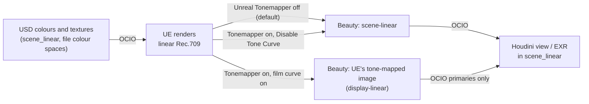

# Colour management (OCIO, ACES)

hdUE hands Houdini a scene-linear image in the colour space of your OpenColorIO config, as Karma does. Houdini's OCIO view then turns it into a picture for your monitor.

The same frame as a scene-linear beauty (Unreal Tonemapper off, the default) and as UE's tone-mapped image (on), both through an sRGB view.

## How the image flows

- **Colours you author** (Preview Surface diffuse and emissive colours, `displayColor`, light colours) are read as values in the config's `scene_linear` role.
- **UE renders** in linear Rec.709.
- **The beauty** comes back in the `scene_linear` role. With Houdini's default config that is linear Rec.709, so nothing is converted. With an ACES config whose `scene_linear` is ACEScg, the beauty is ACEScg.

hdUE uses the config Houdini uses (`$OCIO`). usdview and other hosts without OCIO get linear Rec.709.

!!! note "Unreal Engine departs here on purpose"
    UE's editor shows a display-ready image: tonemapper, auto exposure, bloom, vignette and grain on. hdUE keeps the Unreal Tonemapper off by default, so Houdini receives scene-linear values and applies its own OCIO view. Turn it on to get UE's look; see [Post-processing](post-processing.md).

## Viewing the beauty in Houdini

| Unreal Tonemapper | Config's default view | What the beauty holds | View it with |
|---|---|---|---|
| Off (default) | any | Scene-linear radiance | Any view: Un-tone-mapped, ACES, AgX |
| On | Un-tone-mapped (Houdini's default) | UE's tone-mapped image, display-linear Rec.709 | Un-tone-mapped (an sRGB encode). Not Raw: Raw shows it too dark |
| On | An ACES or AgX view | Scene-linear, graded: hdUE turns UE's film curve off | The ACES or AgX view |

With the tonemapper on and an ACES or AgX default view, hdUE does what UE does when OpenColorIO handles the display: it turns UE's film curve off and keeps the rest of the tonemapper. Grading, bloom, vignette and grain still apply. Without this, the image would be tone-mapped twice.

hdUE reads the config's **default** view only. Switching the viewport to another view does not change what hdUE renders.

## Parameters

### Disable Tone Curve

**Disable Tone Curve** (`unreal:disableToneCurve`) · Default Off · [reference](../reference/render-settings/index.md#unreal-disabletonecurve)

Movie Render Queue's Disable Tone Curve. The Unreal Tonemapper still grades, blooms, vignettes and adds grain, but skips UE's film curve, so the beauty stays scene-linear for your OCIO view. It has no effect while the Unreal Tonemapper is off. hdUE forces it on when the config's default view is an ACES or AgX display transform.

Unreal Tonemapper on, Disable Tone Curve off and on, through an sRGB view.

### Unreal Tonemapper

**Unreal Tonemapper** (`unreal:tonemapper`) · Default Off · [reference](../reference/render-settings/index.md#unreal-tonemapper)

Runs UE's tonemapper and every effect inside it. See [Post-processing](post-processing.md#unreal-tonemapper).

## Texture colour spaces

hdUE converts colour textures (base colour, emissive, specular colour) to linear Rec.709 for UE, from the colour space you author. Data textures (roughness, normal, ...) are never converted.

| Authored colour space | 8-bit image (PNG, JPG, TIF) | Float image (EXR, HDR) |
|---|---|---|
| `sRGB`, `srgb_texture` | UE decodes sRGB itself | UE decodes sRGB itself |
| `raw`, `data` | Used as is | Used as is |
| `lin_rec709` (linear Rec.709) | Used as is | Used as is |
| Another linear space (`acescg`, ...) | Converted through OCIO to a half-float copy | Converted through OCIO |
| None, or `auto` | sRGB for colour inputs, linear for data inputs | Read as `scene_linear`, converted if needed |

Where the colour space comes from, first match wins:

1. UsdUVTexture **Source Color Space** (`inputs:sourceColorSpace`: `raw`, `sRGB`, `auto`).
2. The file's `colorSpace` metadata, or MaterialX `colorspace` on an image node (`srgb_texture`, `lin_rec709`, `acescg`, ...).

Names are resolved through your OCIO config. A name the config does not know is used as is, with one warning.

Converted copies are cached in your temp folder (`%TEMP%/hdue_ocio`), keyed by file, file time and colour space. Entries unused for a week are deleted.

## Recipes

### How to match UE's editor look

Use Houdini's default OCIO config (default view Un-tone-mapped).

1. On **hdUE Render Settings**, turn on **Unreal Tonemapper**.
2. Set **Lens > Exposure > Metering Mode** to **Auto Exposure Histogram**.
3. Set **Exposure Compensation** to **1** (UE's project default, `r.DefaultFeature.AutoExposure.Bias`).
4. Keep the viewport and image viewer on **Un-tone-mapped**.

Bloom (0.675) and vignette (0.4) are already at UE's defaults once the tonemapper is on. See [Post-processing](post-processing.md#how-to-match-ues-editor-look) for the exposure caveats.

### How to deliver ACEScg EXRs for comp

1. Point `OCIO` at a config whose `scene_linear` role is ACEScg before you start Houdini. Houdini 22 ships one: `$HFS/packages/ocio/cg-config-v3.0.0_aces-v2.0_ocio-v2.5.ocio`.
2. Leave **Unreal Tonemapper** off. The beauty and the lighting AOVs are then scene-linear ACEScg radiance.
3. Tag your textures: `srgb_texture` for 8-bit colour maps, `acescg` for ACEScg EXRs, `raw` for data.
4. Write 16-bit half or 32-bit float EXRs (hdUE Standard Render Vars **Precision**).

If you need UE's grade baked in, turn on **Unreal Tonemapper** and **Disable Tone Curve**: the EXR stays scene-linear ACEScg, with grading, bloom and vignette applied.

## Troubleshooting

| Symptom | Cause | Fix |
|---|---|---|
| Tonemapper on, image too dark and contrasty | Viewed with Raw | Use the Un-tone-mapped view. |
| Tonemapper on, highlights look flat and twice compressed | The film curve and an ACES view both applied: you switched the viewport to ACES, but the config's default view is Un-tone-mapped | Turn on **Disable Tone Curve**, or make ACES the config's default view. |
| Textures look washed out or too dark | Wrong colour space on the texture | Set `sourceColorSpace` or MaterialX `colorspace`: `srgb_texture` for 8-bit colour, `raw` for data. |
| Warning "the OCIO config has no colour space ..." | The texture's colour space name is not in your config | Use a colour space name from the config file. The texture is used as is. |
| Viewport shadows black, husk EXR shows detail | Houdini 22.0.368's viewport OCIO display shows linear values below about 0.004 as black | Judge dark images in the EXR, or turn the viewport's OCIO off to check. |
| Need UE's raw linear Rec.709 output | You want no conversion at all | Set `HDUE_COLOR_MANAGEMENT=0` before starting Houdini. |

## Unreal Engine and Karma

- UE renders in linear Rec.709; its working colour space is a project setting baked into cooked shaders. UsdRenderSettings `renderingColorSpace` is therefore not applied: hdUE warns.
- Disable Tone Curve is the same switch Movie Render Queue's Color Output turns on when OCIO handles the display.
- Karma ignores `colorSpace` metadata on a UsdUVTexture file; hdUE converts by it. An ACEScg EXR on a MaterialX image renders at 1.03 times Karma's brightness.
- With the tonemapper off, hdUE's beauty is scene-linear like Karma's. With it on, the beauty is UE's look, which Karma does not reproduce.
