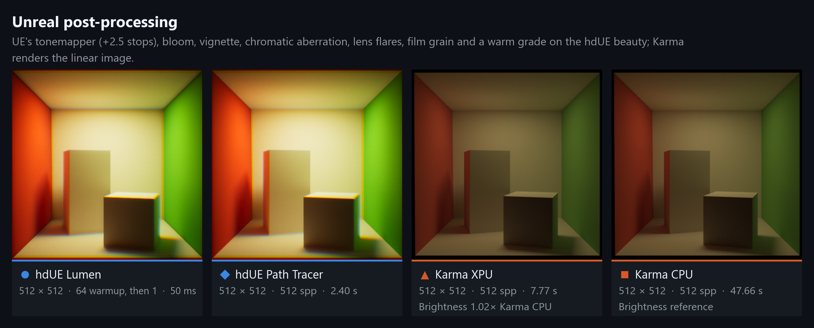

# Engine quality

`unreal:cvar:<name>` sets a UE console variable for the process (`:` stands for `.`, which USD attribute names cannot hold); removing the attribute restores the value the variable had before. Booleans are written as 1 and 0. Read-only variables (`ECVF_ReadOnly`, such as `r.RayTracing`) cannot change at runtime and are skipped with a warning. The render settings LOP's **Engine Quality** tab, and the viewport's display options for the interactive ones, offer:

| Folder | Console variables |
| --- | --- |
| Scalability | `sg.*Quality` (Low to Cinematic): the levels of UE's scalability groups; Epic in the viewport, Cinematic in husk (see below) |
| Resolution and Anti-Aliasing | `r.AntiAliasingMethod` (None, FXAA, TAA, TSR), `r.ScreenPercentage` (realtime beauty), `r.HdUE.InteractiveResolution` and `r.HdUE.InteractiveScreenPercentage` (Houdini's viewport renders at 50% while moving), `r.NGX.DLSS.Enable` (NVIDIA DLSS, see below) |
| Lumen | `r.Lumen.HardwareRayTracing`, `r.Lumen.Reflections.HardwareRayTracing`; quality and hit lighting are post-process properties (hdUE Render Settings: Hit Lighting, off by default as in UE, authors `LumenRayLightingMode`) |
| Shadows | `r.Shadow.Virtual.Enable` (on in this project, as in new UE projects; 0 falls back to cascaded shadow maps), resolution biases and soft-shadow rays, `r.Shadow.FilterMethod`, `r.RayTracing.Shadows` |
| Nanite, MegaLights, Ray Tracing | `r.Nanite`, `r.Nanite.MaxPixelsPerEdge`, `r.MegaLights.NumSamplesPerPixel`, `r.MegaLights.DefaultShadowMethod`, `r.RayTracing.Enable` |
| Path Tracer | `r.PathTracing.ApproximateCaustics`, `r.PathTracing.FilterWidth` |

Batch renders (husk, the USD Render ROP) apply an offline profile like Movie Render Queue's Game Overrides: Cinematic scalability (the screen percentage stays), all used textures fully streamed in before frames count (`r.Streaming.FullyLoadUsedTextures`, pending virtual-texture tiles loaded), `r.D3D12.GPUTimeout 0` so long Path Tracer dispatches are not reset by Windows. Lumen's post-process qualities keep UE's defaults. Glass behind other glass lights from Lumen's Radiance Cache with UE's default Raster translucency, and `unreal:postProcess:TranslucencyType = "ETranslucencyType::RayTraced"` traces every layer (a bottle in a closed, dome-lit room: 18 times the Path Tracer's brightness with Raster, within 2 times with Ray Traced). Nanite meshes are ray traced as their fallback meshes, as in UE (`r.RayTracing.Nanite.Mode 0`): foliage simplified into its fallback looks thinner in the Path Tracer and Lumen's ray tracing, and **Nanite Ray Tracing** (`unreal:cvar:r:RayTracing:Nanite:Mode = 1`) traces the full Nanite geometry streamed out for the view (Intel Sponza's tree: 65 s instead of 25 s for a 256-sample husk frame, including load). Authored `unreal:cvar:*` and `unreal:postProcess:*` values win. The Houdini viewport keeps UE's interactive defaults.

Other console variables work as attributes too. `scripts/Test-RenderSettings.ps1 -RuntimeConfig <config>` renders with every generated setting at its default and fails if UE skipped one or if a console variable's generated default differs from UE's value.

**NVIDIA DLSS** Super Resolution replaces TAA or TSR in realtime mode when the backend is built with NVIDIA's DLSS plugin (see [building](../building.md#nvidia-dlss)) and `r.NGX.DLSS.Enable` is 1 (the render settings' **NVIDIA DLSS**, off by default as in the plugin). It is the plugin's own upscaler, as in a UE game: the screen percentage picks the DLSS mode (50% Performance, about 67% Quality, 100% DLAA), and the viewport's 50% while moving is upscaled by DLSS. The plugin enables itself only for game and editor viewports, so hdUE adds its view extension to each realtime frame, as the plugin's Movie Render Queue support does. The Path Tracer and the GBuffer AOVs do not use it. Without the plugin, or on a GPU without DLSS, the setting is skipped and the anti-aliasing method renders. **DLSS Ray Reconstruction** (`r.HdUE.DLSS.RayReconstruction`, Advanced, off) makes DLSS denoise too, in place of UE's denoisers: hdUE switches it with the plugin's own `EnableDLSSRR`, which UE projects call from Blueprints, so the plugin turns off the denoisers it replaces (`r.Shadow.Denoiser`, Lumen reflections' temporal and screen-space reconstruction and bilateral filter) and restores them when it is off. It needs NVIDIA DLSS on, as in the plugin. DLSS accepts only its mode's range of screen percentages (DLAA 99 to 100%), so with DLSS on the viewport's moving frames size their buffers to their own percentage, as UE's dynamic resolution keeps to the upscaler's range. `Launch-Houdini.ps1 -TestKind dlss -InputUsd samples\smoke.usda -RuntimeConfig <a DLSS runtime>` checks it in Houdini's viewport: DLSS and Ray Reconstruction on and off, and NVIDIA's runtime creating both features.

