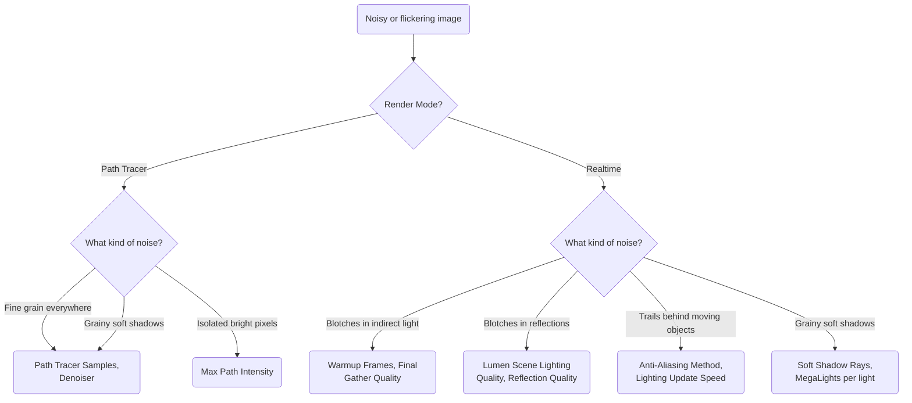

# Removing noise

Noise has a different cause in each render mode. The Path Tracer converges by adding samples; Realtime converges over frames, and its noise comes from Lumen, shadows and the temporal anti-aliasing. Find your symptom below, then change the one setting that fixes it.

The Path Tracer at 16 samples without the denoiser, at 512 samples, and at 16 samples with the denoiser.

The scenes: the Cornell box for the Path Tracer, the Bistro (`samples/docs/bistro.usda`) for Lumen, the chrome ball and box (`samples/docs/lights.usda`) for shadows. All settings are on the hdUE Render Settings LOP.

## Path Tracer: grain everywhere

**Cause.** Too few samples per pixel. Each sample is one random light path; noise falls as the square root of the sample count, so 4 times the samples halves the noise.

1. Leave **Denoiser** (`unreal:postProcess:PathTracingEnableDenoiser`) on, its default.
    It runs UE's NNE Denoiser (Open Image Denoise's network) on the last sample. See [Denoising](../rendering/denoising.md).
2. Raise **Path Tracer Samples** (`unreal:samplesPerPixel`, default 2048) until the denoised image stops changing.
    The denoiser removes grain but also fine detail, so give it enough samples to keep texture and contact shadows. Render time grows in proportion to the samples.

The denoiser runs on the beauty only: AOVs stay noisy. In the viewport, the image stays noisy while it refines and is denoised once the last sample is in.

## Path Tracer: fireflies

**Cause.** Rare paths that find a bright light through a glossy bounce. Each one is a single very bright pixel that more samples average away only slowly.

Glossy Cornell box at 64 samples, denoiser off, with **Max Path Intensity** at 1000, 24 and 4.

1. Keep **Max Path Intensity** (`unreal:postProcess:PathTracingMaxPathIntensity`) at 24, its default.
    It clamps the intensity of indirect samples. UE's documentation says the default clamps fireflies aggressively and rarely needs changing ([Path Tracer](https://dev.epicgames.com/documentation/unreal-engine/path-tracer-in-unreal-engine)).
2. If fireflies remain, lower it to 4–10.
    Lower values clamp harder and lose some energy: bright reflections of bright surfaces darken.
3. Keep **Approximate Caustics** (`unreal:cvar:r:PathTracing:ApproximateCaustics`) on, its default.
    It approximates caustic paths through smooth glass and metal, which reduces their speckles.

The clamp is relative to the exposure, so you do not need to change it with **Exposure Compensation**.

## Realtime: blotches in indirect light

**Cause.** Lumen has not settled, or its final gather traces too few rays for the scene. Blotches show on surfaces lit only by bounced light: ceilings, the shaded side of a room.

First check that the frame had time to settle. The Bistro with 1, 8 and 64 **Warmup Frames**.

1. Keep **Warmup Frames** (`unreal:warmupFrames`) at 64, its default.
    These are the frames UE renders before a still counts as finished. In a husk sequence, only the first frame warms up; later frames continue from the previous one, as Movie Render Queue does.
2. If blotches remain, raise **Final Gather Quality** (`unreal:postProcess:LumenFinalGatherQuality`, Lighting tab) from 1 to 2.
    It scales the rays Lumen's final gather traces. UE's tooltip: larger values reduce noise but greatly increase GPU cost.

The Bistro with **Final Gather Quality** at 0.25, 1 and 2.

See [Lighting reference](../reference/render-settings/lighting.md#unreal-postprocess-lumenfinalgatherquality) for the other Lumen settings.

## Realtime: blotches in reflections

**Cause.** Mirror-like reflections show Lumen's own simplified scene, which it lights at low quality. UE's documentation names this "splotchy artifacts in mirror reflections" ([Lumen Technical Details](https://dev.epicgames.com/documentation/unreal-engine/lumen-technical-details-in-unreal-engine)).

1. Raise **Lumen Scene Lighting Quality** (`unreal:postProcess:LumenSceneLightingQuality`) from 1 to 2.
2. Raise **Quality** under Lumen Reflections (`unreal:postProcess:LumenReflectionQuality`) from 1 to 2.
    It reduces noise in reflections, at a GPU cost.
3. For the cleanest mirrors, set **Ray Lighting Mode** (`unreal:postProcess:LumenRayLightingMode`) to **Hit Lighting for Reflections**.
    Reflection rays are then lit where they hit instead of read from the surface cache. See [Lumen or the Path Tracer](lumen-or-path-tracer.md#glossy-reflections).

## Realtime: trails behind moving objects

**Cause.** Realtime accumulates over frames. Two parts of it can lag behind motion: the temporal anti-aliasing, which blends each frame with the previous ones, and Lumen, which caches its lighting between frames. This shows in sequences, not in a still.

1. Keep **Anti-Aliasing Method** (`unreal:cvar:r:AntiAliasingMethod`, Rendering tab) at **TSR**, its default.
    UE's documentation says TSR ghosts less against detailed backgrounds than TAA ([Anti-Aliasing and Upscaling](https://dev.epicgames.com/documentation/unreal-engine/anti-aliasing-and-upscaling-in-unreal-engine)).
2. If trails remain on edges, set it to **FXAA**.
    FXAA works on one frame only, so it cannot ghost; edges alias more.
3. If the lighting lags behind a moving light or object, raise **Final Gather Lighting Update Speed** (`unreal:postProcess:LumenFinalGatherLightingUpdateSpeed`) and **Lumen Scene Lighting Update Speed** (`unreal:postProcess:LumenSceneLightingUpdateSpeed`) from 1 to 2.
    Lighting changes then propagate faster, at a GPU cost and, for the final gather, more noise.

No figure here: a still render cannot show motion. Render a short sequence with husk to check.

## Grainy soft shadows

**Cause.** Soft shadows are sampled. In Realtime, local lights (rect, sphere, disk, spot) go through MegaLights, which samples lights stochastically and denoises the result; the distant light uses Virtual Shadow Maps, which trace a few rays per pixel through the shadow map. In the Path Tracer, shadows converge with the samples.

A distant light with a 5° angle, with 1 and 8 **Directional Soft Shadow Rays** (Realtime).

1. For a distant light, keep **Directional Soft Shadow Rays** (`unreal:cvar:r:Shadow:Virtual:SMRT:RayCountDirectional`) at 8, its default, or raise it to 16.
    UE's documentation: fewer rays show noise in the penumbra ([Virtual Shadow Maps](https://dev.epicgames.com/documentation/unreal-engine/virtual-shadow-maps-in-unreal-engine)).
2. For local lights, MegaLights already takes 4 samples per pixel, UE's maximum (`r.MegaLights.NumSamplesPerPixel` supports 1, 2 and 4). Keep lights out of geometry and their influence tight instead.
    UE's documentation: every light that can reach a pixel shares a fixed sample budget, so hidden or overlapping lights add noise ([MegaLights](https://dev.epicgames.com/documentation/unreal-engine/megalights-in-unreal-engine)).
3. If one local light's shadow stays grainy, turn MegaLights off for that light (`unreal:megaLights` = 0 on the light's Unreal Engine tab) and raise **Local Soft Shadow Rays** (`unreal:cvar:r:Shadow:Virtual:SMRT:RayCountLocal`) from 8 to 16.
    The light then uses UE's deferred lighting and Virtual Shadow Maps. See [Lights](../lights.md).

The same scene in the Path Tracer at 16 and 256 samples, denoiser off.

4. In the Path Tracer, raise **Path Tracer Samples**, as for grain.

## Final render settings

- Path Tracer: **Denoiser** on, **Path Tracer Samples** high enough that the denoised image is stable, **Max Path Intensity** 24.
- Realtime: **Warmup Frames** 64, **Final Gather Quality** 1 (2 for noisy interiors), **Anti-Aliasing Method** TSR.
- See [Render settings](../rendering/render-settings.md) for where each setting sits on the LOP.
